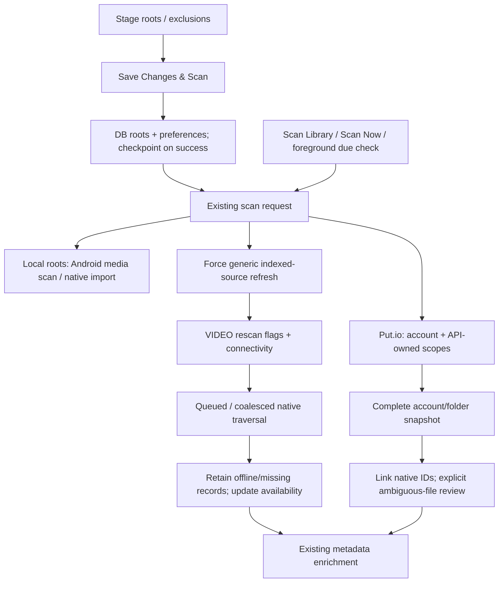
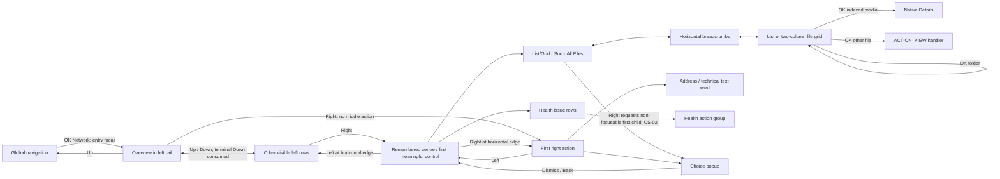

# FD-003 — Network & Files functionality and redesign-readiness audit

**Date:** 23 October 2026. **Status:** completed source investigation; no redesign chosen or implemented. **Audit baseline:** delivered Supernova 0.141, application commit `4f0937f1fe8826f50d2c0e844b0837e8a2360a46`. **Owner reports installation on NVIDIA Shield; device binary and behaviour were not read back in this session.**

## 1. Executive assessment

Network & Files is a shared three-panel workspace over several distinct systems: mounted local storage, protocol listing engines, indexed library roots, browsing bookmarks, credentials, generic network scan scheduling, Library Health, and Put.io API associations. These systems must not be collapsed into a single “connected source” concept during a redesign.

The application has **six explicit connection choices**, **three browser toolbar controls**, **six sort choices**, **five Library Health categories**, and **eight base left-rail control types**, before dynamic volume/bookmark/expanded-health rows. This report documents **28 screen/state families**; that count is an editorial inventory, not a claim of 28 Activities or a fixed number of visible controls. Dynamic item, candidate, page and device counts depend on the installed library and services.

The highest-priority source findings are a listing/authentication scheme mismatch (CS-01), Library Health action-pane entry targeting a non-focusable heading (CS-02), discovery callbacks remaining able to redraw other categories (CS-03), and email-style non-SMB usernames being split by an SMB-oriented credential model (CS-09). The remote keyboard also cannot enter several normal credential characters (L-01). These are not fixed by this audit. Detailed evidence, conditions and reproduction plans appear below; none is labelled physically reproduced in this session.

Useful protections already exist: staged library changes, source/exclusion canonicalisation, single-worker/coalesced network traversal, retained records for offline/missing media, asynchronous listing/metadata guards, separate bookmark/library removal, complete-snapshot Put.io reconciliation, secure OAuth storage and Put.io destructive-operation blocking. A visual redesign should preserve these contracts.

No new Android test run, emulator run, network-provider login or physical Shield test was performed. The execution workspace failed its connection/capability startup; repository investigation continued through GitHub read-only tools. Five non-mutating source/model checks were performed in the orchestration runtime. Historical 0.141 CI is evidence about the delivered candidate, not proof that the new issue reproductions pass.

## 2. Provenance, authority and method

### 2.1 Exact delivered baseline

- Brief read in full: [FD-003 audit brief at planning commit 2c8733c9](https://github.com/heretoecode/Supernova/blob/2c8733c90a7522292c4a21a93bb8d8ac8231539f/docs/Future%20Development/01%20Under%20Discussion/FD-003-network-and-files-functionality-audit-brief-2026-10-23.md), blob `c039c894fd37c91adda09c877e2d8176db33ca4a`.
- Delivered application source: `4f0937f1fe8826f50d2c0e844b0837e8a2360a46`; package `app.supernova.player`, version `0.141`, code `141`.
- Delivery branch: `codex/supernova-0.141-implementation-2026-10-22`; observed tip `0f2dfe4dcd7189fad0c92f7d30068c5ac9668b61`. [PR #19](https://github.com/heretoecode/Supernova/pull/19) was open, draft and unmerged, based on preserved 0.140 branch `cf257aaa59ad8d59b2ab7252d5beae174f5879c5`.
- Signed run: [39939855407](https://github.com/heretoecode/Supernova/actions/runs/39939855407). Workflow-definition commit `d5a374ee953ebac663089081b120bb995ac4b384` pins checkout to `4f0937f1`; it is not the APK application source.
- Delivered APK: 87,899,088 bytes; SHA-256 `239d0d5273e1b59806d56e96e3667759d49db3a1926817f2123af6ddb9045e51`. Existing certificate SHA-256 `79ed34c52c3e359756ade0634d7bbb6f8e94e42a059020c1220bd8c7092a9f5e`.
- Re-read [signed public receipt](https://github.com/heretoecode/Supernova/blob/0f2dfe4dcd7189fad0c92f7d30068c5ac9668b61/docs/0.141/CI_SIGNED_QA_EVIDENCE.json), [Drive readback receipt](https://github.com/heretoecode/Supernova/blob/0f2dfe4dcd7189fad0c92f7d30068c5ac9668b61/docs/0.141/DRIVE_DELIVERY_VERIFICATION.json) and [independent signed verification](https://github.com/heretoecode/Supernova/blob/0f2dfe4dcd7189fad0c92f7d30068c5ac9668b61/docs/0.141/INDEPENDENT_SIGNED_APK_VERIFICATION.json): all agree on source/hash/identity. The [4f0937f1…0f2dfe4d comparison](https://github.com/heretoecode/Supernova/compare/4f0937f1fe8826f50d2c0e844b0837e8a2360a46...0f2dfe4dcd7189fad0c92f7d30068c5ac9668b61) contains no application source/resource/asset/manifest/build.gradle change; it contains delivery documentation, the workflow pin and its tooling assertions.
- Owner installation is accepted as an observation, not a measured device checksum. If the installed APK differs from the delivered hash, reconfirm its source before using this report for defect reproduction.

### 2.2 Dependency baseline matters

The app repository alone is insufficient. [PIN L1–25](https://github.com/heretoecode/Supernova/blob/4f0937f1fe8826f50d2c0e844b0837e8a2360a46/.github/build/nova-ci.xml#L1-L25) pins FileCoreLibrary `c4b760c55102c72d45f68b0d16999fc1f4f013a7` and the Supernova MediaLib fork `5758074049bc153ac4967b4ecd21886469270076`. The signed build applies repository patches; [PREP L8–42](https://github.com/heretoecode/Supernova/blob/4f0937f1fe8826f50d2c0e844b0837e8a2360a46/.github/build/prepare-foundation.py#L8-L42) also isolates permanent provider authorities.

This audit fetched those pinned trees and inspected the actual transport factories, credential model, listing engines, discovery, shortcut DB and scanner. It reconstructed **29 relevant MediaLib patch hunks with exact old-context checks** for NetworkAutoRefresh, NetworkScannerServiceVideo, ShortcutDbAdapter, SupernovaLibraryPolicy and ProviderDiscoveryGate, in the workflow's patch order. This was text analysis in memory, not a checkout change, build or execution of the application. Base-code citations for unchanged dependency files are immutable; changed behaviour is cited to both base and the applicable Supernova patch. The credential DB, transport factory and UPnP listing engine cited below are not changed by the release's FileCore/MediaLib patch sets.

### 2.3 Evidence labels

| Label | Meaning |
| --- | --- |
| Source-confirmed | Explicit source wiring/algorithm establishes the stated conditional behaviour. Does not imply a Shield reproduction. |
| Historical automated | Existing tests and successful delivered-candidate CI; not re-run in this session. |
| Owner-reported | Preserved owner observation, with release/date where known. Not silently carried forward as a newly reproduced 0.141 defect. |
| Hypothesis / physical pending | Plausible concern or service/device behaviour requiring a fixture, account, logs or Shield observation. |
| Runtime-verified this audit | **None.** No new app/device execution occurred. |

The repository's recursive delivered-source tree was complete (3,498 entries; not truncated); no repository `AGENTS.md` was found. At least ninety application-repository text files plus pinned dependency sources were retrieved for tracing; this is a retrieval count, not a claim that every unrelated method in large classes was audited. No owner credentials, account data, original recordings or raw diagnostic logs were accessed or published.

### 2.4 Prior decisions and visual evidence

Read [DESIGN](https://github.com/heretoecode/Supernova/blob/4f0937f1fe8826f50d2c0e844b0837e8a2360a46/docs/design/NETWORK_FILES.md), [GLOBAL](https://github.com/heretoecode/Supernova/blob/4f0937f1fe8826f50d2c0e844b0837e8a2360a46/docs/design/GLOBAL_VISUAL_SYSTEM.md), [FRAME](https://github.com/heretoecode/Supernova/blob/4f0937f1fe8826f50d2c0e844b0837e8a2360a46/docs/design/shared-three-panel-framework/SHARED_FRAMEWORK_BROWSER_0.135.md), [PARKED](https://github.com/heretoecode/Supernova/blob/4f0937f1fe8826f50d2c0e844b0837e8a2360a46/docs/Future%20Development/02%20Parked%20Ideas/FD-005-network-files-visual-redesign.md) and the relevant [SCOPE L69–79](https://github.com/heretoecode/Supernova/blob/4f0937f1fe8826f50d2c0e844b0837e8a2360a46/docs/Releases/0.141-playback-hud-settings-planned-scope.md#L69-L79). The three design documents have identical blobs on the delivered source and the current planning branch. They preserve useful invariants, but are not a substitute for describing actual 0.141 behaviour.

There are historical conflicts: the older Network authority says exactly five rail entries and no activation on focus; the later shared-framework handover describes contextual health/source sections and loading content on focus, with expansion on OK. Current code has eight base row types plus dynamic children/bookmarks, uses focus to load categories and OK to expand parents, and uses 31/42/27 rather than the provisional 24/38/38 pane proportions. Record these as contract/implementation differences for owner review; this audit selects no new hierarchy.

Original Network mock-up identifiers are recorded in NETWORK_FILES.md, but no complete original Network image set is committed there. The shared illustrative Settings image `docs/design/shared-three-panel-framework/settings-subtitles-three-panel-no-top-nav.png` is present in the tree (1,770,713 bytes; blob `f5c9e48589aee5a2c28157c6fc9e16f63b2761b4`); the connector returned no usable image bytes, so it was **not visually inspected** here. No current Shield screenshots were supplied. The atlas and diagrams below are source schematics, not screenshots or approved replacement designs.

Historical [0.137 owner QA](https://github.com/heretoecode/Supernova/blob/2c8733c90a7522292c4a21a93bb8d8ac8231539f/docs/project/QA_0137_SETTINGS_LICENSES_AND_NETWORK_FILES_FOCUS_2026-10-12.md) records local-volume focus escape, All Files problems and Overview clipping. Its referenced recordings are not in this audit's accessible evidence; do not upload them without owner permission.

## 3. Screen and state atlas

```text
Existing main workspace, below global navigation
┌──────────────────┬─────────────────────────┬───────────────────┐
│ Locations        │ Category / folder pane  │ Information       │
│ Overview         │ or scan/health/account  │ Name / Type       │
│ Local Storage ›  │ content                 │ Address / Library │
│ Network Shares   │                         │ conditional facts │
│ Add Network Source│ Listing toolbar        │ and action rows   │
│ Discover Devices │ ancestry + status       │                   │
│ Cloud Services   │ list / 2-column grid    │                   │
│ Network Scanning │                         │                   │
│ Library Health › │                         │                   │
│ Saved bookmark…  │                         │                   │
└──────────────────┴─────────────────────────┴───────────────────┘
Widths 31% / 42% / 27%, excluding shared gaps/padding.
This is an inventory schematic; no new design is proposed by it.
```

| ID | Entry / surface | Contents and conditional states | Evidence |
| --- | --- | --- | --- |
| A01 | Network & Files → Overview | Left Locations rail; read-only centre Scan Overview plus guidance; right Information with Scan Library, Network Scanning, Library Health. Idle/requested/scanning/partial/failure/last-result states derive from scan records, not fabricated progress. | [B L255–267](https://github.com/heretoecode/Supernova/blob/4f0937f1fe8826f50d2c0e844b0837e8a2360a46/src/main/java/com/archos/mediacenter/video/leanback/filebrowsing/UniversalFileBrowser.java#L255-L267); [SCAN L106–121](https://github.com/heretoecode/Supernova/blob/4f0937f1fe8826f50d2c0e844b0837e8a2360a46/src/main/java/com/archos/mediacenter/video/leanback/PreviewLibraryScan.java#L106-L121) |
| A02 | Local Storage parent and volume children | OK expands/collapses; only one of Local Storage / Library Health expanded. Internal, USB, SD and Other mounted volumes are conditional. Focusing a volume opens its URI. Opening does not include it in the library. No capacity/free-space field is populated here. | [B L197–228](https://github.com/heretoecode/Supernova/blob/4f0937f1fe8826f50d2c0e844b0837e8a2360a46/src/main/java/com/archos/mediacenter/video/leanback/filebrowsing/UniversalFileBrowser.java#L197-L228) |
| A03 | Shared folder/file listing | Three toolbar controls, horizontally scrollable ancestry, loading/status strip, list (one column) or text grid (two). Folder OK opens; first/last, empty/no matching files, hidden/video-only and all-files states. 30-second listing timeout; authentication required, protocol fatal error and Retry states. See CS-06/07 for stale content and duplicate Retry controls. | [B L270–379](https://github.com/heretoecode/Supernova/blob/4f0937f1fe8826f50d2c0e844b0837e8a2360a46/src/main/java/com/archos/mediacenter/video/leanback/filebrowsing/UniversalFileBrowser.java#L270-L379) |
| A04 | Selected item / current-folder Information | Name, Type, Address, Library status; conditional size and indexed availability/resolution/video/audio/duration. Right actions vary by membership, bookmark and indexing state. Long address and technical text have scroll regions. No unindexed metadata probe is wired. | [B L381–413](https://github.com/heretoecode/Supernova/blob/4f0937f1fe8826f50d2c0e844b0837e8a2360a46/src/main/java/com/archos/mediacenter/video/leanback/filebrowsing/UniversalFileBrowser.java#L381-L413) |
| A05 | Network Shares | Merged, canonical-URI-deduplicated library sources and saved locations; empty No saved shares; Add Network Source in centre/right. Focus updates Information; OK browses. This is not a separate persistent connection registry. | [B L202–226](https://github.com/heretoecode/Supernova/blob/4f0937f1fe8826f50d2c0e844b0837e8a2360a46/src/main/java/com/archos/mediacenter/video/leanback/filebrowsing/UniversalFileBrowser.java#L202-L226) |
| A06 | Add Network Source | Inline middle-pane form; right Connect. SMB has six text fields, other choices hide SMB Domain. Save Password and Show Password; invalid address/port feedback appears in status. A successful form submission means listing is attempted, not that credentials were verified. | [B L235–236](https://github.com/heretoecode/Supernova/blob/4f0937f1fe8826f50d2c0e844b0837e8a2360a46/src/main/java/com/archos/mediacenter/video/leanback/filebrowsing/UniversalFileBrowser.java#L235-L236) |
| A07 | Protocol selection | Six centre rows: SMB, WebDAV HTTPS, WebDAV HTTP, SFTP, FTP, FTP TLS. Current row gets a tick. Selecting returns to the form. Underlying SMB/SFTP backend choice remains preference-dependent. | [B L235–236](https://github.com/heretoecode/Supernova/blob/4f0937f1fe8826f50d2c0e844b0837e8a2360a46/src/main/java/com/archos/mediacenter/video/leanback/filebrowsing/UniversalFileBrowser.java#L235-L236) |
| A08 | Shared text/secret keyboard | Modal compact single-line input, four character rows, Caps Lock/Space/Backspace and Clear/Done/Cancel. Hardware editing supported; password masking and whitespace preservation. Remote has no general symbols mode: L-01. | [INPUT L24–33](https://github.com/heretoecode/Supernova/blob/4f0937f1fe8826f50d2c0e844b0837e8a2360a46/src/main/java/com/archos/mediacenter/video/leanback/PreviewTextInput.java#L24-L33); [KB L13–88](https://github.com/heretoecode/Supernova/blob/4f0937f1fe8826f50d2c0e844b0837e8a2360a46/src/main/java/com/archos/mediacenter/video/leanback/PreviewKeyboard.java#L13-L88) |
| A09 | Discover Devices | SMB computers/NAS plus DLNA/UPnP callbacks; discovering/count/fatal/unavailable states; right Refresh. Row OK opens device URI. Direct FTP/SFTP are not discovered. No dedicated No devices message is inserted when results stay empty. | [B L237–239](https://github.com/heretoecode/Supernova/blob/4f0937f1fe8826f50d2c0e844b0837e8a2360a46/src/main/java/com/archos/mediacenter/video/leanback/filebrowsing/UniversalFileBrowser.java#L237-L239) |
| A10 | Cloud Services → put.io | Enabled On/Off, Account / Connection when enabled; disabled state retains credentials/associations. Account controller replaces centre content inline. Right-side account action and centre account row enter the same controller. | [B L232–233](https://github.com/heretoecode/Supernova/blob/4f0937f1fe8826f50d2c0e844b0837e8a2360a46/src/main/java/com/archos/mediacenter/video/leanback/filebrowsing/UniversalFileBrowser.java#L232-L233) |
| A11 | Put.io loading / disconnected / reconnect / operation error | Please wait; Connect put.io; reconnect Cancel/Reconnect put.io; generic incomplete-operation reader. Pending work uses generation/cancellation guards. A historical Home focus escape was addressed in source, not physically certified here. | [AC L25–64](https://github.com/heretoecode/Supernova/blob/4f0937f1fe8826f50d2c0e844b0837e8a2360a46/src/main/java/com/archos/mediacenter/video/streaming/putio/PutioAccountController.java#L25-L64) |
| A12 | Put.io device authorisation | Request code → QR/code/link reader → poll/pending → success, expiry/transport failure or dismiss/cancel. Configuration-unavailable reader is a conditional fallback; delivered resources actually contain a registered public client and link template. | [AUTH L20–38](https://github.com/heretoecode/Supernova/blob/4f0937f1fe8826f50d2c0e844b0837e8a2360a46/src/main/java/com/archos/mediacenter/video/streaming/putio/PutioAuthFlow.java#L20-L38); [CONFIG L2–7](https://github.com/heretoecode/Supernova/blob/4f0937f1fe8826f50d2c0e844b0837e8a2360a46/res/values/putio_configuration.xml#L2-L7) |
| A13 | Connected Put.io account overview | Username/status/storage usage and Movies/TV associations with sync state/time. Eight account actions: Library folders / Sync Now; Associate Movies; Associate TV Shows; Change Library Folders; Browse Files; Search Files; Account / Connection; Disconnect. | [AC L65–90](https://github.com/heretoecode/Supernova/blob/4f0937f1fe8826f50d2c0e844b0837e8a2360a46/src/main/java/com/archos/mediacenter/video/streaming/putio/PutioAccountController.java#L65-L90) |
| A14 | Put.io association folder picker | Use this folder, Back to root, each folder, conditional Next page. Loading/error/cursor-loop rejection. Folder selection is followed by explicit existing-WebDAV-source association; it is not a cloud upload picker. | [AC L92–108](https://github.com/heretoecode/Supernova/blob/4f0937f1fe8826f50d2c0e844b0837e8a2360a46/src/main/java/com/archos/mediacenter/video/streaming/putio/PutioAccountController.java#L92-L108) |
| A15 | Put.io source/account change and disconnect decisions | WebDAV source required; source selector; Cancel/Save & Continue; reassignment retirement choices; different-account ownership decision. Disconnect offers Cancel, keep inactive, return to generic discovery or revoke this app grant and keep inactive. | [AC L62–62](https://github.com/heretoecode/Supernova/blob/4f0937f1fe8826f50d2c0e844b0837e8a2360a46/src/main/java/com/archos/mediacenter/video/streaming/putio/PutioAccountController.java#L62-L62); [AC L99–114](https://github.com/heretoecode/Supernova/blob/4f0937f1fe8826f50d2c0e844b0837e8a2360a46/src/main/java/com/archos/mediacenter/video/streaming/putio/PutioAccountController.java#L99-L114); [AC L142–142](https://github.com/heretoecode/Supernova/blob/4f0937f1fe8826f50d2c0e844b0837e8a2360a46/src/main/java/com/archos/mediacenter/video/streaming/putio/PutioAccountController.java#L142-L142) |
| A16 | Put.io sync / reconciliation review | Read complete library → link/reconcile → Sync complete, Needs Review, association pending, reassignment pending, inactive/generic and resume states. Finish Later, Keep Separate and Same File candidates. No delete of provider files. | [AC L83–122](https://github.com/heretoecode/Supernova/blob/4f0937f1fe8826f50d2c0e844b0837e8a2360a46/src/main/java/com/archos/mediacenter/video/streaming/putio/PutioAccountController.java#L83-L122); [SYNC L26–79](https://github.com/heretoecode/Supernova/blob/4f0937f1fe8826f50d2c0e844b0837e8a2360a46/src/main/java/com/archos/mediacenter/video/streaming/putio/PutioSync.java#L26-L79) |
| A17 | Put.io API browser | Shared shell with provider dock; read-only folder/file rows, provider breadcrumbs, Parent folder, First page, Next page, loading/empty/unavailable/reconnect. Folder OK browses; file OK shows info. Defined browser options callback is not installed in the surface: L-07. | [PB L20–75](https://github.com/heretoecode/Supernova/blob/4f0937f1fe8826f50d2c0e844b0837e8a2360a46/src/main/java/com/archos/mediacenter/video/streaming/putio/PutioBrowserActivity.java#L20-L75); [SURFACE L16–35](https://github.com/heretoecode/Supernova/blob/4f0937f1fe8826f50d2c0e844b0837e8a2360a46/src/main/java/com/archos/mediacenter/video/leanback/filebrowsing/PreviewBrowserSurface.java#L16-L35) |
| A18 | Put.io search and file-information readers | Search keyboard (non-empty, max 256), Back to account, Change search, result rows, conditional Next page, file info / API media description. Folder result opens A17. Original-quality playback is directed to the indexed WebDAV source. | [AC L125–140](https://github.com/heretoecode/Supernova/blob/4f0937f1fe8826f50d2c0e844b0837e8a2360a46/src/main/java/com/archos/mediacenter/video/streaming/putio/PutioAccountController.java#L125-L140); [READ L63–83](https://github.com/heretoecode/Supernova/blob/4f0937f1fe8826f50d2c0e844b0837e8a2360a46/src/main/java/com/archos/mediacenter/video/streaming/putio/PutioReadClient.java#L63-L83) |
| A19 | Network Scanning and Sources Included | Centre read-only live overview; right Automatic, Frequency, On Open / Return, Sources Included, Scan Now. Frequency popup has five durations. Included-source multi-select persists checkboxes without dismissing each selection; empty-source reader. Legacy scanner chooser also has Last Scan / Result. | [B L146–154](https://github.com/heretoecode/Supernova/blob/4f0937f1fe8826f50d2c0e844b0837e8a2360a46/src/main/java/com/archos/mediacenter/video/leanback/filebrowsing/UniversalFileBrowser.java#L146-L154); [NS L14–49](https://github.com/heretoecode/Supernova/blob/4f0937f1fe8826f50d2c0e844b0837e8a2360a46/src/main/java/com/archos/mediacenter/video/leanback/PreviewNetworkScanning.java#L14-L49) |
| A20 | Library Health overview and five review categories | Expandable rail: Unmatched Media, Incorrect Matches, Missing Metadata (body title Missing Metadata or Artwork), Unavailable Files, Source Problems. Centre issue/empty lists; right report or item review, View Details, Find a Match, conditional Match Is Correct, source Scan Library. No source deletion action. Right entry defect CS-02. | [HL L15–32](https://github.com/heretoecode/Supernova/blob/4f0937f1fe8826f50d2c0e844b0837e8a2360a46/src/main/java/com/archos/mediacenter/video/leanback/LibraryHealthPanel.java#L15-L32); [B L219–219](https://github.com/heretoecode/Supernova/blob/4f0937f1fe8826f50d2c0e844b0837e8a2360a46/src/main/java/com/archos/mediacenter/video/leanback/filebrowsing/UniversalFileBrowser.java#L219-L219) |
| A21 | Saved Locations | Non-focusable heading only if bookmarks exist, then individual bookmark rail rows; no standalone Saved Locations parent screen. Opens the shared listing. Save Location is immediate; Remove Saved Location has Cancel/Remove confirmation and checked DB-removal feedback. | [B L220–221](https://github.com/heretoecode/Supernova/blob/4f0937f1fe8826f50d2c0e844b0837e8a2360a46/src/main/java/com/archos/mediacenter/video/leanback/filebrowsing/UniversalFileBrowser.java#L220-L221); [B L406–410](https://github.com/heretoecode/Supernova/blob/4f0937f1fe8826f50d2c0e844b0837e8a2360a46/src/main/java/com/archos/mediacenter/video/leanback/filebrowsing/UniversalFileBrowser.java#L406-L410); [SAVE L21–22](https://github.com/heretoecode/Supernova/blob/4f0937f1fe8826f50d2c0e844b0837e8a2360a46/src/main/java/com/archos/mediacenter/video/leanback/PreviewFolderActions.java#L21-L22) |
| A22 | Unsaved library changes review | Centred dimmed modal, grouped Added / Excluded / Removed previously indexed locations / Restored; Discard Changes, Continue Editing (initial focus), Save Changes & Scan. Apply/load/write failures remain pending and show a reader. Ordinary folder ancestry does not commit changes. | [B L415–447](https://github.com/heretoecode/Supernova/blob/4f0937f1fe8826f50d2c0e844b0837e8a2360a46/src/main/java/com/archos/mediacenter/video/leanback/filebrowsing/UniversalFileBrowser.java#L415-L447) |
| A23 | Home initial-library / onboarding browser variant | Same browser at approximately 65% available Home height; local-folder checkbox selection, Browse Folder, Save & Finish; network/cloud/health sections omitted. Multiple drives can be staged. Intro and Home rows are host-specific, not a second filesystem implementation. | [PAGES L683–691](https://github.com/heretoecode/Supernova/blob/4f0937f1fe8826f50d2c0e844b0837e8a2360a46/src/main/java/com/archos/mediacenter/video/leanback/PreviewPages.java#L683-L691); [B L72–72](https://github.com/heretoecode/Supernova/blob/4f0937f1fe8826f50d2c0e844b0837e8a2360a46/src/main/java/com/archos/mediacenter/video/leanback/filebrowsing/UniversalFileBrowser.java#L72-L72); [B L371–413](https://github.com/heretoecode/Supernova/blob/4f0937f1fe8826f50d2c0e844b0837e8a2360a46/src/main/java/com/archos/mediacenter/video/leanback/filebrowsing/UniversalFileBrowser.java#L371-L413) |
| A24 | Local writable-folder picker variant | FolderPicker uses the shared browser directly (without global nav) when new UI is enabled. Directories only; Choose This Folder only for writable local paths. Returns original path result contract; Back cancels at browser root. It does not add library sources. | [PICKER L99–138](https://github.com/heretoecode/Supernova/blob/4f0937f1fe8826f50d2c0e844b0837e8a2360a46/src/main/java/com/archos/mediacenter/video/utils/FolderPicker.java#L99-L138); [B L396–400](https://github.com/heretoecode/Supernova/blob/4f0937f1fe8826f50d2c0e844b0837e8a2360a46/src/main/java/com/archos/mediacenter/video/leanback/filebrowsing/UniversalFileBrowser.java#L396-L400) |
| A25 | Legacy/compatibility NetworkRoot activity | Retained four native rows: Indexed folders, shared computers, DLNA servers, network shortcuts. New UI wraps these in PreviewSources four-column tiles; section intent filters library/saved/SMB/UPnP/add. Not the ordinary 0.141 tab-3 landing. Native rescan debug gesture remains in NetworkRootActivity. | [NR L155–162](https://github.com/heretoecode/Supernova/blob/4f0937f1fe8826f50d2c0e844b0837e8a2360a46/src/main/java/com/archos/mediacenter/video/leanback/network/NetworkRootFragment.java#L155-L162); [NR L267–305](https://github.com/heretoecode/Supernova/blob/4f0937f1fe8826f50d2c0e844b0837e8a2360a46/src/main/java/com/archos/mediacenter/video/leanback/network/NetworkRootFragment.java#L267-L305); [PAGES L483–484](https://github.com/heretoecode/Supernova/blob/4f0937f1fe8826f50d2c0e844b0837e8a2360a46/src/main/java/com/archos/mediacenter/video/leanback/PreviewPages.java#L483-L484) |
| A26 | Legacy source-options and native credential modals | Source detail becomes a three-action popup (Open; Add or Rescan; Remove bookmark or indexed root). Native generic connection dialog and SMB/FTP credential dialogs remain behind protocol hosts; title controls/options survive in legacy code. Current shared-host callback reachability is limited; do not treat every retained control as visible in A03. | [ND L201–253](https://github.com/heretoecode/Supernova/blob/4f0937f1fe8826f50d2c0e844b0837e8a2360a46/src/main/java/com/archos/mediacenter/video/leanback/network/NetworkShortcutDetailsFragment.java#L201-L253); [ND L289–359](https://github.com/heretoecode/Supernova/blob/4f0937f1fe8826f50d2c0e844b0837e8a2360a46/src/main/java/com/archos/mediacenter/video/leanback/network/NetworkShortcutDetailsFragment.java#L289-L359); [LF L268–294](https://github.com/heretoecode/Supernova/blob/4f0937f1fe8826f50d2c0e844b0837e8a2360a46/src/main/java/com/archos/mediacenter/video/leanback/filebrowsing/ListingFragment.java#L268-L294); [NC L128–170](https://github.com/heretoecode/Supernova/blob/4f0937f1fe8826f50d2c0e844b0837e8a2360a46/src/main/java/com/archos/mediacenter/video/leanback/network/NetworkServerCredentialsDialog.java#L128-L170) |
| A27 | Handoffs from browsing | Indexed media opens native Details; unindexed/all-files content uses ACTION_VIEW, local FileProvider or remote loopback streaming. Details has its own guarded delete/confirmation route, distinct from library/bookmark removal; Put.io ownership blocks destructive WebDAV deletion. | [B L375–379](https://github.com/heretoecode/Supernova/blob/4f0937f1fe8826f50d2c0e844b0837e8a2360a46/src/main/java/com/archos/mediacenter/video/leanback/filebrowsing/UniversalFileBrowser.java#L375-L379); [PLAY L413–455](https://github.com/heretoecode/Supernova/blob/4f0937f1fe8826f50d2c0e844b0837e8a2360a46/src/main/java/com/archos/mediacenter/video/utils/PlayUtils.java#L413-L455); [DETAILS L928–951](https://github.com/heretoecode/Supernova/blob/4f0937f1fe8826f50d2c0e844b0837e8a2360a46/src/main/java/com/archos/mediacenter/video/leanback/details/VideoDetailsFragment.java#L928-L951) |
| A28 | Related Settings surfaces | Library & Metadata: Display All Files, remote thumbnails. Advanced → Network Compatibility: implementation/resolver/discovery/buffer choices. Network: SFTP recorded identities/reset. Scheduling preferences created then hidden in Settings, leaving Network & Files as current visible schedule home. | [SETS L22–28](https://github.com/heretoecode/Supernova/blob/4f0937f1fe8826f50d2c0e844b0837e8a2360a46/src/main/java/com/archos/mediacenter/video/leanback/settings/PreviewSettings.java#L22-L28); [SETS L75–98](https://github.com/heretoecode/Supernova/blob/4f0937f1fe8826f50d2c0e844b0837e8a2360a46/src/main/java/com/archos/mediacenter/video/leanback/settings/PreviewSettings.java#L75-L98) |

The A25/A26 compatibility surfaces are deliberately separated from the main landing. `PreviewPages.render()` currently creates one NETWORK cell for tab 3; its old NETWORK_PANEL builders and `networkSection()` still exist but are not emitted by that branch. `UniversalFileBrowser.networkAction` is assigned but is not invoked by the current controls. Retained classes, manifest declarations or a factory branch alone are therefore not proof that a control is reachable from the ordinary landing.


## 4. Functionality and control/action matrix

Rows below parameterise dynamically repeated items (each file, volume, source, candidate and page); all fixed labels and conditional control families in the traced surfaces are included. **Shared default:** actions activate on OK/click; focus alone does not execute an ordinary action row. **Exception:** category/source/file focus listeners explicitly load content or Information, as listed. Remote long-press is not assigned a separate action by the main shared browser's file rows; holding D-pad repeats traversal, while Back uses the host's ancestry/exit contract. Do not invent a main-browser context menu because a legacy handler still exists.

Each row records trigger/focus, effect, validation/persistence and error/dependency evidence. Static headings, status, labels and artwork have no click action except the explicitly focusable address/description read regions.

### 4.1 Navigation, filesystem and membership

| ID / control and location | Trigger and focus destination | Action, validation and persistence | Feedback / dependency / evidence |
| --- | --- | --- | --- |
| C001 · Global Network & Files; other global destinations | Focus moves only; OK changes page; tab-3 entry focuses Overview; Down re-enters content. | Other-page OK checks the browser's pending transaction before leaving. Brand/clock are display, not file controls. | [NAV L60–88](https://github.com/heretoecode/Supernova/blob/4f0937f1fe8826f50d2c0e844b0837e8a2360a46/src/main/java/com/archos/mediacenter/video/leanback/TopNavigation.java#L60-L88); [NAV L179–192](https://github.com/heretoecode/Supernova/blob/4f0937f1fe8826f50d2c0e844b0837e8a2360a46/src/main/java/com/archos/mediacenter/video/leanback/TopNavigation.java#L179-L192); [PAGES L361–374](https://github.com/heretoecode/Supernova/blob/4f0937f1fe8826f50d2c0e844b0837e8a2360a46/src/main/java/com/archos/mediacenter/video/leanback/PreviewPages.java#L361-L374) |
| C002 · Overview rail row | Focus or OK loads overview; Up can return to global nav; Right selects a meaningful control. | Read-only scan text; Scan Library / Network Scanning / Library Health are in right pane. | [B L246–267](https://github.com/heretoecode/Supernova/blob/4f0937f1fe8826f50d2c0e844b0837e8a2360a46/src/main/java/com/archos/mediacenter/video/leanback/filebrowsing/UniversalFileBrowser.java#L246-L267) |
| C003 · Local Storage parent; right Expand | Parent focus shows instructions; parent OK or Expand toggles children; parent keeps focus. | Local/Health expansion mutually exclusive; no inclusion or scan from expansion. | [B L205–228](https://github.com/heretoecode/Supernova/blob/4f0937f1fe8826f50d2c0e844b0837e8a2360a46/src/main/java/com/archos/mediacenter/video/leanback/filebrowsing/UniversalFileBrowser.java#L205-L228) |
| C004 · Each Internal Storage / USB / SD / Other volume | Focus opens root; OK repeats open. Right enters toolbar / current centre anchor. | Mounted path from Box/ExtStorageManager. Browsing does not persist a library root. | [B L206–212](https://github.com/heretoecode/Supernova/blob/4f0937f1fe8826f50d2c0e844b0837e8a2360a46/src/main/java/com/archos/mediacenter/video/leanback/filebrowsing/UniversalFileBrowser.java#L206-L212); [EXT L198–281](https://github.com/nova-video-player/aos-FileCoreLibrary/blob/c4b760c55102c72d45f68b0d16999fc1f4f013a7/src/com/archos/filecorelibrary/ExtStorageManager.java#L198-L281) |
| C005 · Network Shares category and each saved/indexed source row | Category focus builds source list; source focus updates right; OK browses URI. | Canonical dedup of library plus bookmark inputs. Empty state; no distinct edit-connection row. | [B L202–226](https://github.com/heretoecode/Supernova/blob/4f0937f1fe8826f50d2c0e844b0837e8a2360a46/src/main/java/com/archos/mediacenter/video/leanback/filebrowsing/UniversalFileBrowser.java#L202-L226) |
| C006 · Add Network Source rail / centre / right | Focus rail loads form; OK on corresponding action loads form. | Connection and indexed-source membership remain separate; see 4.2. | [B L215–226](https://github.com/heretoecode/Supernova/blob/4f0937f1fe8826f50d2c0e844b0837e8a2360a46/src/main/java/com/archos/mediacenter/video/leanback/filebrowsing/UniversalFileBrowser.java#L215-L226) |
| C007 · Discover Devices category and each discovered device | Category focus starts discovery; device OK opens URI; device refresh is explicit right action. | SMB + UPnP; dynamic source list, retained row tag where possible. CS-03 affects leaving. | [B L237–239](https://github.com/heretoecode/Supernova/blob/4f0937f1fe8826f50d2c0e844b0837e8a2360a46/src/main/java/com/archos/mediacenter/video/leanback/filebrowsing/UniversalFileBrowser.java#L237-L239) |
| C008 · Cloud Services category | Focus loads Put.io enabled/account page; Right enters centre. | Only Put.io is installed in this category. See 4.3. | [B L232–233](https://github.com/heretoecode/Supernova/blob/4f0937f1fe8826f50d2c0e844b0837e8a2360a46/src/main/java/com/archos/mediacenter/video/leanback/filebrowsing/UniversalFileBrowser.java#L232-L233) |
| C009 · Network Scanning category | Focus runs guarded transition; Right can fall through to first right action because middle has only read-only text. | No separate Configure button in this main workspace; five right controls. | [B L146–154](https://github.com/heretoecode/Supernova/blob/4f0937f1fe8826f50d2c0e844b0837e8a2360a46/src/main/java/com/archos/mediacenter/video/leanback/filebrowsing/UniversalFileBrowser.java#L146-L154); [B L449–457](https://github.com/heretoecode/Supernova/blob/4f0937f1fe8826f50d2c0e844b0837e8a2360a46/src/main/java/com/archos/mediacenter/video/leanback/filebrowsing/UniversalFileBrowser.java#L449-L457) |
| C010 · Library Health parent and five children | Parent focus shows overview, OK toggles children; child focus loads its category. | No media or connection mutation merely from category focus. | [B L219–229](https://github.com/heretoecode/Supernova/blob/4f0937f1fe8826f50d2c0e844b0837e8a2360a46/src/main/java/com/archos/mediacenter/video/leanback/filebrowsing/UniversalFileBrowser.java#L219-L229); [HL L20–25](https://github.com/heretoecode/Supernova/blob/4f0937f1fe8826f50d2c0e844b0837e8a2360a46/src/main/java/com/archos/mediacenter/video/leanback/LibraryHealthPanel.java#L20-L25) |
| C011 · Saved Locations heading and each bookmark row | Heading is non-focusable; bookmark focus or OK opens its URI. | Dynamic rail entries, not a separate saved-location landing. Original entry is remembered for Left. | [B L220–222](https://github.com/heretoecode/Supernova/blob/4f0937f1fe8826f50d2c0e844b0837e8a2360a46/src/main/java/com/archos/mediacenter/video/leanback/filebrowsing/UniversalFileBrowser.java#L220-L222) |
| C012 · List View / Grid View toolbar toggle | OK; current folder selection/scroll remembered, preference change re-renders. | supernova_browser_grid; two-column text grid vs one-column list; not poster browsing. | [B L341–371](https://github.com/heretoecode/Supernova/blob/4f0937f1fe8826f50d2c0e844b0837e8a2360a46/src/main/java/com/archos/mediacenter/video/leanback/filebrowsing/UniversalFileBrowser.java#L341-L371); [B L459–463](https://github.com/heretoecode/Supernova/blob/4f0937f1fe8826f50d2c0e844b0837e8a2360a46/src/main/java/com/archos/mediacenter/video/leanback/filebrowsing/UniversalFileBrowser.java#L459-L463) |
| C013 · Sort toolbar; Name ↑, Name ↓, Date ↑, Date ↓, Size ↑, Size ↓ | OK opens anchored finite chooser; selection persists and reloads current listing. | supernova_browser_sort; common control does not guarantee transport implements all sort orders (CS-08). | [B L460–463](https://github.com/heretoecode/Supernova/blob/4f0937f1fe8826f50d2c0e844b0837e8a2360a46/src/main/java/com/archos/mediacenter/video/leanback/filebrowsing/UniversalFileBrowser.java#L460-L463) |
| C014 · All Files On/Off toolbar control | OK toggles; selected state/icon/accessibility description refresh; async reload. | preference_display_all_files shared with Settings. On clears video MIME filter and keeps hidden files; directories retained. This does not remove library exclusions. | [B L88–104](https://github.com/heretoecode/Supernova/blob/4f0937f1fe8826f50d2c0e844b0837e8a2360a46/src/main/java/com/archos/mediacenter/video/leanback/filebrowsing/UniversalFileBrowser.java#L88-L104); [B L286–295](https://github.com/heretoecode/Supernova/blob/4f0937f1fe8826f50d2c0e844b0837e8a2360a46/src/main/java/com/archos/mediacenter/video/leanback/filebrowsing/UniversalFileBrowser.java#L286-L295); [B L462–463](https://github.com/heretoecode/Supernova/blob/4f0937f1fe8826f50d2c0e844b0837e8a2360a46/src/main/java/com/archos/mediacenter/video/leanback/filebrowsing/UniversalFileBrowser.java#L462-L463) |
| C015 · Each breadcrumb ancestor | Horizontal D-pad scrolls/reveals segment; OK opens ancestor, including filesystem/host root. | URI-segment ancestry; all segments constructed. Provider ancestry instead uses callbacks. No root-boundary guarantee for opaque provider IDs is inferred. | [B L323–339](https://github.com/heretoecode/Supernova/blob/4f0937f1fe8826f50d2c0e844b0837e8a2360a46/src/main/java/com/archos/mediacenter/video/leanback/filebrowsing/UniversalFileBrowser.java#L323-L339); [B L176–184](https://github.com/heretoecode/Supernova/blob/4f0937f1fe8826f50d2c0e844b0837e8a2360a46/src/main/java/com/archos/mediacenter/video/leanback/filebrowsing/UniversalFileBrowser.java#L176-L184) |
| C016 · Folder row | Focus updates Information; OK opens folder; grid horizontal moves inside row before pane exit. | Listing generation guards reject stale callbacks; no automatic library addition. | [B L291–310](https://github.com/heretoecode/Supernova/blob/4f0937f1fe8826f50d2c0e844b0837e8a2360a46/src/main/java/com/archos/mediacenter/video/leanback/filebrowsing/UniversalFileBrowser.java#L291-L310); [B L369–379](https://github.com/heretoecode/Supernova/blob/4f0937f1fe8826f50d2c0e844b0837e8a2360a46/src/main/java/com/archos/mediacenter/video/leanback/filebrowsing/UniversalFileBrowser.java#L369-L379) |
| C017 · Indexed media row; right View Details | OK opens VideoDetailsActivity with native Video object. | Indexed lookup is async. Existing Details actions and identity are preserved. | [B L304–310](https://github.com/heretoecode/Supernova/blob/4f0937f1fe8826f50d2c0e844b0837e8a2360a46/src/main/java/com/archos/mediacenter/video/leanback/filebrowsing/UniversalFileBrowser.java#L304-L310); [B L375–412](https://github.com/heretoecode/Supernova/blob/4f0937f1fe8826f50d2c0e844b0837e8a2360a46/src/main/java/com/archos/mediacenter/video/leanback/filebrowsing/UniversalFileBrowser.java#L375-L412) |
| C018 · Unindexed file / non-video All Files row | OK invokes ACTION_VIEW; external handler can be the Supernova player if registered. | Local content uses FileProvider; remote uses StreamOverHttp. Local no-handler fallback has Toast; remote no-handler branch has no equivalent user message. | [PLAY L413–455](https://github.com/heretoecode/Supernova/blob/4f0937f1fe8826f50d2c0e844b0837e8a2360a46/src/main/java/com/archos/mediacenter/video/utils/PlayUtils.java#L413-L455) |
| C019 · Address / technical description scroll regions | Right pane Up/Down scrolls address by 48dp or technical text by 60dp; Left restores centre. | Address focus only entered when content extends; non-empty technical description becomes focusable. Not general editable fields. | [B L107–123](https://github.com/heretoecode/Supernova/blob/4f0937f1fe8826f50d2c0e844b0837e8a2360a46/src/main/java/com/archos/mediacenter/video/leanback/filebrowsing/UniversalFileBrowser.java#L107-L123); [B L513–527](https://github.com/heretoecode/Supernova/blob/4f0937f1fe8826f50d2c0e844b0837e8a2360a46/src/main/java/com/archos/mediacenter/video/leanback/filebrowsing/UniversalFileBrowser.java#L513-L527) |
| C020 · Add to Library | OK stages include; refills right pane and may add Save Changes & Scan. | Recursive inclusion with nested-root collapse; no Movies/TV classification popup in current shared browser. Inherited exclusion issue CS-05. | [B L403–405](https://github.com/heretoecode/Supernova/blob/4f0937f1fe8826f50d2c0e844b0837e8a2360a46/src/main/java/com/archos/mediacenter/video/leanback/filebrowsing/UniversalFileBrowser.java#L403-L405); [SEL L29–44](https://github.com/heretoecode/Supernova/blob/4f0937f1fe8826f50d2c0e844b0837e8a2360a46/src/main/java/com/archos/mediacenter/video/leanback/filebrowsing/BrowserSelection.java#L29-L44) |
| C021 · Remove from Library (exact root) | OK stages root removal, preserving transaction for later save. | Changes library policy/index visibility, not physical media or bookmarks. | [B L403–413](https://github.com/heretoecode/Supernova/blob/4f0937f1fe8826f50d2c0e844b0837e8a2360a46/src/main/java/com/archos/mediacenter/video/leanback/filebrowsing/UniversalFileBrowser.java#L403-L413); [SEL L38–52](https://github.com/heretoecode/Supernova/blob/4f0937f1fe8826f50d2c0e844b0837e8a2360a46/src/main/java/com/archos/mediacenter/video/leanback/filebrowsing/BrowserSelection.java#L38-L52) |
| C022 · Exclude from Library (included descendant) | OK stages exclusion without unmonitoring parent root. | Parent remains selected, future non-excluded additions remain eligible; main loader hides excluded rows. | [SEL L38–44](https://github.com/heretoecode/Supernova/blob/4f0937f1fe8826f50d2c0e844b0837e8a2360a46/src/main/java/com/archos/mediacenter/video/leanback/filebrowsing/BrowserSelection.java#L38-L44); [LOAD L197–197](https://github.com/heretoecode/Supernova/blob/4f0937f1fe8826f50d2c0e844b0837e8a2360a46/src/main/java/com/archos/mediacenter/video/leanback/PreviewLibraryLoader.java#L197-L197) |
| C023 · Restore Inclusion (exact excluded URI) | OK removes exact exclusion and refreshes information. | Only shown for exact exclusion membership. Does not restore through an excluded ancestor; CS-05. | [B L405–405](https://github.com/heretoecode/Supernova/blob/4f0937f1fe8826f50d2c0e844b0837e8a2360a46/src/main/java/com/archos/mediacenter/video/leanback/filebrowsing/UniversalFileBrowser.java#L405-L405); [SEL L38–44](https://github.com/heretoecode/Supernova/blob/4f0937f1fe8826f50d2c0e844b0837e8a2360a46/src/main/java/com/archos/mediacenter/video/leanback/filebrowsing/BrowserSelection.java#L38-L44) |
| C024 · Save Location | OK immediately inserts bookmark if missing; does not wait for Apply. | Not a library mutation; no success reader in this helper. Uses separate app ShortcutDb. | [B L406–406](https://github.com/heretoecode/Supernova/blob/4f0937f1fe8826f50d2c0e844b0837e8a2360a46/src/main/java/com/archos/mediacenter/video/leanback/filebrowsing/UniversalFileBrowser.java#L406-L406); [SAVE L21–22](https://github.com/heretoecode/Supernova/blob/4f0937f1fe8826f50d2c0e844b0837e8a2360a46/src/main/java/com/archos/mediacenter/video/leanback/PreviewFolderActions.java#L21-L22) |
| C025 · Remove Saved Location; Cancel / Remove | OK opens chooser initially on Cancel; Remove verifies affected-row result. | Only bookmark record is removed; failed removal shows Removal not confirmed. Library/media retained. | [B L407–410](https://github.com/heretoecode/Supernova/blob/4f0937f1fe8826f50d2c0e844b0837e8a2360a46/src/main/java/com/archos/mediacenter/video/leanback/filebrowsing/UniversalFileBrowser.java#L407-L410) |
| C026 · Save Changes & Scan; onboarding Save & Finish | OK applies staged roots/exclusions and starts/coalesces existing scanner. | Historical-root loading blocks apply; DB/preferences rollback attempt on failure; no physical-delete route. | [B L415–423](https://github.com/heretoecode/Supernova/blob/4f0937f1fe8826f50d2c0e844b0837e8a2360a46/src/main/java/com/archos/mediacenter/video/leanback/filebrowsing/UniversalFileBrowser.java#L415-L423) |
| C027 · Listing Retry | OK re-runs same current URI; intended status/progress refreshed. | Transport/timeout failure text. Duplicate Retry rows can accumulate (CS-07); previous folder rows can persist (CS-06). | [B L281–312](https://github.com/heretoecode/Supernova/blob/4f0937f1fe8826f50d2c0e844b0837e8a2360a46/src/main/java/com/archos/mediacenter/video/leanback/filebrowsing/UniversalFileBrowser.java#L281-L312) |
| C028 · Authentication-required Connect | OK dispatches to inline credential form, preserving host/port/path for supported recovery schemes. | Stored handler is not used to fall back to native dialogs. Unsupported scheme gives account-controls text (CS-01). | [B L297–319](https://github.com/heretoecode/Supernova/blob/4f0937f1fe8826f50d2c0e844b0837e8a2360a46/src/main/java/com/archos/mediacenter/video/leanback/filebrowsing/UniversalFileBrowser.java#L297-L319) |
| C029 · Overview Scan Library | OK requests local-root Android media scan plus generic network request and Put.io scheduling. | Configured-library guard; native import and metadata work remain separate. No fake Cancel button. | [SCAN L50–73](https://github.com/heretoecode/Supernova/blob/4f0937f1fe8826f50d2c0e844b0837e8a2360a46/src/main/java/com/archos/mediacenter/video/leanback/PreviewLibraryScan.java#L50-L73) |
| C030 · Scan settings Automatic On/Off | OK toggles schedule and rebuilds actions, then focuses Automatic row. | NetworkAutoRefresh period and preview_scan_frequency; Off cancels Android job; manual force remains possible. | [B L150–151](https://github.com/heretoecode/Supernova/blob/4f0937f1fe8826f50d2c0e844b0837e8a2360a46/src/main/java/com/archos/mediacenter/video/leanback/filebrowsing/UniversalFileBrowser.java#L150-L151); [NU L48–104](https://github.com/heretoecode/aos-MediaLib/blob/5758074049bc153ac4967b4ecd21886469270076/src/com/archos/mediaprovider/video/NetworkScannerUtil.java#L48-L104) |
| C031 · Scan Frequency; 15m / 30m / 1h / 6h / 24h | OK opens anchored chooser; return focuses Frequency action. | Stores remembered interval even if Automatic is Off; schedules only if currently automatic. | [B L152–152](https://github.com/heretoecode/Supernova/blob/4f0937f1fe8826f50d2c0e844b0837e8a2360a46/src/main/java/com/archos/mediacenter/video/leanback/filebrowsing/UniversalFileBrowser.java#L152-L152) |
| C032 · Scan On Open / Return | OK toggles stored preference and refocuses same row. | auto_rescan_on_app_restart; absent-key display/runtime default disagreement CS-10. | [B L153–153](https://github.com/heretoecode/Supernova/blob/4f0937f1fe8826f50d2c0e844b0837e8a2360a46/src/main/java/com/archos/mediacenter/video/leanback/filebrowsing/UniversalFileBrowser.java#L153-L153); [APP L1215–1232](https://github.com/heretoecode/Supernova/blob/4f0937f1fe8826f50d2c0e844b0837e8a2360a46/src/main/java/com/archos/mediacenter/video/CustomApplication.java#L1215-L1232) |
| C033 · Sources Included; each checkbox | OK toggles row without dismissing multi-select; Back dismisses chooser. | Writes VIDEO shortcut rescan flag by stable ID; no-source reader. Does not control Put.io API scope enumeration (L-05). | [NS L43–49](https://github.com/heretoecode/Supernova/blob/4f0937f1fe8826f50d2c0e844b0837e8a2360a46/src/main/java/com/archos/mediacenter/video/leanback/PreviewNetworkScanning.java#L43-L49) |
| C034 · Scan Now | OK calls requestNetwork; focus stays on action. | Uses the same force-rescan path; selected rescan-flag sources, not indiscriminately every stored URI. | [B L154–154](https://github.com/heretoecode/Supernova/blob/4f0937f1fe8826f50d2c0e844b0837e8a2360a46/src/main/java/com/archos/mediacenter/video/leanback/filebrowsing/UniversalFileBrowser.java#L154-L154); [SCAN L58–73](https://github.com/heretoecode/Supernova/blob/4f0937f1fe8826f50d2c0e844b0837e8a2360a46/src/main/java/com/archos/mediacenter/video/leanback/PreviewLibraryScan.java#L58-L73); [UDB L218–237](https://github.com/heretoecode/aos-MediaLib/blob/5758074049bc153ac4967b4ecd21886469270076/src/com/archos/mediacenter/utils/ShortcutDbAdapter.java#L218-L237) |
| C035 · Health issue/source row | Focus populates right review; OK repeats review. | Categories suppress unmatched/missing-metadata warnings during import. Right navigation defect CS-02. | [HL L20–29](https://github.com/heretoecode/Supernova/blob/4f0937f1fe8826f50d2c0e844b0837e8a2360a46/src/main/java/com/archos/mediacenter/video/leanback/LibraryHealthPanel.java#L20-L29) |
| C036 · Health View Details / Find a Match | OK starts Details / ManualVideoScrappingActivity. | Existing media identity passed; matching may use network. No source credentials or file bytes changed by opening. | [HL L29–31](https://github.com/heretoecode/Supernova/blob/4f0937f1fe8826f50d2c0e844b0837e8a2360a46/src/main/java/com/archos/mediacenter/video/leanback/LibraryHealthPanel.java#L29-L31) |
| C037 · Health Match Is Correct | OK clears incorrect:<mediaId> flag and refreshes category. | Conditional only in Incorrect Matches; unrelated history/metadata not cleared. | [HL L32–32](https://github.com/heretoecode/Supernova/blob/4f0937f1fe8826f50d2c0e844b0837e8a2360a46/src/main/java/com/archos/mediacenter/video/leanback/LibraryHealthPanel.java#L32-L32) |
| C038 · Source Problem Scan Library | OK uses global Scan Library request. | Not an individual-source retry or connection editor. | [HL L28–28](https://github.com/heretoecode/Supernova/blob/4f0937f1fe8826f50d2c0e844b0837e8a2360a46/src/main/java/com/archos/mediacenter/video/leanback/LibraryHealthPanel.java#L28-L28) |
| C039 · Review Discard Changes | OK restores selection checkpoint and runs pending exit. | Library staging only; immediate bookmarks and stored credentials are not rolled back by this action. | [B L425–440](https://github.com/heretoecode/Supernova/blob/4f0937f1fe8826f50d2c0e844b0837e8a2360a46/src/main/java/com/archos/mediacenter/video/leanback/filebrowsing/UniversalFileBrowser.java#L425-L440) |
| C040 · Review Continue Editing | Initial focus; OK/Back dismiss restores opener/centre/left fallback. | No persistence or scan; modal is shown only for changed library selection. | [B L425–436](https://github.com/heretoecode/Supernova/blob/4f0937f1fe8826f50d2c0e844b0837e8a2360a46/src/main/java/com/archos/mediacenter/video/leanback/filebrowsing/UniversalFileBrowser.java#L425-L436) |
| C041 · Review Save Changes & Scan | OK persists then leaves only on successful apply. | Failure keeps editing path; dimensions capped at 720×440dp with .35 dim. | [B L415–436](https://github.com/heretoecode/Supernova/blob/4f0937f1fe8826f50d2c0e844b0837e8a2360a46/src/main/java/com/archos/mediacenter/video/leanback/filebrowsing/UniversalFileBrowser.java#L415-L436) |


### 4.2 Connection form and keyboard

| ID / control and location | Trigger and focus destination | Action, validation and persistence | Feedback / dependency / evidence |
| --- | --- | --- | --- |
| C042 · Protocol row and six protocol choices | OK enters inline choice list; selection rebuilds form and focuses centre. | UI labels hide internal SMBJ/SSHJ names; backend chosen from preferences. | [B L235–236](https://github.com/heretoecode/Supernova/blob/4f0937f1fe8826f50d2c0e844b0837e8a2360a46/src/main/java/com/archos/mediacenter/video/leanback/filebrowsing/UniversalFileBrowser.java#L235-L236) |
| C043 · Server / Address field | OK opens keyboard, Done trims and returns to form/first centre row. | Max 512 characters; non-empty host; rejects slash, @, ? (including whole protocol URLs). Does not perform a network test. | [B L235–236](https://github.com/heretoecode/Supernova/blob/4f0937f1fe8826f50d2c0e844b0837e8a2360a46/src/main/java/com/archos/mediacenter/video/leanback/filebrowsing/UniversalFileBrowser.java#L235-L236); [INPUT L28–33](https://github.com/heretoecode/Supernova/blob/4f0937f1fe8826f50d2c0e844b0837e8a2360a46/src/main/java/com/archos/mediacenter/video/leanback/PreviewTextInput.java#L28-L33) |
| C044 · Port field | OK keyboard; Done accepts empty or one-to-five digits. | Connect then enforces numeric 1–65535; blank delegates protocol default; validation failure in status. | [B L235–236](https://github.com/heretoecode/Supernova/blob/4f0937f1fe8826f50d2c0e844b0837e8a2360a46/src/main/java/com/archos/mediacenter/video/leanback/filebrowsing/UniversalFileBrowser.java#L235-L236) |
| C045 · Path field | OK keyboard; Done stores in-memory field. | Leading slash added at Connect; arbitrary folder path not automatically indexed. | [B L235–236](https://github.com/heretoecode/Supernova/blob/4f0937f1fe8826f50d2c0e844b0837e8a2360a46/src/main/java/com/archos/mediacenter/video/leanback/filebrowsing/UniversalFileBrowser.java#L235-L236) |
| C046 · Username field | OK keyboard; Done trims; no non-empty check in shared form. | Credential constructor also interprets @ or backslash as SMB domain syntax, even for non-SMB (CS-09). | [B L235–236](https://github.com/heretoecode/Supernova/blob/4f0937f1fe8826f50d2c0e844b0837e8a2360a46/src/main/java/com/archos/mediacenter/video/leanback/filebrowsing/UniversalFileBrowser.java#L235-L236); [CREDS L76–115](https://github.com/nova-video-player/aos-FileCoreLibrary/blob/c4b760c55102c72d45f68b0d16999fc1f4f013a7/src/com/archos/filecorelibrary/samba/NetworkCredentialsDatabase.java#L76-L115) |
| C047 · Password field | OK opens masked secret keyboard; Done preserves whitespace. | Max 512; diagnostic-private field tags; form's cleartext is erased after constructing credential; masking toggle resets. | [B L235–236](https://github.com/heretoecode/Supernova/blob/4f0937f1fe8826f50d2c0e844b0837e8a2360a46/src/main/java/com/archos/mediacenter/video/leanback/filebrowsing/UniversalFileBrowser.java#L235-L236); [INPUT L20–33](https://github.com/heretoecode/Supernova/blob/4f0937f1fe8826f50d2c0e844b0837e8a2360a46/src/main/java/com/archos/mediacenter/video/leanback/PreviewTextInput.java#L20-L33) |
| C048 · SMB Domain field | Visible only for protocol index 0; OK keyboard. | Shared connection array retains hidden field values across protocol changes; no separate domain editor for WebDAV/SFTP. | [B L235–236](https://github.com/heretoecode/Supernova/blob/4f0937f1fe8826f50d2c0e844b0837e8a2360a46/src/main/java/com/archos/mediacenter/video/leanback/filebrowsing/UniversalFileBrowser.java#L235-L236) |
| C049 · Save Password On/Off | OK toggles form state; no disk mutation until Connect. | On writes persistent legacy credential DB before listing verification; Off adds temporary in-memory credential and does not erase an older saved record. | [B L235–236](https://github.com/heretoecode/Supernova/blob/4f0937f1fe8826f50d2c0e844b0837e8a2360a46/src/main/java/com/archos/mediacenter/video/leanback/filebrowsing/UniversalFileBrowser.java#L235-L236); [CREDS L157–179](https://github.com/nova-video-player/aos-FileCoreLibrary/blob/c4b760c55102c72d45f68b0d16999fc1f4f013a7/src/com/archos/filecorelibrary/samba/NetworkCredentialsDatabase.java#L157-L179) |
| C050 · Show Password On/Off | OK toggles display and rebuilds form. | Changes visibility only; does not alter secret or credential store. | [B L235–236](https://github.com/heretoecode/Supernova/blob/4f0937f1fe8826f50d2c0e844b0837e8a2360a46/src/main/java/com/archos/mediacenter/video/leanback/filebrowsing/UniversalFileBrowser.java#L235-L236) |
| C051 · Right Connect | OK validates form, saves/adds credential, opens URI, calls focusCentre. | Connection attempt may fail after credentials have been saved. Current centre entry normally reaches toolbar rather than waiting on network. | [B L236–236](https://github.com/heretoecode/Supernova/blob/4f0937f1fe8826f50d2c0e844b0837e8a2360a46/src/main/java/com/archos/mediacenter/video/leanback/filebrowsing/UniversalFileBrowser.java#L236-L236) |
| C052 · Keyboard letters/digits and . , / backslash | OK replaces selection / inserts current case; hardware editing forwarded. | Four character rows. No symbol chooser for @ - _ : + !; L-01. | [KB L13–59](https://github.com/heretoecode/Supernova/blob/4f0937f1fe8826f50d2c0e844b0837e8a2360a46/src/main/java/com/archos/mediacenter/video/leanback/PreviewKeyboard.java#L13-L59); [INPUT L30–33](https://github.com/heretoecode/Supernova/blob/4f0937f1fe8826f50d2c0e844b0837e8a2360a46/src/main/java/com/archos/mediacenter/video/leanback/PreviewTextInput.java#L30-L33) |
| C053 · Keyboard Caps Lock / Space / Backspace | OK toggles persistent-in-widget caps indication / inserts space / deletes selection or prior code point. | Caps Lock starts On in a new widget; bottom-left location retained; not renamed Shift. | [KB L17–21](https://github.com/heretoecode/Supernova/blob/4f0937f1fe8826f50d2c0e844b0837e8a2360a46/src/main/java/com/archos/mediacenter/video/leanback/PreviewKeyboard.java#L17-L21); [KB L43–62](https://github.com/heretoecode/Supernova/blob/4f0937f1fe8826f50d2c0e844b0837e8a2360a46/src/main/java/com/archos/mediacenter/video/leanback/PreviewKeyboard.java#L43-L62) |
| C054 · Keyboard Clear / Done / Cancel; remote Back | OK clears current input / validates and accepts / dismisses; Back cancels dialog. | Modal initial keyboard focus T; horizontal edges consumed, vertical chooses nearest key; no automatic Android soft keyboard. | [KB L64–88](https://github.com/heretoecode/Supernova/blob/4f0937f1fe8826f50d2c0e844b0837e8a2360a46/src/main/java/com/archos/mediacenter/video/leanback/PreviewKeyboard.java#L64-L88); [INPUT L28–33](https://github.com/heretoecode/Supernova/blob/4f0937f1fe8826f50d2c0e844b0837e8a2360a46/src/main/java/com/archos/mediacenter/video/leanback/PreviewTextInput.java#L28-L33) |
| C055 · Discovery Refresh | OK stops old listeners and starts new SMB/UPnP discovery; right action remains context-specific. | Protocol discovery failures give direct-connection fallback text; callback ownership defect on other category paths CS-03. | [B L237–239](https://github.com/heretoecode/Supernova/blob/4f0937f1fe8826f50d2c0e844b0837e8a2360a46/src/main/java/com/archos/mediacenter/video/leanback/filebrowsing/UniversalFileBrowser.java#L237-L239) |


### 4.3 Put.io account, sync and browsing

| ID / control and location | Trigger and focus destination | Action, validation and persistence | Feedback / dependency / evidence |
| --- | --- | --- | --- |
| C056 · Put.io Enabled On/Off | OK flips integration preference and redraws cloud page. | Off retains encrypted token and associations. Sync fetch is blocked, but scheduled account probe can still occur (CS-11). | [B L232–233](https://github.com/heretoecode/Supernova/blob/4f0937f1fe8826f50d2c0e844b0837e8a2360a46/src/main/java/com/archos/mediacenter/video/leanback/filebrowsing/UniversalFileBrowser.java#L232-L233); [SYNC L26–27](https://github.com/heretoecode/Supernova/blob/4f0937f1fe8826f50d2c0e844b0837e8a2360a46/src/main/java/com/archos/mediacenter/video/streaming/putio/PutioSync.java#L26-L27) |
| C057 · Account / Connection (cloud) | OK attaches inline account controller; first meaningful inline row gets focus. | Account fetch / disconnected state; owned task and auth flow close on category change. | [AC L25–64](https://github.com/heretoecode/Supernova/blob/4f0937f1fe8826f50d2c0e844b0837e8a2360a46/src/main/java/com/archos/mediacenter/video/streaming/putio/PutioAccountController.java#L25-L64); [B L239–239](https://github.com/heretoecode/Supernova/blob/4f0937f1fe8826f50d2c0e844b0837e8a2360a46/src/main/java/com/archos/mediacenter/video/leanback/filebrowsing/UniversalFileBrowser.java#L239-L239) |
| C058 · Connect put.io / Reconnect put.io; Cancel | OK starts device-code flow; reconnect Cancel currently does not replace inline prompt (CS-13). | No password or token-entry workaround; registered client/link validation; encrypted token save only on successful active poll. | [AC L31–64](https://github.com/heretoecode/Supernova/blob/4f0937f1fe8826f50d2c0e844b0837e8a2360a46/src/main/java/com/archos/mediacenter/video/streaming/putio/PutioAccountController.java#L31-L64); [AUTH L20–38](https://github.com/heretoecode/Supernova/blob/4f0937f1fe8826f50d2c0e844b0837e8a2360a46/src/main/java/com/archos/mediacenter/video/streaming/putio/PutioAuthFlow.java#L20-L38) |
| C059 · QR/code/link reader Close / Copy; Back | Read-only scroll focus; Close/Back stops polling; Copy copies displayed temporary code/link text, not OAuth token. | Poll every five seconds, ten-minute deadline; stale success/close guards. QR accessibility description is wrong (CS-12). | [AUTH L25–38](https://github.com/heretoecode/Supernova/blob/4f0937f1fe8826f50d2c0e844b0837e8a2360a46/src/main/java/com/archos/mediacenter/video/streaming/putio/PutioAuthFlow.java#L25-L38); [DIALOG L85–100](https://github.com/heretoecode/Supernova/blob/4f0937f1fe8826f50d2c0e844b0837e8a2360a46/src/main/java/com/archos/mediacenter/video/leanback/PreviewDialog.java#L85-L100) |
| C060 · Account Library folders / Sync Now | OK lists scopes; selecting active/preparing association syncs; inactive/generic prompts Review & Resume. | Pending reassignment resumes its journal; statuses and relative sync times loaded. | [AC L78–90](https://github.com/heretoecode/Supernova/blob/4f0937f1fe8826f50d2c0e844b0837e8a2360a46/src/main/java/com/archos/mediacenter/video/streaming/putio/PutioAccountController.java#L78-L90) |
| C061 · Associate Movies folder / Associate TV Shows folder | OK opens API folder selector from root. | Stores classification hint and chosen account/folder association after explicit review; requires existing WebDAV playback source. | [AC L79–108](https://github.com/heretoecode/Supernova/blob/4f0937f1fe8826f50d2c0e844b0837e8a2360a46/src/main/java/com/archos/mediacenter/video/streaming/putio/PutioAccountController.java#L79-L108) |
| C062 · Change Library Folders | OK lists existing associations then picks new API folder/source. | Retirement choice required; same association may simply sync; journal handles pending reassignment. | [AC L87–114](https://github.com/heretoecode/Supernova/blob/4f0937f1fe8826f50d2c0e844b0837e8a2360a46/src/main/java/com/archos/mediacenter/video/streaming/putio/PutioAccountController.java#L87-L114) |
| C063 · Browse Files | OK starts read-only PutioBrowserActivity for current account. | Separate provider API, not generic transport listing; current API browser has no play/download/delete operations. | [AC L79–81](https://github.com/heretoecode/Supernova/blob/4f0937f1fe8826f50d2c0e844b0837e8a2360a46/src/main/java/com/archos/mediacenter/video/streaming/putio/PutioAccountController.java#L79-L81); [PB L20–75](https://github.com/heretoecode/Supernova/blob/4f0937f1fe8826f50d2c0e844b0837e8a2360a46/src/main/java/com/archos/mediacenter/video/streaming/putio/PutioBrowserActivity.java#L20-L75) |
| C064 · Search Files | OK opens shared query keyboard; Done starts API search. | Non-empty max 256; pages/cursor validation; errors retain library. | [AC L125–132](https://github.com/heretoecode/Supernova/blob/4f0937f1fe8826f50d2c0e844b0837e8a2360a46/src/main/java/com/archos/mediacenter/video/streaming/putio/PutioAccountController.java#L125-L132); [READ L63–74](https://github.com/heretoecode/Supernova/blob/4f0937f1fe8826f50d2c0e844b0837e8a2360a46/src/main/java/com/archos/mediacenter/video/streaming/putio/PutioReadClient.java#L63-L74) |
| C065 · Account / Connection (account overview) | OK shows inline username/status/connection explanation. | Read-only; body is focusable, no standard Close/Copy buttons in inline reader; Back exits account controller to cloud page. | [AC L28–29](https://github.com/heretoecode/Supernova/blob/4f0937f1fe8826f50d2c0e844b0837e8a2360a46/src/main/java/com/archos/mediacenter/video/streaming/putio/PutioAccountController.java#L28-L29); [AC L81–81](https://github.com/heretoecode/Supernova/blob/4f0937f1fe8826f50d2c0e844b0837e8a2360a46/src/main/java/com/archos/mediacenter/video/streaming/putio/PutioAccountController.java#L81-L81); [B L444–447](https://github.com/heretoecode/Supernova/blob/4f0937f1fe8826f50d2c0e844b0837e8a2360a46/src/main/java/com/archos/mediacenter/video/leanback/filebrowsing/UniversalFileBrowser.java#L444-L447) |
| C066 · Disconnect | OK shows Cancel / Keep associated sources inactive / Return associated sources to generic discovery / Revoke Supernova access and keep sources inactive. | Cancel reloads overview. Other choices invalidate sync ownership, clear encrypted local token; only explicit revoke posts grant deletion. | [AC L142–142](https://github.com/heretoecode/Supernova/blob/4f0937f1fe8826f50d2c0e844b0837e8a2360a46/src/main/java/com/archos/mediacenter/video/streaming/putio/PutioAccountController.java#L142-L142); [READ L51–53](https://github.com/heretoecode/Supernova/blob/4f0937f1fe8826f50d2c0e844b0837e8a2360a46/src/main/java/com/archos/mediacenter/video/streaming/putio/PutioReadClient.java#L51-L53) |
| C067 · Different account: Cancel / Keep previous sources inactive / Return previous sources to generic discovery | Selection chooses ownership for previous account while retaining library. | Cancel is an inline no-op (CS-13); changed account only recorded after ownership choice. | [AC L61–62](https://github.com/heretoecode/Supernova/blob/4f0937f1fe8826f50d2c0e844b0837e8a2360a46/src/main/java/com/archos/mediacenter/video/streaming/putio/PutioAccountController.java#L61-L62) |
| C068 · Folder selector Use this folder / Back to root / each folder / Next page | OK selects current API folder / restarts root / descends / continues page. | Cycle guards; next step is choosing corresponding existing WebDAV root. | [AC L92–108](https://github.com/heretoecode/Supernova/blob/4f0937f1fe8826f50d2c0e844b0837e8a2360a46/src/main/java/com/archos/mediacenter/video/streaming/putio/PutioAccountController.java#L92-L108) |
| C069 · Existing WebDAV source row; Cancel / Save & Continue | OK selects source and requests explicit same-folder confirmation. | Credential-free http(s)/dav aliases eligible; no API proof that selected source is semantically the same folder. Cancel inline no-op (CS-13). | [AC L99–108](https://github.com/heretoecode/Supernova/blob/4f0937f1fe8826f50d2c0e844b0837e8a2360a46/src/main/java/com/archos/mediacenter/video/streaming/putio/PutioAccountController.java#L99-L108) |
| C070 · Retire previous source: Cancel / Keep inactive / Return to generic discovery | OK selects migration policy, then complete snapshot/reassignment. | No physical-delete choice. Cancel inline no-op (CS-13). | [AC L110–114](https://github.com/heretoecode/Supernova/blob/4f0937f1fe8826f50d2c0e844b0837e8a2360a46/src/main/java/com/archos/mediacenter/video/streaming/putio/PutioAccountController.java#L110-L114) |
| C071 · Resume retained association: Cancel / Review & Resume | OK explicitly restores discovery ownership path before sync. | Changed/inactive ownership does not silently become active. Cancel inline no-op (CS-13). | [AC L87–90](https://github.com/heretoecode/Supernova/blob/4f0937f1fe8826f50d2c0e844b0837e8a2360a46/src/main/java/com/archos/mediacenter/video/streaming/putio/PutioAccountController.java#L87-L90) |
| C072 · Needs Review: Finish Later / Keep Separate / Same File candidate | OK defers / inserts separate identity / links chosen existing media ID. | Explicit candidate validation, two-provider-files-to-one-media rejection. Finish Later inline no-op (CS-13); Back remains escape. | [AC L117–122](https://github.com/heretoecode/Supernova/blob/4f0937f1fe8826f50d2c0e844b0837e8a2360a46/src/main/java/com/archos/mediacenter/video/streaming/putio/PutioAccountController.java#L117-L122); [SYNC L60–79](https://github.com/heretoecode/Supernova/blob/4f0937f1fe8826f50d2c0e844b0837e8a2360a46/src/main/java/com/archos/mediacenter/video/streaming/putio/PutioSync.java#L60-L79) |
| C073 · Search Back to account / Change search / each result / Next page | OK reloads overview / keyboard / folder browser or info / next API page. | Same validated account API, not a web search. Original WebDAV source remains playback route. | [AC L125–140](https://github.com/heretoecode/Supernova/blob/4f0937f1fe8826f50d2c0e844b0837e8a2360a46/src/main/java/com/archos/mediacenter/video/streaming/putio/PutioAccountController.java#L125-L140) |
| C074 · Put.io provider breadcrumbs; folder/file rows | OK navigates via provider ancestry callbacks / folder child / file info; focus updates right. | Provider-specific parents/cursors retained separately. File row is information-only, not playback. | [PB L38–73](https://github.com/heretoecode/Supernova/blob/4f0937f1fe8826f50d2c0e844b0837e8a2360a46/src/main/java/com/archos/mediacenter/video/streaming/putio/PutioBrowserActivity.java#L38-L73) |
| C075 · Provider Parent folder / First page / Next page | OK restores parent item / resets pagination / requests next cursor. | Empty folder focuses another available row if possible; cycles rejected. Scroll and restoration still require physical QA. | [PB L50–73](https://github.com/heretoecode/Supernova/blob/4f0937f1fe8826f50d2c0e844b0837e8a2360a46/src/main/java/com/archos/mediacenter/video/streaming/putio/PutioBrowserActivity.java#L50-L73) |
| C076 · Provider right File Information | Right from a file enters actionable information row; OK fetches /file metadata. | Not present for folders; original-quality playback guidance only. | [B L190–194](https://github.com/heretoecode/Supernova/blob/4f0937f1fe8826f50d2c0e844b0837e8a2360a46/src/main/java/com/archos/mediacenter/video/leanback/filebrowsing/UniversalFileBrowser.java#L190-L194); [PB L55–69](https://github.com/heretoecode/Supernova/blob/4f0937f1fe8826f50d2c0e844b0837e8a2360a46/src/main/java/com/archos/mediacenter/video/streaming/putio/PutioBrowserActivity.java#L55-L69) |
| C077 · Provider Close / Retry / Account / Connection error chooser | OK dismisses / reissues current page / opens account controller. | 401-like unauthorised reason clears client; close retains library. Refresh-folder menu is not wired (CS-14). | [PB L29–35](https://github.com/heretoecode/Supernova/blob/4f0937f1fe8826f50d2c0e844b0837e8a2360a46/src/main/java/com/archos/mediacenter/video/streaming/putio/PutioBrowserActivity.java#L29-L35) |


### 4.4 Variants, retained controls and settings

| ID / control and location | Trigger and focus destination | Action, validation and persistence | Feedback / dependency / evidence |
| --- | --- | --- | --- |
| C078 · Home folder checkbox / Browse Folder / Save & Finish | OK toggles inclusion; Right on selected folder may browse; right Browse Folder explicitly descends. | Local-only onboarding; stage across drives; confirmation/scan via same apply. | [B L371–413](https://github.com/heretoecode/Supernova/blob/4f0937f1fe8826f50d2c0e844b0837e8a2360a46/src/main/java/com/archos/mediacenter/video/leanback/filebrowsing/UniversalFileBrowser.java#L371-L413); [PAGES L688–691](https://github.com/heretoecode/Supernova/blob/4f0937f1fe8826f50d2c0e844b0837e8a2360a46/src/main/java/com/archos/mediacenter/video/leanback/PreviewPages.java#L688-L691) |
| C079 · Directory picker Choose This Folder / Back | OK rechecks local isDirectory/canWrite and returns selected path; root Back returns cancelled. | No library mutations or network providers; existing download-destination contract. | [PICKER L99–138](https://github.com/heretoecode/Supernova/blob/4f0937f1fe8826f50d2c0e844b0837e8a2360a46/src/main/java/com/archos/mediacenter/video/utils/FolderPicker.java#L99-L138); [B L396–400](https://github.com/heretoecode/Supernova/blob/4f0937f1fe8826f50d2c0e844b0837e8a2360a46/src/main/java/com/archos/mediacenter/video/leanback/filebrowsing/UniversalFileBrowser.java#L396-L400) |
| C080 · Legacy network tiles: Library Sources / Saved Locations / SMB / UPnP / Add | OK calls native handler or protocol host; section filters restrict tiles. | Compatibility route only; ordinary tab 3 no longer emits old network-panel cards. | [NR L308–415](https://github.com/heretoecode/Supernova/blob/4f0937f1fe8826f50d2c0e844b0837e8a2360a46/src/main/java/com/archos/mediacenter/video/leanback/network/NetworkRootFragment.java#L308-L415); [PAGES L483–484](https://github.com/heretoecode/Supernova/blob/4f0937f1fe8826f50d2c0e844b0837e8a2360a46/src/main/java/com/archos/mediacenter/video/leanback/PreviewPages.java#L483-L484) |
| C081 · Legacy source Open / Scan / Add / Remove | OK directly invokes native DB/scanner routes; source popup initially on Open. | Not the staged browser transaction; can delete indexed DB records, never physical media through source removal. Reachability from normal root not established. | [ND L201–253](https://github.com/heretoecode/Supernova/blob/4f0937f1fe8826f50d2c0e844b0837e8a2360a46/src/main/java/com/archos/mediacenter/video/leanback/network/NetworkShortcutDetailsFragment.java#L201-L253); [ND L289–359](https://github.com/heretoecode/Supernova/blob/4f0937f1fe8826f50d2c0e844b0837e8a2360a46/src/main/java/com/archos/mediacenter/video/leanback/network/NetworkShortcutDetailsFragment.java#L289-L359) |
| C082 · Legacy generic / SMB / FTP credential dialogs | Protocol spinner, address/port/path/user/secret/domain/save, native OK/Cancel and protocol host callbacks. | Retained host code; original implementation choice behind canonical protocol labels. Shared inline recovery does not invoke supplied host handler. | [NC L128–170](https://github.com/heretoecode/Supernova/blob/4f0937f1fe8826f50d2c0e844b0837e8a2360a46/src/main/java/com/archos/mediacenter/video/leanback/network/NetworkServerCredentialsDialog.java#L128-L170); [NC L191–239](https://github.com/heretoecode/Supernova/blob/4f0937f1fe8826f50d2c0e844b0837e8a2360a46/src/main/java/com/archos/mediacenter/video/leanback/network/NetworkServerCredentialsDialog.java#L191-L239); [LF L268–271](https://github.com/heretoecode/Supernova/blob/4f0937f1fe8826f50d2c0e844b0837e8a2360a46/src/main/java/com/archos/mediacenter/video/leanback/filebrowsing/ListingFragment.java#L268-L271) |
| C083 · Standard reader Close / Copy; finite-choice rows; multi-select Back | Reader actions dismiss or copy body; choice defaults selected/first enabled; dismiss returns opener or fallback. | Common PreviewDialog lifetime/focus machinery; inline Put.io readers/choices are separate construction and differ on Cancel. | [DIALOG L18–43](https://github.com/heretoecode/Supernova/blob/4f0937f1fe8826f50d2c0e844b0837e8a2360a46/src/main/java/com/archos/mediacenter/video/leanback/PreviewDialog.java#L18-L43); [DIALOG L85–134](https://github.com/heretoecode/Supernova/blob/4f0937f1fe8826f50d2c0e844b0837e8a2360a46/src/main/java/com/archos/mediacenter/video/leanback/PreviewDialog.java#L85-L134) |
| C084 · Settings Display All Files in Browser | Toggle same preference as toolbar; active browser listens and reloads. | Shared/global boolean; no duplicate backend state. | [SETS L75–75](https://github.com/heretoecode/Supernova/blob/4f0937f1fe8826f50d2c0e844b0837e8a2360a46/src/main/java/com/archos/mediacenter/video/leanback/settings/PreviewSettings.java#L75-L75); [B L463–463](https://github.com/heretoecode/Supernova/blob/4f0937f1fe8826f50d2c0e844b0837e8a2360a46/src/main/java/com/archos/mediacenter/video/leanback/filebrowsing/UniversalFileBrowser.java#L463-L463); [PREF L674–678](https://github.com/heretoecode/Supernova/blob/4f0937f1fe8826f50d2c0e844b0837e8a2360a46/res/xml/preferences_video.xml#L674-L678) |
| C085 · Settings Create remote thumbnails / network resume bookmarks | Toggle native preferences; mounted source capabilities apply. | Remote thumbnail key in Library & Metadata; network bookmarks key moved to Playback; can write sidecars through existing supported source paths. | [SETS L74–75](https://github.com/heretoecode/Supernova/blob/4f0937f1fe8826f50d2c0e844b0837e8a2360a46/src/main/java/com/archos/mediacenter/video/leanback/settings/PreviewSettings.java#L74-L75); [PREF L558–569](https://github.com/heretoecode/Supernova/blob/4f0937f1fe8826f50d2c0e844b0837e8a2360a46/res/xml/preferences_video.xml#L558-L569) |
| C086 · Advanced Network Compatibility: alternate SMB / SMBv2 / resolver / TCP, UDP, mDNS discovery / newer SFTP / stream buffer | OK/toggle or native preference editor; persistence through default preferences. | Actual choices listed in section 5.3; not exposed as technical implementation names in main protocol picker. | [SETS L77–82](https://github.com/heretoecode/Supernova/blob/4f0937f1fe8826f50d2c0e844b0837e8a2360a46/src/main/java/com/archos/mediacenter/video/leanback/settings/PreviewSettings.java#L77-L82); [PREF L502–549](https://github.com/heretoecode/Supernova/blob/4f0937f1fe8826f50d2c0e844b0837e8a2360a46/res/xml/preferences_video.xml#L502-L549) |
| C087 · Network SFTP server identities; each host; Cancel / Reset identity | OK lists recorded pins, then explicit verified-reset confirmation; Cancel initial focus. | TOFU first use; changed keys rejected; reset forgets selected host only, not account, files or library. | [SETS L22–28](https://github.com/heretoecode/Supernova/blob/4f0937f1fe8826f50d2c0e844b0837e8a2360a46/src/main/java/com/archos/mediacenter/video/leanback/settings/PreviewSettings.java#L22-L28); [P415 L82–114](https://github.com/heretoecode/Supernova/blob/4f0937f1fe8826f50d2c0e844b0837e8a2360a46/.github/build/filecore-preview415.patch#L82-L114) |
| C088 · Details Delete / Cancel (handoff only) | Only existing Details action; confirmation before physical deletion where supported. | ProviderDiscoveryGate blocks Put.io-managed sources. Never confuse this with source/root/bookmark removal; redesign must not expose it by inference from editor classes. | [DETAILS L934–951](https://github.com/heretoecode/Supernova/blob/4f0937f1fe8826f50d2c0e844b0837e8a2360a46/src/main/java/com/archos/mediacenter/video/leanback/details/VideoDetailsFragment.java#L934-L951) |


### 4.5 Additional network-routing and metadata side-effect settings

| ID / control | Trigger / effect | Persistence / dependency / evidence |
| --- | --- | --- |
| C089 · Prefer VPN network | Toggle in Network settings; preserves existing routing preference. | pref_network_prefer_vpn, XML default false; SambaDiscovery explicitly selects its interface using this preference; real VPN/LAN reachability still needs testing. No VPN configuration wizard is supplied here. [DISC L542–550](https://github.com/nova-video-player/aos-FileCoreLibrary/blob/c4b760c55102c72d45f68b0d16999fc1f4f013a7/src/com/archos/filecorelibrary/samba/SambaDiscovery.java#L542-L550) [PREF L572–577](https://github.com/heretoecode/Supernova/blob/4f0937f1fe8826f50d2c0e844b0837e8a2360a46/res/xml/preferences_video.xml#L572-L577) |
| C090 · Enable network share on mobile connection | Toggle existing VPN/mobile allowance; no credentials change. | vpn_mobile, default false; NetworkState permits connected mobile-network route when enabled. Intended for configured VPN; does not itself create VPN/tunnel. [PREF L579–584](https://github.com/heretoecode/Supernova/blob/4f0937f1fe8826f50d2c0e844b0837e8a2360a46/res/xml/preferences_video.xml#L579-L584); [NETWORKSTATE L165–180](https://github.com/nova-video-player/aos-FileCoreLibrary/blob/c4b760c55102c72d45f68b0d16999fc1f4f013a7/src/com/archos/environment/NetworkState.java#L165-L180) |
| C091 · Automatic identification / scraper language / Process .nfo files / database-assisted scraping / automatic NFO export | Existing Library & Metadata preferences affect enrichment after scanning and may cause metadata/sidecar reads or writes. | Preserve underlying keys and server write permissions; do not treat Scan Library as only a filesystem listing. [PREF L590–620](https://github.com/heretoecode/Supernova/blob/4f0937f1fe8826f50d2c0e844b0837e8a2360a46/res/xml/preferences_video.xml#L590-L620); [STR L691–692](https://github.com/heretoecode/Supernova/blob/4f0937f1fe8826f50d2c0e844b0837e8a2360a46/res/values/strings.xml#L691-L692) |
| C092 · Rescrape all / movies / collections; Export already scraped videos; Export media database | Existing settings launch native metadata/export services; debug DB export is distinct from logical Backup & Restore. | These are cross-workspace handoffs, not new Network & Files file-manager actions. Export NFO can write remote/local metadata where supported; never run these against owner's library merely to audit UI. [VPREF L872–908](https://github.com/heretoecode/Supernova/blob/4f0937f1fe8826f50d2c0e844b0837e8a2360a46/src/main/java/com/archos/mediacenter/video/utils/VideoPreferencesCommon.java#L872-L908); [PREF L622–657](https://github.com/heretoecode/Supernova/blob/4f0937f1fe8826f50d2c0e844b0837e8a2360a46/res/xml/preferences_video.xml#L622-L657) |

All Settings Back/finite editors use the existing Settings host and shared dialog/keyboard rules. Logical Backup & Restore uses its own controlled reconnection workflow; this audit does not re-audit or execute a library restore.

## 5. Source/provider capability matrix

“Supported” means a traced code route exists, not certification of a particular NAS, server, account, filesystem, SMB dialect, TLS configuration or Android document provider. Visible controls, backend editor classes and physical interoperability are separate evidence.

| Source | Entry / URI | Implementation and authentication | Wired capability | Limits | Evidence |
| --- | --- | --- | --- | --- | --- |
| Internal storage | Local Storage → Internal Storage; file URI | LocalStorageListingEngine; OS/media permissions; no login. | Browse, filtered/all files, staged roots/exclusions, bookmark; local writable-directory picker. Android media scan/import. | Mounted root is not automatically indexed. No physical rename/delete toolbar in shared browser. | [B L206–210](https://github.com/heretoecode/Supernova/blob/4f0937f1fe8826f50d2c0e844b0837e8a2360a46/src/main/java/com/archos/mediacenter/video/leanback/filebrowsing/UniversalFileBrowser.java#L206-L210); [CF L32–37](https://github.com/nova-video-player/aos-FileCoreLibrary/blob/c4b760c55102c72d45f68b0d16999fc1f4f013a7/src/com/archos/filecorelibrary/ListingEngineFactory.java#L32-L37); [SCAN L50–56](https://github.com/heretoecode/Supernova/blob/4f0937f1fe8826f50d2c0e844b0837e8a2360a46/src/main/java/com/archos/mediacenter/video/leanback/PreviewLibraryScan.java#L50-L56) |
| USB/removable | Mounted Box.USB path | ExtStorageManager public/reflection volume enumeration; file engine. | Shared browse/inclusion/bookmark/availability controls. | No formatting/eject/grant flow here. Filesystem, scoped-storage and stable mount identity need Shield QA. | [EXT L198–281](https://github.com/nova-video-player/aos-FileCoreLibrary/blob/c4b760c55102c72d45f68b0d16999fc1f4f013a7/src/com/archos/filecorelibrary/ExtStorageManager.java#L198-L281); [P135 L411–468](https://github.com/heretoecode/Supernova/blob/4f0937f1fe8826f50d2c0e844b0837e8a2360a46/.github/build/medialib-supernova135.patch#L411-L468) |
| SD / Other | Conditional Box.SDCARD / OTHER | Same mounted-volume path layer. | Same shared browse/index controls; system-mounted filesystems may appear as local paths. | Do not claim native NFS mounting from a mounted path, or SD hardware on every Shield model. | [B L206–210](https://github.com/heretoecode/Supernova/blob/4f0937f1fe8826f50d2c0e844b0837e8a2360a46/src/main/java/com/archos/mediacenter/video/leanback/filebrowsing/UniversalFileBrowser.java#L206-L210); [EXT L303–317](https://github.com/nova-video-player/aos-FileCoreLibrary/blob/c4b760c55102c72d45f68b0d16999fc1f4f013a7/src/com/archos/filecorelibrary/ExtStorageManager.java#L303-L317) |
| SMB | SMB choice → smb or smbj, preference-dependent | JCIFS / SMBJ; smbj host root uses JCIFS share enumeration, share paths SMBJ. Username/password/domain; guest where allowed. | Direct browse, discovery, saved locations and library traversal. Backends have editors; main browser is not a general write/delete manager. | Negotiated dialect/server compatibility unverified. Explicit smbj forces its engine; credential recovery misses this alias. | [B L235–237](https://github.com/heretoecode/Supernova/blob/4f0937f1fe8826f50d2c0e844b0837e8a2360a46/src/main/java/com/archos/mediacenter/video/leanback/filebrowsing/UniversalFileBrowser.java#L235-L237); [CF L38–65](https://github.com/nova-video-player/aos-FileCoreLibrary/blob/c4b760c55102c72d45f68b0d16999fc1f4f013a7/src/com/archos/filecorelibrary/ListingEngineFactory.java#L38-L65); [SMBJ L109–190](https://github.com/nova-video-player/aos-FileCoreLibrary/blob/c4b760c55102c72d45f68b0d16999fc1f4f013a7/src/com/archos/filecorelibrary/smbj/SmbjUtils.java#L109-L190) |
| WebDAV HTTPS | WebDAV HTTPS → webdavs | WebdavListingEngine → WebdavUtils / OkHttpSardine; origin-scoped Basic; default HTTPS port 443. | PROPFIND listing, original-byte streaming, scan/index/bookmark; independent Put.io playback source possible. | Recovery misses webdavs. Empty/email-style username handling requires attention; no cloud-specific login inferred. | [DAV L102–188](https://github.com/nova-video-player/aos-FileCoreLibrary/blob/c4b760c55102c72d45f68b0d16999fc1f4f013a7/src/com/archos/filecorelibrary/webdav/WebdavUtils.java#L102-L188); [DAVLIST L78–103](https://github.com/nova-video-player/aos-FileCoreLibrary/blob/c4b760c55102c72d45f68b0d16999fc1f4f013a7/src/com/archos/filecorelibrary/webdav/WebdavListingEngine.java#L78-L103); [B L313–319](https://github.com/heretoecode/Supernova/blob/4f0937f1fe8826f50d2c0e844b0837e8a2360a46/src/main/java/com/archos/mediacenter/video/leanback/filebrowsing/UniversalFileBrowser.java#L313-L319) |
| WebDAV HTTP | WebDAV HTTP → webdav | Same engine over HTTP, default port 80. | Generic operations where server permissions allow. | Cleartext is permitted by app configuration. HTTPS protections do not automatically upgrade an HTTP source. | [CF L56–58](https://github.com/nova-video-player/aos-FileCoreLibrary/blob/c4b760c55102c72d45f68b0d16999fc1f4f013a7/src/com/archos/filecorelibrary/ListingEngineFactory.java#L56-L58); [DAV L122–187](https://github.com/nova-video-player/aos-FileCoreLibrary/blob/c4b760c55102c72d45f68b0d16999fc1f4f013a7/src/com/archos/filecorelibrary/webdav/WebdavUtils.java#L122-L187); [TLS L1–10](https://github.com/heretoecode/Supernova/blob/4f0937f1fe8826f50d2c0e844b0837e8a2360a46/res/xml/network_security_config.xml#L1-L10) |
| SFTP | SFTP → sshj or sftp | SSHJ/JSch, password credentials, normal port 22; persisted first-use host-key trust. | Browse/scan/bookmark; changed key rejected; selected identity can be reset in Settings after verification. | No private-key/agent import control in form. Explicit sshj forces engine; recovery misses alias. | [CF L46–54](https://github.com/nova-video-player/aos-FileCoreLibrary/blob/c4b760c55102c72d45f68b0d16999fc1f4f013a7/src/com/archos/filecorelibrary/ListingEngineFactory.java#L46-L54); [P415 L41–135](https://github.com/heretoecode/Supernova/blob/4f0937f1fe8826f50d2c0e844b0837e8a2360a46/.github/build/filecore-preview415.patch#L41-L135); [SETS L22–28](https://github.com/heretoecode/Supernova/blob/4f0937f1fe8826f50d2c0e844b0837e8a2360a46/src/main/java/com/archos/mediacenter/video/leanback/settings/PreviewSettings.java#L22-L28) |
| FTP | FTP → ftp | Apache Commons Net session; default port 21; session anonymous fallback only when credential absent. | Direct browse/read/scan/bookmark; force refresh removes cached FTP client. | No encryption or FTP-server discovery implied. Empty form username differs from absent credential. | [FTP L70–159](https://github.com/nova-video-player/aos-FileCoreLibrary/blob/c4b760c55102c72d45f68b0d16999fc1f4f013a7/src/com/archos/filecorelibrary/ftp/Session.java#L70-L159); [NA L159–165](https://github.com/heretoecode/aos-MediaLib/blob/5758074049bc153ac4967b4ecd21886469270076/src/com/archos/mediaprovider/video/NetworkAutoRefresh.java#L159-L165) |
| FTP TLS | FTP TLS → ftps | Explicit FTPS: FTPSClient(TLS,false), default 21, passive mode, PBSZ 0 / PROT P. | Direct browse/read/scan/bookmark. | Not an implicit-FTPS/990 promise. Certificate/hostname/server interoperability requires controlled fixtures; no trust bypass tested. | [FTP L163–224](https://github.com/nova-video-player/aos-FileCoreLibrary/blob/c4b760c55102c72d45f68b0d16999fc1f4f013a7/src/com/archos/filecorelibrary/ftp/Session.java#L163-L224) |
| DLNA / UPnP | Discover Devices → upnp server | MediaLib extension factory; JUPnP ContentDirectory Browse; no password form. | Container/media browse and MIME filtering; generic source/scan path exists and scheduler starts UPnP service. | Common Sort is not implemented by this engine (CS-08). Real-server completeness, IDs and reconnect remain unverified. | [UF L28–35](https://github.com/heretoecode/aos-MediaLib/blob/5758074049bc153ac4967b4ecd21886469270076/src/com/archos/mediacenter/filecoreextension/upnp2/ListingEngineFactoryWithUpnp.java#L28-L35); [UPLIST L58–82](https://github.com/heretoecode/aos-MediaLib/blob/5758074049bc153ac4967b4ecd21886469270076/src/com/archos/mediacenter/filecoreextension/upnp2/UpnpListingEngine.java#L58-L82); [UPLIST L126–198](https://github.com/heretoecode/aos-MediaLib/blob/5758074049bc153ac4967b4ecd21886469270076/src/com/archos/mediacenter/filecoreextension/upnp2/UpnpListingEngine.java#L126-L198) |
| Put.io API | Cloud Services → account/browse/sync | Registered OOB OAuth client 9874; Token header; AES-GCM device-local token. | Account info, file/folder list/search/media info, complete-snapshot library association, explicit app-grant revoke. | API browser is read-only. No upload, download, transcode, torrent queue, delete or API playback control is wired. | [CONFIG L2–7](https://github.com/heretoecode/Supernova/blob/4f0937f1fe8826f50d2c0e844b0837e8a2360a46/res/values/putio_configuration.xml#L2-L7); [READ L32–83](https://github.com/heretoecode/Supernova/blob/4f0937f1fe8826f50d2c0e844b0837e8a2360a46/src/main/java/com/archos/mediacenter/video/streaming/putio/PutioReadClient.java#L32-L83); [TOKEN L24–71](https://github.com/heretoecode/Supernova/blob/4f0937f1fe8826f50d2c0e844b0837e8a2360a46/src/main/java/com/archos/mediacenter/video/streaming/putio/PutioTokenStore.java#L24-L71) |
| Put.io WebDAV | Generic WebDAV source, optionally API-associated | Separate ordinary WebDAV password and indexed root. | Original-quality playback independent of OAuth; API links existing native IDs to avoid duplicate paths. | API authorisation does not create/authenticate WebDAV playback; matching source is an explicit user association. | [AC L99–108](https://github.com/heretoecode/Supernova/blob/4f0937f1fe8826f50d2c0e844b0837e8a2360a46/src/main/java/com/archos/mediacenter/video/streaming/putio/PutioAccountController.java#L99-L108); [BRIDGE L34–61](https://github.com/heretoecode/Supernova/blob/4f0937f1fe8826f50d2c0e844b0837e8a2360a46/src/main/java/com/archos/mediacenter/video/streaming/putio/PutioLibraryBridge.java#L34-L61) |
| Android content / SAF | content URI supported by framework; Android Files in dedicated workflows | ContentProviderListingEngine / ContentStorageFileEditor; platform grants. | Backend capability; export/restore callers can use system picker; local FolderPicker returns a file path. | No SAF/cloud-provider connection choice in Network & Files. Do not call Android DocumentsProvider access a native Drive/Dropbox integration. | [CF L32–37](https://github.com/nova-video-player/aos-FileCoreLibrary/blob/c4b760c55102c72d45f68b0d16999fc1f4f013a7/src/com/archos/filecorelibrary/ListingEngineFactory.java#L32-L37); [EF L58–60](https://github.com/nova-video-player/aos-FileCoreLibrary/blob/c4b760c55102c72d45f68b0d16999fc1f4f013a7/src/com/archos/filecorelibrary/FileEditorFactory.java#L58-L60); [PICKER L104–115](https://github.com/heretoecode/Supernova/blob/4f0937f1fe8826f50d2c0e844b0837e8a2360a46/src/main/java/com/archos/mediacenter/video/utils/FolderPicker.java#L104-L115) |
| ZIP | zip scheme in dependency factories | ZipListingEngine / ZipRawLister / ZipFileEditor. | Framework-only capability. | No ZIP connection choice; unindexed archive activation is ACTION_VIEW, not proof of an internal archive browser. | [CF L66–74](https://github.com/nova-video-player/aos-FileCoreLibrary/blob/c4b760c55102c72d45f68b0d16999fc1f4f013a7/src/com/archos/filecorelibrary/ListingEngineFactory.java#L66-L74); [RF L54–56](https://github.com/nova-video-player/aos-FileCoreLibrary/blob/c4b760c55102c72d45f68b0d16999fc1f4f013a7/src/com/archos/filecorelibrary/RawListerFactory.java#L54-L56); [PLAY L413–455](https://github.com/heretoecode/Supernova/blob/4f0937f1fe8826f50d2c0e844b0837e8a2360a46/src/main/java/com/archos/mediacenter/video/utils/PlayUtils.java#L413-L455) |
| HTTP(S) media link | Existing playback/intent contract, not a form protocol | Streaming is distinct from WebDAV PROPFIND. | Playback capability does not establish arbitrary HTTP directory browsing. | Generic factories explicitly handle webdav(s); plain http(s) association aliases do not establish working generic listings. | [CF L56–74](https://github.com/nova-video-player/aos-FileCoreLibrary/blob/c4b760c55102c72d45f68b0d16999fc1f4f013a7/src/com/archos/filecorelibrary/ListingEngineFactory.java#L56-L74); [RF L65–76](https://github.com/nova-video-player/aos-FileCoreLibrary/blob/c4b760c55102c72d45f68b0d16999fc1f4f013a7/src/com/archos/filecorelibrary/RawListerFactory.java#L65-L76); [AC L101–106](https://github.com/heretoecode/Supernova/blob/4f0937f1fe8826f50d2c0e844b0837e8a2360a46/src/main/java/com/archos/mediacenter/video/streaming/putio/PutioAccountController.java#L101-L106) |
| NFS | No native connection choice or explicit NFS listing branch found | No native NFS workflow established. | OS-mounted NFS might appear as local storage if the OS mounts it. | No native support claim from dependencies, labels or mounting possibility. | [B L235–236](https://github.com/heretoecode/Supernova/blob/4f0937f1fe8826f50d2c0e844b0837e8a2360a46/src/main/java/com/archos/mediacenter/video/leanback/filebrowsing/UniversalFileBrowser.java#L235-L236); [CF L32–74](https://github.com/nova-video-player/aos-FileCoreLibrary/blob/c4b760c55102c72d45f68b0d16999fc1f4f013a7/src/com/archos/filecorelibrary/ListingEngineFactory.java#L32-L74); [RF L39–76](https://github.com/nova-video-player/aos-FileCoreLibrary/blob/c4b760c55102c72d45f68b0d16999fc1f4f013a7/src/com/archos/filecorelibrary/RawListerFactory.java#L39-L76) |
| Drive / Dropbox / OneDrive / other cloud drives | No dedicated current Cloud Services route | cloud() delegates only to putio(). | Could be exposed externally by a document provider or supported protocol server. | Assistant connector access is unrelated to support inside the app. | [B L232–233](https://github.com/heretoecode/Supernova/blob/4f0937f1fe8826f50d2c0e844b0837e8a2360a46/src/main/java/com/archos/mediacenter/video/leanback/filebrowsing/UniversalFileBrowser.java#L232-L233) |
| Streaming availability services | Separate Streaming/Details integration | StreamingRepository provider availability and links. | Metadata/external playback offers, not storage credentials or mounts. | Keep separate from cloud file providers; not a Network & Files authentication feature. | [STREAM L165–201](https://github.com/heretoecode/Supernova/blob/4f0937f1fe8826f50d2c0e844b0837e8a2360a46/src/main/java/com/archos/mediacenter/video/streaming/StreamingRepository.java#L165-L201) |

Related routing keys not to omit: pref_network_prefer_vpn and vpn_mobile (Network settings), both XML false; the latter is consumed by NetworkState.isLocalNetworkConnectedOrVpnMobileEnabled. Automatic scraping/language, NFO parsing/database assistance and NFO export settings also affect scan/enrichment side effects. See C089–C092 and [PREF L572–657](https://github.com/heretoecode/Supernova/blob/4f0937f1fe8826f50d2c0e844b0837e8a2360a46/res/xml/preferences_video.xml#L572-L657). These do not add a source type or establish a VPN themselves.

### 5.1 Authentication, transport and reconnection

The form optionally saves a credential, adds it to the in-memory map and then opens a listing. **Persistent save precedes successful authentication.** Credentials use longest matching URI-prefix lookup with directory-boundary checks; lookup strings are not generally canonicalised/scheme-normalised. Save Password Off adds temporary state but does not erase an older stored credential. [B L236–236](https://github.com/heretoecode/Supernova/blob/4f0937f1fe8826f50d2c0e844b0837e8a2360a46/src/main/java/com/archos/mediacenter/video/leanback/filebrowsing/UniversalFileBrowser.java#L236-L236); [CREDS L157–172](https://github.com/nova-video-player/aos-FileCoreLibrary/blob/c4b760c55102c72d45f68b0d16999fc1f4f013a7/src/com/archos/filecorelibrary/samba/NetworkCredentialsDatabase.java#L157-L172); [CREDS L266–295](https://github.com/nova-video-player/aos-FileCoreLibrary/blob/c4b760c55102c72d45f68b0d16999fc1f4f013a7/src/com/archos/filecorelibrary/samba/NetworkCredentialsDatabase.java#L266-L295).

Legacy network passwords use reversible Blowfish encryption with an embedded application key; path/username/domain remain DB fields. This is not Keystore-backed per-device encryption. No key literal, owner credential or DB contents are published here. Put.io OAuth instead uses AES-256-GCM, AndroidKeyStore and an atomic no-backup file, with no plaintext fallback. Preserve the distinction rather than labelling all saved connections equally secure. [CREDS L56–66](https://github.com/nova-video-player/aos-FileCoreLibrary/blob/c4b760c55102c72d45f68b0d16999fc1f4f013a7/src/com/archos/filecorelibrary/samba/NetworkCredentialsDatabase.java#L56-L66); [CREDS L298–319](https://github.com/nova-video-player/aos-FileCoreLibrary/blob/c4b760c55102c72d45f68b0d16999fc1f4f013a7/src/com/archos/filecorelibrary/samba/NetworkCredentialsDatabase.java#L298-L319); [TOKEN L24–71](https://github.com/heretoecode/Supernova/blob/4f0937f1fe8826f50d2c0e844b0837e8a2360a46/src/main/java/com/archos/mediacenter/video/streaming/putio/PutioTokenStore.java#L24-L71).

SFTP verification is **patched in this release**: first-use wire-key fingerprints are persisted for JSch and SSHJ; changed keys are rejected; failed persistence fails closed. First-use pinning is not manual verification of the first connection. The selected-host reset is explicitly exposed in Settings. [P415 L41–135](https://github.com/heretoecode/Supernova/blob/4f0937f1fe8826f50d2c0e844b0837e8a2360a46/.github/build/filecore-preview415.patch#L41-L135).

WebDAV attaches Basic credentials to matching origin and blocks HTTPS-to-HTTP attachment in this client. HTTP remains an explicit user choice. FTPS uses explicit TLS and private data-channel protection; this investigation does not infer complete certificate/hostname validation behaviour from third-party defaults alone. [DAV L122–188](https://github.com/nova-video-player/aos-FileCoreLibrary/blob/c4b760c55102c72d45f68b0d16999fc1f4f013a7/src/com/archos/filecorelibrary/webdav/WebdavUtils.java#L122-L188); [FTP L163–205](https://github.com/nova-video-player/aos-FileCoreLibrary/blob/c4b760c55102c72d45f68b0d16999fc1f4f013a7/src/com/archos/filecorelibrary/ftp/Session.java#L163-L205).

| Condition | Source-backed response | Physical uncertainty |
| --- | --- | --- |
| Listing startup | New engine/filter/sort/hidden policy; indeterminate ring; 30s timeout; generation+URI callback guard. | Whether each real engine/server enforces timeout identically. |
| Timeout / fatal listing error | Status + Retry, with retained library. Old content / repeated Retry risks CS-06/07. | Actual callback ordering and focus after retries. |
| Authentication required | Connect dispatch to inline form for accepted schemes only; no native-host fallback (CS-01). | Expiry, guest, domain, email-style and case-sensitive credential routes. |
| Discovery unavailable | Fallback text directs to direct connections; no authentication inference. | Multicast/VLAN/VPN/sleeping-NAS discovery. |
| Generic scan offline/busy | Eligibility checks, coalescing, foreground retries; retention policy. | Owner network reconnect timing and process death. |
| Put.io absent/corrupt/unauthorised token | Disconnected/reconnect UI; no plaintext fallback; retained library. | Real external authorisation, approval return and expiry. |
| Put.io partial/cyclic/malformed snapshot | Validation refuses incomplete reconciliation. | Real large-account/throttle/error handling. |
| Missing storage/file | Separate offline/missing flags and retained native IDs/history. | Stable mount identity and reliable re-match; not automatic arbitrary-rename recovery. |

### 5.2 Relevant setting/store inventory

| Key / store | Current owner | Meaning / persistence | Constraints | Evidence |
| --- | --- | --- | --- | --- |
| preference_display_all_files | Toolbar + Library & Metadata | XML false; On clears video filter and permits hidden files; shared listener reloads. | Does not remove policy exclusions or add membership. | [B L286–295](https://github.com/heretoecode/Supernova/blob/4f0937f1fe8826f50d2c0e844b0837e8a2360a46/src/main/java/com/archos/mediacenter/video/leanback/filebrowsing/UniversalFileBrowser.java#L286-L295); [B L462–463](https://github.com/heretoecode/Supernova/blob/4f0937f1fe8826f50d2c0e844b0837e8a2360a46/src/main/java/com/archos/mediacenter/video/leanback/filebrowsing/UniversalFileBrowser.java#L462-L463); [PREF L674–678](https://github.com/heretoecode/Supernova/blob/4f0937f1fe8826f50d2c0e844b0837e8a2360a46/res/xml/preferences_video.xml#L674-L678) |
| supernova_browser_grid / supernova_browser_sort | Shared browser | Default false / 0; persists across folders/consumers. | Selection/scroll restoration; six enum orders; provider capability differs. | [B L39–40](https://github.com/heretoecode/Supernova/blob/4f0937f1fe8826f50d2c0e844b0837e8a2360a46/src/main/java/com/archos/mediacenter/video/leanback/filebrowsing/UniversalFileBrowser.java#L39-L40); [B L459–463](https://github.com/heretoecode/Supernova/blob/4f0937f1fe8826f50d2c0e844b0837e8a2360a46/src/main/java/com/archos/mediacenter/video/leanback/filebrowsing/UniversalFileBrowser.java#L459-L463) |
| supernova_library_roots / supernova_library_exclusions | Staged browser / explicit apply | Canonical URI sets; recursive parent inclusion, persistent exclusions. | Membership and library display filtering, not physical deletion. | [SEL L9–65](https://github.com/heretoecode/Supernova/blob/4f0937f1fe8826f50d2c0e844b0837e8a2360a46/src/main/java/com/archos/mediacenter/video/leanback/filebrowsing/BrowserSelection.java#L9-L65); [LOAD L197–197](https://github.com/heretoecode/Supernova/blob/4f0937f1fe8826f50d2c0e844b0837e8a2360a46/src/main/java/com/archos/mediacenter/video/leanback/PreviewLibraryLoader.java#L197-L197) |
| supernova_library_policy_initialized / supernova_onboarding_complete | Setup/migration/apply | Marks existing baseline and explicit initial confirmation. | Guards first scans; mature/restored inventory needs migration QA. | [B L130–143](https://github.com/heretoecode/Supernova/blob/4f0937f1fe8826f50d2c0e844b0837e8a2360a46/src/main/java/com/archos/mediacenter/video/leanback/filebrowsing/UniversalFileBrowser.java#L130-L143); [P135 L349–374](https://github.com/heretoecode/Supernova/blob/4f0937f1fe8826f50d2c0e844b0837e8a2360a46/.github/build/medialib-supernova135.patch#L349-L374); [PNEXT L48–75](https://github.com/heretoecode/Supernova/blob/4f0937f1fe8826f50d2c0e844b0837e8a2360a46/.github/build/medialib-next-refinement.patch#L48-L75) |
| auto_rescan_period / auto_rescan_starting_time / preview_scan_frequency | Network Scanning | Current job schedule plus remembered interval. | Android may defer jobs; Off does not prohibit manual scan. | [B L150–154](https://github.com/heretoecode/Supernova/blob/4f0937f1fe8826f50d2c0e844b0837e8a2360a46/src/main/java/com/archos/mediacenter/video/leanback/filebrowsing/UniversalFileBrowser.java#L150-L154); [NU L48–104](https://github.com/heretoecode/aos-MediaLib/blob/5758074049bc153ac4967b4ecd21886469270076/src/com/archos/mediaprovider/video/NetworkScannerUtil.java#L48-L104) |
| auto_rescan_on_app_restart | On Open / Return | UI fallback true; runtime getter false if absent (CS-10). | Foreground due-check retries offline/busy, 30s polling / 60s throttle. | [APP L1215–1232](https://github.com/heretoecode/Supernova/blob/4f0937f1fe8826f50d2c0e844b0837e8a2360a46/src/main/java/com/archos/mediacenter/video/CustomApplication.java#L1215-L1232); [NA L291–299](https://github.com/heretoecode/aos-MediaLib/blob/5758074049bc153ac4967b4ecd21886469270076/src/com/archos/mediaprovider/video/NetworkAutoRefresh.java#L291-L299) |
| VIDEO shortcut rescan flag | Sources Included | Stable shortcut-ID checkbox state. | Used by automatic AND force/global generic scans; API scope selection independent. | [NS L43–49](https://github.com/heretoecode/Supernova/blob/4f0937f1fe8826f50d2c0e844b0837e8a2360a46/src/main/java/com/archos/mediacenter/video/leanback/PreviewNetworkScanning.java#L43-L49); [UDB L218–237](https://github.com/heretoecode/aos-MediaLib/blob/5758074049bc153ac4967b4ecd21886469270076/src/com/archos/mediacenter/utils/ShortcutDbAdapter.java#L218-L237) |
| pref_smbj / pref_sshj | Advanced → Network Compatibility | XML false; connection-form fallback true if key absent; explicit alias forces engine. | No source/credential migration implied by toggling backend. | [PREF L502–549](https://github.com/heretoecode/Supernova/blob/4f0937f1fe8826f50d2c0e844b0837e8a2360a46/res/xml/preferences_video.xml#L502-L549); [B L236–236](https://github.com/heretoecode/Supernova/blob/4f0937f1fe8826f50d2c0e844b0837e8a2360a46/src/main/java/com/archos/mediacenter/video/leanback/filebrowsing/UniversalFileBrowser.java#L236-L236); [CF L38–65](https://github.com/nova-video-player/aos-FileCoreLibrary/blob/c4b760c55102c72d45f68b0d16999fc1f4f013a7/src/com/archos/filecorelibrary/ListingEngineFactory.java#L38-L65) |
| pref_smbv2 / pref_smb_resolv | Advanced → Network Compatibility | XML true / false; JCIFS compatibility and resolver settings. | Backend-specific; do not promise same dialect on all shares. | [PREF L509–521](https://github.com/heretoecode/Supernova/blob/4f0937f1fe8826f50d2c0e844b0837e8a2360a46/res/xml/preferences_video.xml#L509-L521) |
| pref_smb_disable_tcp_discovery / UDP / mDNS | Advanced → Network Compatibility | Default false; read by discovery start. | Discovery visibility is not authentication success. | [PREF L523–542](https://github.com/heretoecode/Supernova/blob/4f0937f1fe8826f50d2c0e844b0837e8a2360a46/res/xml/preferences_video.xml#L523-L542); [DISC L344–357](https://github.com/nova-video-player/aos-FileCoreLibrary/blob/c4b760c55102c72d45f68b0d16999fc1f4f013a7/src/com/archos/filecorelibrary/samba/SambaDiscovery.java#L344-L357) |
| stream_buffer_size | Advanced → Network Compatibility | Native media input-buffer preference. | Not a discovery or scan-progress control. | [STR L529–530](https://github.com/heretoecode/Supernova/blob/4f0937f1fe8826f50d2c0e844b0837e8a2360a46/res/values/strings.xml#L529-L530); [SETS L80–82](https://github.com/heretoecode/Supernova/blob/4f0937f1fe8826f50d2c0e844b0837e8a2360a46/src/main/java/com/archos/mediacenter/video/leanback/settings/PreviewSettings.java#L80-L82) |
| pref_create_remote_thumbs / network_bookmarks | Library & Metadata / Playback | Existing native thumbnail and resume/bookmark behaviour; false / true. | May require source write permission; no new file-manager UI implied. | [PREF L558–569](https://github.com/heretoecode/Supernova/blob/4f0937f1fe8826f50d2c0e844b0837e8a2360a46/res/xml/preferences_video.xml#L558-L569); [SETS L74–75](https://github.com/heretoecode/Supernova/blob/4f0937f1fe8826f50d2c0e844b0837e8a2360a46/src/main/java/com/archos/mediacenter/video/leanback/settings/PreviewSettings.java#L74-L75) |
| SFTP host trust | Network → SFTP server identities | Atomic per-host properties and OS lock; first-use pin, explicit forget. | Independent of password/OAuth; mismatch never silently resets. | [P415 L82–114](https://github.com/heretoecode/Supernova/blob/4f0937f1fe8826f50d2c0e844b0837e8a2360a46/.github/build/filecore-preview415.patch#L82-L114) |
| supernova_putio_enabled / putio-library-selection-v1 | Cloud / account controller | Enabled, account, folder kind/name, root path and last sync/status. | Token, association DB and WebDAV password are separate. | [B L232–233](https://github.com/heretoecode/Supernova/blob/4f0937f1fe8826f50d2c0e844b0837e8a2360a46/src/main/java/com/archos/mediacenter/video/leanback/filebrowsing/UniversalFileBrowser.java#L232-L233); [AC L60–76](https://github.com/heretoecode/Supernova/blob/4f0937f1fe8826f50d2c0e844b0837e8a2360a46/src/main/java/com/archos/mediacenter/video/streaming/putio/PutioAccountController.java#L60-L76); [ROOT L34–44](https://github.com/heretoecode/Supernova/blob/4f0937f1fe8826f50d2c0e844b0837e8a2360a46/src/main/java/com/archos/mediacenter/video/streaming/putio/PutioRootLocation.java#L34-L44) |

Settings organisation creates schedule preferences and then hides them in consolidate(); current visible scheduling belongs in Network & Files. The retained PreviewNetworkScanning.show popup and compatibility rescan classes are alternate presentations, not proof of two ordinary visible schedule panels. [SETS L97–99](https://github.com/heretoecode/Supernova/blob/4f0937f1fe8826f50d2c0e844b0837e8a2360a46/src/main/java/com/archos/mediacenter/video/leanback/settings/PreviewSettings.java#L97-L99).

## 6. Data, side effects and safety boundaries

### 6.1 Four independent concepts

1. **Library membership:** BrowserSelection roots/exclusions, default preferences and VIDEO network-shortcut/rescan rows. Staged in an in-memory checkpoint, explicitly applied. Local roots skip network-shortcut insertion. The main loader filters excluded records from presentation while underlying records may remain preserved. [SEL L9–69](https://github.com/heretoecode/Supernova/blob/4f0937f1fe8826f50d2c0e844b0837e8a2360a46/src/main/java/com/archos/mediacenter/video/leanback/filebrowsing/BrowserSelection.java#L9-L69); [P135 L9–16](https://github.com/heretoecode/Supernova/blob/4f0937f1fe8826f50d2c0e844b0837e8a2360a46/.github/build/medialib-supernova135.patch#L9-L16); [LOAD L197–197](https://github.com/heretoecode/Supernova/blob/4f0937f1fe8826f50d2c0e844b0837e8a2360a46/src/main/java/com/archos/mediacenter/video/leanback/PreviewLibraryLoader.java#L197-L197).
2. **Saved Locations:** app ShortcutDb bookmarks, loaded separately by PreviewPages. Save/remove is immediate; a bookmark is not proof of indexing or authentication. [PAGES L29–35](https://github.com/heretoecode/Supernova/blob/4f0937f1fe8826f50d2c0e844b0837e8a2360a46/src/main/java/com/archos/mediacenter/video/leanback/PreviewPages.java#L29-L35); [SAVE L21–22](https://github.com/heretoecode/Supernova/blob/4f0937f1fe8826f50d2c0e844b0837e8a2360a46/src/main/java/com/archos/mediacenter/video/leanback/PreviewFolderActions.java#L21-L22); [B L407–410](https://github.com/heretoecode/Supernova/blob/4f0937f1fe8826f50d2c0e844b0837e8a2360a46/src/main/java/com/archos/mediacenter/video/leanback/filebrowsing/UniversalFileBrowser.java#L407-L410).
3. **Credentials/session state:** generic credential DB/in-memory map and protocol caches. Storing a password does not create a connection entity, bookmark or library source.
4. **Put.io API ownership:** encrypted OAuth token, scopes/links/reassignment sidecars, selected-account/folder metadata and ProviderDiscoveryGate. Provider folder/file IDs link to native media IDs and separate WebDAV paths; disconnect controls token/ownership, not physical files. [ASSOC L13–40](https://github.com/heretoecode/Supernova/blob/4f0937f1fe8826f50d2c0e844b0837e8a2360a46/src/main/java/com/archos/mediacenter/video/streaming/putio/PutioAssociationStore.java#L13-L40); [ASSOC L136–173](https://github.com/heretoecode/Supernova/blob/4f0937f1fe8826f50d2c0e844b0837e8a2360a46/src/main/java/com/archos/mediacenter/video/streaming/putio/PutioAssociationStore.java#L136-L173); [BRIDGE L34–61](https://github.com/heretoecode/Supernova/blob/4f0937f1fe8826f50d2c0e844b0837e8a2360a46/src/main/java/com/archos/mediacenter/video/streaming/putio/PutioLibraryBridge.java#L34-L61).

### 6.2 Apply and remove

apply() coordinates a network-root DB transaction with a preference commit, checkpoints only on success and attempts to restore old preferences on failure. This is in-process coordination of two stores, not a demonstrated atomic cross-file transaction under arbitrary OS kill/disk failure. That window remains a process-death QA case. [B L415–423](https://github.com/heretoecode/Supernova/blob/4f0937f1fe8826f50d2c0e844b0837e8a2360a46/src/main/java/com/archos/mediacenter/video/leanback/filebrowsing/UniversalFileBrowser.java#L415-L423); [P135 L9–16](https://github.com/heretoecode/Supernova/blob/4f0937f1fe8826f50d2c0e844b0837e8a2360a46/.github/build/medialib-supernova135.patch#L9-L16).

Parent inclusion is recursive; parent addition collapses nested roots; descendants may be excluded while their parent remains monitored. Removing membership does not delete media or bookmarks. Discard Changes only discards staged membership, not an immediate bookmark or already saved password.

The **legacy** Source Options path directly adds/deletes VIDEO shortcuts and invokes native scan/unscan. Native doRemoveFiles deletes selected indexed DB rows, not physical media. This differs from the shared staged retained-record route and can bypass preference membership. Ordinary landing reachability is not established, so it is a retained-path consistency risk, not a claimed current root-page data-loss reproduction. [ND L306–359](https://github.com/heretoecode/Supernova/blob/4f0937f1fe8826f50d2c0e844b0837e8a2360a46/src/main/java/com/archos/mediacenter/video/leanback/network/NetworkShortcutDetailsFragment.java#L306-L359); [NSVC L449–475](https://github.com/heretoecode/aos-MediaLib/blob/5758074049bc153ac4967b4ecd21886469270076/src/com/archos/mediaprovider/video/NetworkScannerServiceVideo.java#L449-L475).

### 6.3 Scanner flow



These are distinct paths, **not** a claim that local import, API reads, network traversal and enrichment never overlap. Generic traversal has a single executor, request-key deduplication and at most one follow-up; selection-triggered requests wait/coalesce. Batch membership is registered before dispatch and metadata scheduling waits for completion. [SCAN L58–79](https://github.com/heretoecode/Supernova/blob/4f0937f1fe8826f50d2c0e844b0837e8a2360a46/src/main/java/com/archos/mediacenter/video/leanback/PreviewLibraryScan.java#L58-L79); [NSVC L137–138](https://github.com/heretoecode/aos-MediaLib/blob/5758074049bc153ac4967b4ecd21886469270076/src/com/archos/mediaprovider/video/NetworkScannerServiceVideo.java#L137-L138); [P417 L63–173](https://github.com/heretoecode/Supernova/blob/4f0937f1fe8826f50d2c0e844b0837e8a2360a46/.github/build/medialib-preview417.patch#L63-L173); [NA L175–220](https://github.com/heretoecode/aos-MediaLib/blob/5758074049bc153ac4967b4ecd21886469270076/src/com/archos/mediaprovider/video/NetworkAutoRefresh.java#L175-L220).

For app.supernova.player, reconciliation clears automatic deletion candidates and records availability instead. Local import patches likewise preserve rows for absent/removable storage. Artwork/history can remain attached to stable native IDs. This source-backed protection is not proof of every real mount UUID, path rename or outage recovery. [P135 L288–315](https://github.com/heretoecode/Supernova/blob/4f0937f1fe8826f50d2c0e844b0837e8a2360a46/.github/build/medialib-supernova135.patch#L288-L315); [P135 L376–389](https://github.com/heretoecode/Supernova/blob/4f0937f1fe8826f50d2c0e844b0837e8a2360a46/.github/build/medialib-supernova135.patch#L376-L389); [P135 L411–468](https://github.com/heretoecode/Supernova/blob/4f0937f1fe8826f50d2c0e844b0837e8a2360a46/.github/build/medialib-supernova135.patch#L411-L468).

### 6.4 Put.io integrity

Traversal checks every folder/page, totals and cursor/folder cycles before declaring completeness. Sync is fenced by generation/account/folder ownership; two provider files cannot claim one media ID. Ambiguity requires explicit review; missing files flag review, not history deletion. Generic discovery exclusion precedes API activation. [SNAP L9–35](https://github.com/heretoecode/Supernova/blob/4f0937f1fe8826f50d2c0e844b0837e8a2360a46/src/main/java/com/archos/mediacenter/video/streaming/putio/PutioSnapshotReader.java#L9-L35); [SYNC L26–79](https://github.com/heretoecode/Supernova/blob/4f0937f1fe8826f50d2c0e844b0837e8a2360a46/src/main/java/com/archos/mediacenter/video/streaming/putio/PutioSync.java#L26-L79); [ASSOC L136–173](https://github.com/heretoecode/Supernova/blob/4f0937f1fe8826f50d2c0e844b0837e8a2360a46/src/main/java/com/archos/mediacenter/video/streaming/putio/PutioAssociationStore.java#L136-L173).

Selecting corresponding WebDAV source is a user assertion, not a remote account/path-equivalence proof. API authorisation must not imply WebDAV authenticated playback. Disabling, partial sync, generic source checkboxes and API-owned-scope status are separate states.

### 6.5 Side-effect ledger

| Action | Membership / rows / history | Bookmark / credentials / physical files |
| --- | --- | --- |
| Category focus / browse | No intended membership mutation; reads/discovery can start. | No intended physical write; no automatic source creation. |
| Stage include/exclude/remove | In-memory until explicit Save. | Unchanged. |
| Apply & scan | Changes policy/flags/visibility; invokes existing scan/import. | Bookmarks independent; native optional metadata/sidecar work has separate permissions. |
| Save/remove location | No membership/history removal. | Immediate bookmark DB only; does not forget password. |
| Generic Connect | No root automatically included. | May save password before verification; no bookmark/connection registry entry. |
| Offline generic scan | Retains records; flags availability under Supernova policy. | Identity/permissions govern later reconciliation. |
| Put.io sync/disconnect | Links/retains native IDs, explicit discovery ownership. | Token can clear/revoke; WebDAV password independent; no API physical delete. |
| Details Delete | Separate explicit physical-delete workflow where supported. | Confirmation and Put.io ownership guard; never confuse with Remove from Library. |


## 7. Focus and navigation map

### 7.1 Main workspace graph

Solid edges are explicit routes. The broken Health edge is a confirmed source problem, not a proposed navigation rule. Source diagrams describe current behaviour.



### 7.2 Directional rules and restoration

| Focus origin | Up / Down | Left / Right | OK / Back and restoration |
| --- | --- | --- | --- |
| Global nav | Up consumed; Down asks content to focus entry. | Explicit visual order; terminal edge consumed. Focus does not change page. | OK guards pending browser edits before navigation. Main page entry/reselection focuses Overview. |
| Left rail | Visible/enabled/focusable row list only; Up at first passes to host; last Down consumed. | Left consumed; Right goes to remembered/first meaningful centre, provider dock, or right fallback. | Focus invokes category handler; parent OK expands/collapses. This focus callback can navigate/rebuild content (CS-04). |
| Centre toolbar | FocusFinder constrained to centre for vertical traversal. | Horizontal siblings before pane edge. | OK toggles/settings; first-control fallback usually List/Grid in a folder. |
| Breadcrumb | Vertically enters/leaves centre controls. | Ancestors scroll into view; edges can cross panes. | OK opens ancestor; no hidden intermediate breadcrumb intentionally dropped. |
| File list/grid | RecyclerView handles off-screen focus; first row Up goes to last breadcrumb; last Down consumed. | Two-column grid traverses same row before crossing panes. | Folder OK descends; selection URI/scroll position remembered by folder. Async rebind tries same URI, then nearby index. Empty list falls back to toolbar. |
| Right file actions | Explicit action indices; Up from first may reach technical/address scrolling; bottom Down consumed. | Right consumed; Left attempts exact centre anchor, then fallback. | Ordinary action OK executes; focus itself only scrolls action into viewport. |
| Right address | Up/Down scroll 48dp until edge; Down then description/action. | Left returns centre. | Read-only URI; not editable. |
| Right technical description | Up/Down scroll 60dp; Down at end enters actions. | Left returns centre. | Focusable only when text non-empty; separate from read-only Scan Overview. |
| Inline account controller | Up/Down constrained to items by browser while account active. | Uses normal pane edges; category departure closes controller. | Back closes account controller and returns cloud page, not a general account subpage stack. |
| Choice / review modal | Modal scroll/focus ownership; underlying page not intentionally interactive. | Dialog rows/buttons own navigation. | Dismiss attempts opener, semantic/ID match or first-focusable fallback. Review initially Continue Editing. |
| Keyboard | Nearest key vertically; top Up delegated to host; bottom Down consumed/callback. | Adjacent key; outer edges consumed unless host callback. | Initial T, Caps Lock initially On; Done validates, Cancel/Back dismiss; hardware input supported. |

Evidence: [NAV L60–91](https://github.com/heretoecode/Supernova/blob/4f0937f1fe8826f50d2c0e844b0837e8a2360a46/src/main/java/com/archos/mediacenter/video/leanback/TopNavigation.java#L60-L91); [NAV L188–217](https://github.com/heretoecode/Supernova/blob/4f0937f1fe8826f50d2c0e844b0837e8a2360a46/src/main/java/com/archos/mediacenter/video/leanback/TopNavigation.java#L188-L217); [PAGES L99–103](https://github.com/heretoecode/Supernova/blob/4f0937f1fe8826f50d2c0e844b0837e8a2360a46/src/main/java/com/archos/mediacenter/video/leanback/PreviewPages.java#L99-L103); [PAGES L361–374](https://github.com/heretoecode/Supernova/blob/4f0937f1fe8826f50d2c0e844b0837e8a2360a46/src/main/java/com/archos/mediacenter/video/leanback/PreviewPages.java#L361-L374); [B L341–363](https://github.com/heretoecode/Supernova/blob/4f0937f1fe8826f50d2c0e844b0837e8a2360a46/src/main/java/com/archos/mediacenter/video/leanback/filebrowsing/UniversalFileBrowser.java#L341-L363); [B L449–530](https://github.com/heretoecode/Supernova/blob/4f0937f1fe8826f50d2c0e844b0837e8a2360a46/src/main/java/com/archos/mediacenter/video/leanback/filebrowsing/UniversalFileBrowser.java#L449-L530); [FOCUS L12–45](https://github.com/heretoecode/Supernova/blob/4f0937f1fe8826f50d2c0e844b0837e8a2360a46/src/main/java/com/archos/mediacenter/video/leanback/PreviewFocusRecycler.java#L12-L45); [DIALOG L18–43](https://github.com/heretoecode/Supernova/blob/4f0937f1fe8826f50d2c0e844b0837e8a2360a46/src/main/java/com/archos/mediacenter/video/leanback/PreviewDialog.java#L18-L43); [INPUT L24–33](https://github.com/heretoecode/Supernova/blob/4f0937f1fe8826f50d2c0e844b0837e8a2360a46/src/main/java/com/archos/mediacenter/video/leanback/PreviewTextInput.java#L24-L33); [KB L64–88](https://github.com/heretoecode/Supernova/blob/4f0937f1fe8826f50d2c0e844b0837e8a2360a46/src/main/java/com/archos/mediacenter/video/leanback/PreviewKeyboard.java#L64-L88).

### 7.3 Back, long press and host variants

- Shared filesystem Back first consumes URI ancestry; only at root does it invoke the host exit through pending-change review. It does not commit changes while going to a parent. MainActivity passes finish as that final exit; a standalone ListingActivity does likewise. [B L444–447](https://github.com/heretoecode/Supernova/blob/4f0937f1fe8826f50d2c0e844b0837e8a2360a46/src/main/java/com/archos/mediacenter/video/leanback/filebrowsing/UniversalFileBrowser.java#L444-L447); [MAINACT L143–157](https://github.com/heretoecode/Supernova/blob/4f0937f1fe8826f50d2c0e844b0837e8a2360a46/src/main/java/com/archos/mediacenter/video/leanback/MainActivityLeanback.java#L143-L157); [LA L199–226](https://github.com/heretoecode/Supernova/blob/4f0937f1fe8826f50d2c0e844b0837e8a2360a46/src/main/java/com/archos/mediacenter/video/leanback/filebrowsing/ListingActivity.java#L199-L226).
- MainActivity retains a conditional long-Back shortcut to Settings when the platform back-start callback records a duration beyond long-press timeout. Do not assume every Shield key/event produces that callback sequence; test actual remote. The shared file rows have no separately wired long-click context menu.
- A standalone protocol activity uses the same shared browser when Foundation/new UI is active, but its protocol host stores the credential callback and current URI. The callback is **stored, not invoked** by current shared auth recovery. The legacy title/options View is not mounted by PreviewBrowserSurface. [LF L268–294](https://github.com/heretoecode/Supernova/blob/4f0937f1fe8826f50d2c0e844b0837e8a2360a46/src/main/java/com/archos/mediacenter/video/leanback/filebrowsing/ListingFragment.java#L268-L294); [SURFACE L16–28](https://github.com/heretoecode/Supernova/blob/4f0937f1fe8826f50d2c0e844b0837e8a2360a46/src/main/java/com/archos/mediacenter/video/leanback/filebrowsing/PreviewBrowserSurface.java#L16-L28).
- Home uses the same browser at ~65% height, local-only checkbox selection; Right on a selected folder can browse instead of entering right actions. A design change must preserve this distinct onboarding contract. [B L496–496](https://github.com/heretoecode/Supernova/blob/4f0937f1fe8826f50d2c0e844b0837e8a2360a46/src/main/java/com/archos/mediacenter/video/leanback/filebrowsing/UniversalFileBrowser.java#L496-L496); [PAGES L688–691](https://github.com/heretoecode/Supernova/blob/4f0937f1fe8826f50d2c0e844b0837e8a2360a46/src/main/java/com/archos/mediacenter/video/leanback/PreviewPages.java#L688-L691).
- FolderPicker has no global nav: current writable local folder returns the existing path result; root Back returns RESULT_CANCELED. [PICKER L99–138](https://github.com/heretoecode/Supernova/blob/4f0937f1fe8826f50d2c0e844b0837e8a2360a46/src/main/java/com/archos/mediacenter/video/utils/FolderPicker.java#L99-L138).
- Put.io API browser has its own ID-based parent stack, selected-child restoration and provider breadcrumb callbacks. Back goes to API parent before finish; its source URI is not a generic playable folder path. [PB L38–75](https://github.com/heretoecode/Supernova/blob/4f0937f1fe8826f50d2c0e844b0837e8a2360a46/src/main/java/com/archos/mediacenter/video/streaming/putio/PutioBrowserActivity.java#L38-L75).
- A retained NetworkRootActivity has a five-Up debug gesture to reveal a rescan tile. It belongs to the compatibility activity, not a new main-page control. This audit does not activate it.

### 7.4 Put.io historical focus defect disposition

The 0.141 source addresses the reported Connect → Home escape by temporarily focusing the destination container before removing the old subtree, moving inline content, focusing its first valid child and posting guarded fallback focus. Closing cancels owned work, invalidates generations and closes the authorisation flow. The browser constrains account Up/Down and routes Back to Cloud Services. [AC L25–58](https://github.com/heretoecode/Supernova/blob/4f0937f1fe8826f50d2c0e844b0837e8a2360a46/src/main/java/com/archos/mediacenter/video/streaming/putio/PutioAccountController.java#L25-L58); [B L482–487](https://github.com/heretoecode/Supernova/blob/4f0937f1fe8826f50d2c0e844b0837e8a2360a46/src/main/java/com/archos/mediacenter/video/leanback/filebrowsing/UniversalFileBrowser.java#L482-L487); [AUTH L20–38](https://github.com/heretoecode/Supernova/blob/4f0937f1fe8826f50d2c0e844b0837e8a2360a46/src/main/java/com/archos/mediacenter/video/streaming/putio/PutioAuthFlow.java#L20-L38).

Existing PutioConnectionFocusTest covers repeated disconnected replacement without Home focus, close-before-completion, simulated external approval, cancellation/late completion and error-dialog ownership. This is historical automated evidence; tests mock provider/store interactions and **do not establish real login**. [PFOCUS L17–44](https://github.com/heretoecode/Supernova/blob/4f0937f1fe8826f50d2c0e844b0837e8a2360a46/src/test/java/com/archos/mediacenter/video/streaming/putio/PutioConnectionFocusTest.java#L17-L44). Owner must test the actual Shield account route, external approval, Back/error/re-entry and every connected-account subpage. New findings CS-11/13/14 remain separate from that addressed focus issue.

## 8. Visual design, shared components and layout constraints

### 8.1 Source-derived tokens, not new specifications

| Layer | Delivered implementation | Coupling / redesign consequence |
| --- | --- | --- |
| Workspace geometry | Universal browser overrides panel weights to .31/.42/.27; two 16dp gaps, equal-height containers; each pane 20dp padding, 16dp radius, 1dp border, 4dp elevation. | SharedThreePanel is reused by Settings/Health/wizards; changing its defaults can affect other screens. Browser-specific proportions should not silently become global defaults. |
| Panel surface | Gradient #b3212c39 → #c00b121d, border #557f8996; API28+ shadow tint #337f8996. | Semi-transparent dark depth; preserve branding and source legibility, not raw per-card live blur. |
| Typography | sans-serif-light; shared header 21sp, ordinary action 18sp; browser status 15sp, facts/body 16sp; headings/values white, labels muted #b7bdc6. | Many dimensions are literal dp/sp, not one theme token; font scale can expose fixed-height constraints. |
| Focus / controls | accentAction uses current PreviewAccent stroke; default accent #62bbf3, 1dp outline, 10dp radius, focus fill #263b4857. Toolbar uses boxed SharedThreePanel.control; static rows have separators. | Changing shared factory changes keyboard/settings/health consumers. Current accent outline differs from older white-outline sample; owner should reconcile, not assume a new colour approval. |
| Browser toolbar | Three equal weights, multiline max two lines, compact padding; breadcrumbs 50dp high, single-line horizontal carousel. | Narrow text scaling, long translations and remote target size need testing; view label describes target mode. |
| Listing | RecyclerView one column / two-column text grid; 50dp list row or 100dp grid cell, grid max three lines; icons ~22dp. | This is not a poster grid. Do not replace file-selection semantics with media-card selection without review. |
| Information pane | Fixed 92dp label column; Name/Type/Library values 36dp, Address 60dp scroll; technical text capped at 144dp; nested context/action scroll containers. | Right pane receives only 27% width before padding; long values/large text can be constrained. No new physical clipping measurement is claimed. |
| Artwork | 120dp poster slot exists; adapter focusVideo can load it. Normal filesystem showInformation mainly uses text/indexed facts. | A slot is not evidence that every file has artwork. No fabricated unindexed poster or metadata should appear. |
| Loading | DoubleRingDrawable animated indicator; reserved 26dp status/progress strip. | Keep truthful indeterminate state; do not introduce percent/cancel that engine cannot support. |
| Dialogs | Shared choice list: 17sp heading, 14sp rows, up to 520dp width; anchored fit calculation and bounded scroll; reader and review have their own sizes/dimming. | Centre inline Put.io bodies reuse stripped dialog content and do not inherit all standard reader/Cancel behaviour. |
| Narrow TV | SharedThreePanel.viewport below 780dp uses a 900dp horizontal content surface; focus reveals panes. TvLayout computes logical viewport scale/safe sizes, not physical pixels. | 720p/1080p/4K must be compared by logical dp and text scale. Merely checking 4K screenshots is insufficient. |
| Global shell | TopNavigation retains brand/clock/nav; utility-page background for indices 3–5; no Home-style navigation shade on these pages. | Preserve explicit page allowlisting and underlying modal focus; do not reintroduce a deep frosted header by changing one global style. |

Evidence: [PANELS L29–75](https://github.com/heretoecode/Supernova/blob/4f0937f1fe8826f50d2c0e844b0837e8a2360a46/src/main/java/com/archos/mediacenter/video/leanback/SharedThreePanel.java#L29-L75); [PANELS L79–127](https://github.com/heretoecode/Supernova/blob/4f0937f1fe8826f50d2c0e844b0837e8a2360a46/src/main/java/com/archos/mediacenter/video/leanback/SharedThreePanel.java#L79-L127); [B L84–126](https://github.com/heretoecode/Supernova/blob/4f0937f1fe8826f50d2c0e844b0837e8a2360a46/src/main/java/com/archos/mediacenter/video/leanback/filebrowsing/UniversalFileBrowser.java#L84-L126); [B L369–371](https://github.com/heretoecode/Supernova/blob/4f0937f1fe8826f50d2c0e844b0837e8a2360a46/src/main/java/com/archos/mediacenter/video/leanback/filebrowsing/UniversalFileBrowser.java#L369-L371); [B L381–395](https://github.com/heretoecode/Supernova/blob/4f0937f1fe8826f50d2c0e844b0837e8a2360a46/src/main/java/com/archos/mediacenter/video/leanback/filebrowsing/UniversalFileBrowser.java#L381-L395); [ACCENT L6–10](https://github.com/heretoecode/Supernova/blob/4f0937f1fe8826f50d2c0e844b0837e8a2360a46/src/main/java/com/archos/mediacenter/video/leanback/PreviewAccent.java#L6-L10); [DIALOG L108–134](https://github.com/heretoecode/Supernova/blob/4f0937f1fe8826f50d2c0e844b0837e8a2360a46/src/main/java/com/archos/mediacenter/video/leanback/PreviewDialog.java#L108-L134); [TV L10–20](https://github.com/heretoecode/Supernova/blob/4f0937f1fe8826f50d2c0e844b0837e8a2360a46/src/main/java/com/archos/mediacenter/video/leanback/TvLayout.java#L10-L20); [NAV L172–175](https://github.com/heretoecode/Supernova/blob/4f0937f1fe8826f50d2c0e844b0837e8a2360a46/src/main/java/com/archos/mediacenter/video/leanback/TopNavigation.java#L172-L175).

### 8.2 Accessibility / copy / consistency observations

The main filesystem rows are keyboard-focusable; selected All Files and Caps Lock expose descriptions/states. Onboarding checkboxes use accessibility checkable/checked properties. This is useful existing functionality to preserve. No TalkBack/physical contrast inspection occurred.

Constraints and gaps: many user-visible labels are hardcoded English; long names are ellipsised in rail/provider lists; protocol implementation aliases can appear in canonical Address text; local volume capacity/status and unindexed technical probing are not populated; static Overview may overflow at large text scale without a selectable middle control to scroll it. These are source/layout observations and physical concerns, not a chosen redesign.

The Put.io QR reader inherits a report-reference accessibility description from the shared reader (CS-12). The Health action group and inline account navigation require functional attention before assuming a cosmetic restyle is sufficient. Common factories should be restyled only after checking Settings, Home onboarding, local picker, Health and provider browser variants.

### 8.3 What can be safely separated for future design work

- **Presentation candidates:** pane/header spacing, icon treatment, text hierarchy, human-readable protocol/path labels, truthful empty/error explanations and status formatting, while keeping canonical stored identities and handlers.
- **Interaction changes requiring explicit regression/design review:** focus activation versus OK, rail category taxonomy, discovery cancellation, identity/credential canonicalisation, shared modal/inline account stack, capability-dependent sort/actions, parent-exclusion overrides and any source-removal semantics.
- **Data/engine changes requiring separate authorisation:** credential migration, source schema unification, provider/transport additions, new file operations, scanner ownership changes, scheduled-sync semantics and any change to stable media identity. This audit authorises none of them.


## 9. Issue and uncertainty register

### 9.1 Source-confirmed conditional defects

**15 findings; no physical reproductions in this audit.** P1 denotes a common workflow blocked by the stated condition, P2 a narrower functional/navigation inconsistency, and P3 a copy/accessibility defect. These are audit priorities, not measured failure frequencies. No physical media loss was established. Each reproduction below is a test plan, not a claim it was executed.

#### CS-01 · P1 · Authentication recovery omits four supported URI schemes

**Classification:** source-confirmed conditional defect; runtime verification pending.

The form constructs smbj, webdav, webdavs and sshj locations, but launchCredentials recognises smb, https, http, sftp, ftp and ftps only. All credential-required listing callbacks route to that dispatcher. For those four aliases, Connect changes status to “existing account connection controls” without presenting a credential editor. The externally supplied credentials callback is stored but not invoked by this route.

**Reproduction / evidence to collect:** Open a protected WebDAV HTTPS/HTTP source, or select SMBJ/SSHJ and invalidate its credentials; request Connect after Authentication required. Inspect whether an editable form appears. Re-entering through Add Network Source is a possible manual workaround, subject to the separate keyboard/username issues.

**Evidence:** [B L235–236](https://github.com/heretoecode/Supernova/blob/4f0937f1fe8826f50d2c0e844b0837e8a2360a46/src/main/java/com/archos/mediacenter/video/leanback/filebrowsing/UniversalFileBrowser.java#L235-L236); [B L294–319](https://github.com/heretoecode/Supernova/blob/4f0937f1fe8826f50d2c0e844b0837e8a2360a46/src/main/java/com/archos/mediacenter/video/leanback/filebrowsing/UniversalFileBrowser.java#L294-L319); [CF L38–90](https://github.com/nova-video-player/aos-FileCoreLibrary/blob/c4b760c55102c72d45f68b0d16999fc1f4f013a7/src/com/archos/filecorelibrary/ListingEngineFactory.java#L38-L90).

#### CS-02 · P1 · Library Health right-pane entry targets a non-focusable heading

**Classification:** source-confirmed conditional defect; runtime verification pending.

Health rendering inserts a heading, separator and body before its action rows into the browser actions container. Right from the centre always requests actions child 0, which is the plain non-focusable heading. The event is consumed even if requestFocus fails. This establishes a focus-entry barrier to View Details, Find a Match and the source Scan Library action through that route.

**Reproduction / evidence to collect:** Expand Library Health; choose a populated category and a row. Press Right to enter its actions. Capture the focus rectangle and key trace. Check all five categories; first-child entry must be distinguished from any alternative Android focus route.

**Evidence:** [HL L19–32](https://github.com/heretoecode/Supernova/blob/4f0937f1fe8826f50d2c0e844b0837e8a2360a46/src/main/java/com/archos/mediacenter/video/leanback/LibraryHealthPanel.java#L19-L32); [PANELS L69–75](https://github.com/heretoecode/Supernova/blob/4f0937f1fe8826f50d2c0e844b0837e8a2360a46/src/main/java/com/archos/mediacenter/video/leanback/SharedThreePanel.java#L69-L75); [B L509–510](https://github.com/heretoecode/Supernova/blob/4f0937f1fe8826f50d2c0e844b0837e8a2360a46/src/main/java/com/archos/mediacenter/video/leanback/filebrowsing/UniversalFileBrowser.java#L509-L510).

#### CS-03 · P2 · Late discovery can redraw Overview or Network Scanning

**Classification:** source-confirmed conditional defect; runtime verification pending.

Discover Devices callbacks rebuild centre contents while discovery is non-null. showOverview and scanControls do not stop discovery, unlike open, command and health. Moving focus to either category while discovery runs leaves callbacks able to replace its content or status with discovery results. Occurrence depends on callback timing.

**Reproduction / evidence to collect:** Start discovery on a delayed/multidevice LAN, immediately focus Overview and then Network Scanning in separate attempts; wait for a discovery update/end. Record centre title, content and rail focus together.

**Evidence:** [B L146–155](https://github.com/heretoecode/Supernova/blob/4f0937f1fe8826f50d2c0e844b0837e8a2360a46/src/main/java/com/archos/mediacenter/video/leanback/filebrowsing/UniversalFileBrowser.java#L146-L155); [B L237–244](https://github.com/heretoecode/Supernova/blob/4f0937f1fe8826f50d2c0e844b0837e8a2360a46/src/main/java/com/archos/mediacenter/video/leanback/filebrowsing/UniversalFileBrowser.java#L237-L244); [B L255–269](https://github.com/heretoecode/Supernova/blob/4f0937f1fe8826f50d2c0e844b0837e8a2360a46/src/main/java/com/archos/mediacenter/video/leanback/filebrowsing/UniversalFileBrowser.java#L255-L269).

#### CS-04 · P2 · Returning Left to a source rail row reopens its root

**Classification:** source-confirmed conditional defect; runtime verification pending.

Location focus executes show.run unconditionally. Returning Left requests the prior source/volume rail row; its handler opens the root even when the centre was several folders deep. open's same-URI guard does not preserve a different descendant. Per-folder item memory does not prevent active-location replacement.

**Reproduction / evidence to collect:** Open a volume or saved location, enter two child folders, move Left to its rail row and Right back. Compare breadcrumb and selected item before/after. This is confirmed wiring; whether root-on-rail-focus remains desirable is a later owner interaction decision.

**Evidence:** [B L197–226](https://github.com/heretoecode/Supernova/blob/4f0937f1fe8826f50d2c0e844b0837e8a2360a46/src/main/java/com/archos/mediacenter/video/leanback/filebrowsing/UniversalFileBrowser.java#L197-L226); [B L240–252](https://github.com/heretoecode/Supernova/blob/4f0937f1fe8826f50d2c0e844b0837e8a2360a46/src/main/java/com/archos/mediacenter/video/leanback/filebrowsing/UniversalFileBrowser.java#L240-L252); [B L270–279](https://github.com/heretoecode/Supernova/blob/4f0937f1fe8826f50d2c0e844b0837e8a2360a46/src/main/java/com/archos/mediacenter/video/leanback/filebrowsing/UniversalFileBrowser.java#L270-L279); [B L509–510](https://github.com/heretoecode/Supernova/blob/4f0937f1fe8826f50d2c0e844b0837e8a2360a46/src/main/java/com/archos/mediacenter/video/leanback/filebrowsing/UniversalFileBrowser.java#L509-L510).

#### CS-05 · P2 · Add to Library can leave a descendant excluded

**Classification:** source-confirmed conditional defect; runtime verification pending.

include removes an exact exclusion, but neither removes an ancestor exclusion nor creates an override under it. If an existing root covers the descendant, it adds no new root. The displayed Add action therefore leaves included false for a child of an excluded ancestor. Restore Inclusion is offered only for the exact excluded URI.

**Reproduction / evidence to collect:** Include /media, exclude /media/blocked, browse /media/blocked/child and choose Add to Library. Recheck its membership indicator and pending summary. This condition was also checked using an in-memory translation of the source algorithm.

**Evidence:** [SEL L25–44](https://github.com/heretoecode/Supernova/blob/4f0937f1fe8826f50d2c0e844b0837e8a2360a46/src/main/java/com/archos/mediacenter/video/leanback/filebrowsing/BrowserSelection.java#L25-L44); [B L403–405](https://github.com/heretoecode/Supernova/blob/4f0937f1fe8826f50d2c0e844b0837e8a2360a46/src/main/java/com/archos/mediacenter/video/leanback/filebrowsing/UniversalFileBrowser.java#L403-L405).

#### CS-06 · P2 · Failed navigation can leave previous folder rows under the new path

**Classification:** source-confirmed conditional defect; runtime verification pending.

open changes current, breadcrumbs and information, then reload starts Loading without clearing or hiding the previous files/recycler contents. Only a listing update replaces those rows; failed changes status and adds Retry. If the new engine fails before an update, prior rows can remain interactive with the new path displayed.

**Reproduction / evidence to collect:** First load a populated folder, then open an unreachable/protected/timeout location before it returns any listing. Compare displayed breadcrumb and row URIs; avoid acting on real media while reproducing. No data-loss event was observed.

**Evidence:** [B L270–302](https://github.com/heretoecode/Supernova/blob/4f0937f1fe8826f50d2c0e844b0837e8a2360a46/src/main/java/com/archos/mediacenter/video/leanback/filebrowsing/UniversalFileBrowser.java#L270-L302); [B L312–312](https://github.com/heretoecode/Supernova/blob/4f0937f1fe8826f50d2c0e844b0837e8a2360a46/src/main/java/com/archos/mediacenter/video/leanback/filebrowsing/UniversalFileBrowser.java#L312-L312); [B L341–363](https://github.com/heretoecode/Supernova/blob/4f0937f1fe8826f50d2c0e844b0837e8a2360a46/src/main/java/com/archos/mediacenter/video/leanback/filebrowsing/UniversalFileBrowser.java#L341-L363).

#### CS-07 · P2 · Repeated failure appends duplicate Retry actions

**Classification:** source-confirmed conditional defect; runtime verification pending.

Every failed callback appends Retry; reload does not clear those actions. Repeated retries that fail before a selection or new information render can append more Retry controls, and credential failures can append Connect as well.

**Reproduction / evidence to collect:** Use an unavailable location; activate Retry at least three times without changing the selection. Count visible/focusable Retry rows. Timeout/end callback sequencing must be captured on the Shield.

**Evidence:** [B L281–300](https://github.com/heretoecode/Supernova/blob/4f0937f1fe8826f50d2c0e844b0837e8a2360a46/src/main/java/com/archos/mediacenter/video/leanback/filebrowsing/UniversalFileBrowser.java#L281-L300); [B L312–312](https://github.com/heretoecode/Supernova/blob/4f0937f1fe8826f50d2c0e844b0837e8a2360a46/src/main/java/com/archos/mediacenter/video/leanback/filebrowsing/UniversalFileBrowser.java#L312-L312).

#### CS-08 · P2 · UPnP listing ignores the advertised sort selection

**Classification:** source-confirmed conditional defect; runtime verification pending.

The universal toolbar sets six sort orders on the listing engine. The pinned, unpatched UPnP implementation neither uses the sort order for its ContentDirectory request nor sorts the returned list; the browser also accepts returned order unchanged. Server order can therefore remain unchanged for Name descending, size or date choices.

**Reproduction / evidence to collect:** Use a DLNA fixture with differently named/sized/dated files and stable server order. Choose every sort option; record actual order and labels. A coincidentally matching server order is not evidence that sorting works.

**Evidence:** [B L286–294](https://github.com/heretoecode/Supernova/blob/4f0937f1fe8826f50d2c0e844b0837e8a2360a46/src/main/java/com/archos/mediacenter/video/leanback/filebrowsing/UniversalFileBrowser.java#L286-L294); [B L460–463](https://github.com/heretoecode/Supernova/blob/4f0937f1fe8826f50d2c0e844b0837e8a2360a46/src/main/java/com/archos/mediacenter/video/leanback/filebrowsing/UniversalFileBrowser.java#L460-L463); [UPLIST L58–198](https://github.com/heretoecode/aos-MediaLib/blob/5758074049bc153ac4967b4ecd21886469270076/src/com/archos/mediacenter/filecoreextension/upnp2/UpnpListingEngine.java#L58-L198).

#### CS-09 · P1 · Generic credentials split non-SMB email-style usernames

**Classification:** source-confirmed conditional defect; runtime verification pending.

Credential.setCredentials splits username@domain or domain\username when the domain field is empty, without checking protocol. The same class serves every form choice. WebDAV and FTP authentication use the resulting username, so person@example.test becomes person with a separate unused domain. This is not a remote keyboard-only problem.

**Reproduction / evidence to collect:** With hardware text entry, connect to a disposable WebDAV or FTP account whose actual username contains @. Inspect the server's redacted username log. Compare with a username lacking @; do not publish the password.

**Evidence:** [CREDS L76–115](https://github.com/nova-video-player/aos-FileCoreLibrary/blob/c4b760c55102c72d45f68b0d16999fc1f4f013a7/src/com/archos/filecorelibrary/samba/NetworkCredentialsDatabase.java#L76-L115); [B L235–236](https://github.com/heretoecode/Supernova/blob/4f0937f1fe8826f50d2c0e844b0837e8a2360a46/src/main/java/com/archos/mediacenter/video/leanback/filebrowsing/UniversalFileBrowser.java#L235-L236); [DAV L99–107](https://github.com/nova-video-player/aos-FileCoreLibrary/blob/c4b760c55102c72d45f68b0d16999fc1f4f013a7/src/com/archos/filecorelibrary/webdav/WebdavUtils.java#L99-L107); [FTP L163–180](https://github.com/nova-video-player/aos-FileCoreLibrary/blob/c4b760c55102c72d45f68b0d16999fc1f4f013a7/src/com/archos/filecorelibrary/ftp/Session.java#L163-L180).

#### CS-10 · P2 · Absent startup-scan preference has inconsistent defaults

**Classification:** source-confirmed conditional defect; runtime verification pending.

The scanning UI reads an absent on-return/start preference as true; NetworkAutoRefresh.autoRescanAtStart reads it as false and the application uses that accessor. This is conditional on the key being absent, not a claim that every fresh install has an absent key after preference initialisation.

**Reproduction / evidence to collect:** In a disposable test profile with this key absent, compare the displayed setting with whether startup/resume schedules a scan. Then explicitly toggle/save it and repeat. Do not clear the owner's installed app or library to obtain this fixture.

**Evidence:** [B L146–155](https://github.com/heretoecode/Supernova/blob/4f0937f1fe8826f50d2c0e844b0837e8a2360a46/src/main/java/com/archos/mediacenter/video/leanback/filebrowsing/UniversalFileBrowser.java#L146-L155); [NS L24–33](https://github.com/heretoecode/Supernova/blob/4f0937f1fe8826f50d2c0e844b0837e8a2360a46/src/main/java/com/archos/mediacenter/video/leanback/PreviewNetworkScanning.java#L24-L33); [NA L291–295](https://github.com/heretoecode/aos-MediaLib/blob/5758074049bc153ac4967b4ecd21886469270076/src/com/archos/mediaprovider/video/NetworkAutoRefresh.java#L291-L295); [APP L1219–1229](https://github.com/heretoecode/Supernova/blob/4f0937f1fe8826f50d2c0e844b0837e8a2360a46/src/main/java/com/archos/mediacenter/video/CustomApplication.java#L1219-L1229).

#### CS-11 · P2 · Put.io disabled state does not prevent the scheduler's account request

**Classification:** source-confirmed conditional defect; runtime verification pending.

Disabling retains the token. A generic library scan invokes the Put.io scheduler, which reads the token and calls account() before PutioSync.fetch checks enabled. With a token, an account probe can occur while Off; this finding does not claim that a full disabled-provider import completes.

**Reproduction / evidence to collect:** Connect a test account, set Enabled Off, trigger Scan Library and inspect sanitised request counters/diagnostics. Expected source trace: account request may occur, full fetch is stopped by the later guard. Compare Enabled On.

**Evidence:** [B L233–233](https://github.com/heretoecode/Supernova/blob/4f0937f1fe8826f50d2c0e844b0837e8a2360a46/src/main/java/com/archos/mediacenter/video/leanback/filebrowsing/UniversalFileBrowser.java#L233-L233); [SCAN L59–66](https://github.com/heretoecode/Supernova/blob/4f0937f1fe8826f50d2c0e844b0837e8a2360a46/src/main/java/com/archos/mediacenter/video/leanback/PreviewLibraryScan.java#L59-L66); [SCHED L14–35](https://github.com/heretoecode/Supernova/blob/4f0937f1fe8826f50d2c0e844b0837e8a2360a46/src/main/java/com/archos/mediacenter/video/streaming/putio/PutioSyncScheduler.java#L14-L35); [SYNC L26–31](https://github.com/heretoecode/Supernova/blob/4f0937f1fe8826f50d2c0e844b0837e8a2360a46/src/main/java/com/archos/mediacenter/video/streaming/putio/PutioSync.java#L26-L31).

#### CS-12 · P3 · OAuth QR image has an unrelated accessibility description

**Classification:** source-confirmed conditional defect; runtime verification pending.

The auth flow supplies a QR of the linking URL to the shared reader, whose bitmap content description says it contains only a report reference/category/timestamp. That description is incorrect for this auth QR.

**Reproduction / evidence to collect:** With accessibility reading enabled, open Connect put.io and read the QR description. Do not retain a photograph containing a live linking code in the public audit.

**Evidence:** [AUTH L23–27](https://github.com/heretoecode/Supernova/blob/4f0937f1fe8826f50d2c0e844b0837e8a2360a46/src/main/java/com/archos/mediacenter/video/streaming/putio/PutioAuthFlow.java#L23-L27); [DIALOG L92–98](https://github.com/heretoecode/Supernova/blob/4f0937f1fe8826f50d2c0e844b0837e8a2360a46/src/main/java/com/archos/mediacenter/video/leanback/PreviewDialog.java#L92-L98).

#### CS-13 · P2 · Some inline Put.io Cancel / Finish Later choices are no-ops

**Classification:** source-confirmed conditional defect; runtime verification pending.

Inline choose rows invoke accepted without the automatic dismiss used by PreviewDialog.choose. Several Cancel and Finish Later branches simply return. In those inline flows the same prompt stays rendered, while equivalent native dialogs dismiss. Back still exits to the cloud page, so this is not a proven inescapable trap.

**Reproduction / evidence to collect:** In the inline account flow, Cancel the existing-WebDAV confirmation or reassignment, choose Finish Later in a review, and Cancel a reconnect prompt. Record the resulting screen/focus and Back behaviour for each.

**Evidence:** [AC L29–36](https://github.com/heretoecode/Supernova/blob/4f0937f1fe8826f50d2c0e844b0837e8a2360a46/src/main/java/com/archos/mediacenter/video/streaming/putio/PutioAccountController.java#L29-L36); [AC L108–122](https://github.com/heretoecode/Supernova/blob/4f0937f1fe8826f50d2c0e844b0837e8a2360a46/src/main/java/com/archos/mediacenter/video/streaming/putio/PutioAccountController.java#L108-L122); [DIALOG L108–134](https://github.com/heretoecode/Supernova/blob/4f0937f1fe8826f50d2c0e844b0837e8a2360a46/src/main/java/com/archos/mediacenter/video/leanback/PreviewDialog.java#L108-L134).

#### CS-14 · P2 · Provider browser options callback is never wired

**Classification:** source-confirmed conditional defect; runtime verification pending.

PutioBrowserActivity constructs a Refresh Folder / Account menu callback and passes it into PreviewBrowserSurface. The surface accepts but never uses options. Its legacy overload also drops the native commands view. Thus the defined provider options menu has no ordinary control/key route through this surface. Error Account and breadcrumb reloading are separate routes.

**Reproduction / evidence to collect:** Enter the API file browser and inventory toolbar, right actions and remote menu keys; check whether Refresh Folder / Account is reachable. Compare the defined menu with the actual surface. Do not infer every legacy menu remains reachable.

**Evidence:** [PB L20–35](https://github.com/heretoecode/Supernova/blob/4f0937f1fe8826f50d2c0e844b0837e8a2360a46/src/main/java/com/archos/mediacenter/video/streaming/putio/PutioBrowserActivity.java#L20-L35); [SURFACE L16–25](https://github.com/heretoecode/Supernova/blob/4f0937f1fe8826f50d2c0e844b0837e8a2360a46/src/main/java/com/archos/mediacenter/video/leanback/filebrowsing/PreviewBrowserSurface.java#L16-L25); [LF L280–294](https://github.com/heretoecode/Supernova/blob/4f0937f1fe8826f50d2c0e844b0837e8a2360a46/src/main/java/com/archos/mediacenter/video/leanback/filebrowsing/ListingFragment.java#L280-L294).

#### CS-15 · P2 · Credential lookup and library canonicalisation disagree on host case

**Classification:** source-confirmed conditional defect; runtime verification pending.

Connect saves credentials against the entered URI, preserving address case. Library selection canonicalises the host to lower case and persists canonical roots; subsequent browsing can use that lower-case root. Credential lookup compares exact strings/prefixes case-sensitively. A credential saved for webdavs://NAS/Movies need not match webdavs://nas/Movies even though DNS host identity is the same.

**Reproduction / evidence to collect:** Use an uppercase hostname in a protected test connection; save/include it, leave and reopen the persisted library source. Compare against the same lower-case hostname and record redacted credential lookup/auth results. Scope is conditional on URI spelling and which route reopens it.

**Evidence:** [B L202–226](https://github.com/heretoecode/Supernova/blob/4f0937f1fe8826f50d2c0e844b0837e8a2360a46/src/main/java/com/archos/mediacenter/video/leanback/filebrowsing/UniversalFileBrowser.java#L202-L226); [B L236–236](https://github.com/heretoecode/Supernova/blob/4f0937f1fe8826f50d2c0e844b0837e8a2360a46/src/main/java/com/archos/mediacenter/video/leanback/filebrowsing/UniversalFileBrowser.java#L236-L236); [SEL L20–22](https://github.com/heretoecode/Supernova/blob/4f0937f1fe8826f50d2c0e844b0837e8a2360a46/src/main/java/com/archos/mediacenter/video/leanback/filebrowsing/BrowserSelection.java#L20-L22); [P135 L9–16](https://github.com/heretoecode/Supernova/blob/4f0937f1fe8826f50d2c0e844b0837e8a2360a46/.github/build/medialib-supernova135.patch#L9-L16); [P135 L337–346](https://github.com/heretoecode/Supernova/blob/4f0937f1fe8826f50d2c0e844b0837e8a2360a46/.github/build/medialib-supernova135.patch#L337-L346); [CREDS L266–295](https://github.com/nova-video-player/aos-FileCoreLibrary/blob/c4b760c55102c72d45f68b0d16999fc1f4f013a7/src/com/archos/filecorelibrary/samba/NetworkCredentialsDatabase.java#L266-L295).

### 9.2 Source-backed limitations and concerns

These **12 entries** include deliberate capability boundaries and risks. They are not all bugs and do not authorise implementation.

| ID | Classification | Finding / consequence | Evidence |
| --- | --- | --- | --- |
| L-01 | P1 usability limitation | **Remote keyboard lacks ordinary address/credential punctuation.** The rendered key rows and six action keys have no @, hyphen, underscore, colon, plus or exclamation key, nor a Symbols page. Caps Lock is retained. Hardware keyboard input is forwarded, but is not a complete Shield-remote solution. A server name, path or password needing these characters cannot be entered using only the displayed remote keys. | [KB L13–19](https://github.com/heretoecode/Supernova/blob/4f0937f1fe8826f50d2c0e844b0837e8a2360a46/src/main/java/com/archos/mediacenter/video/leanback/PreviewKeyboard.java#L13-L19); [KB L63–98](https://github.com/heretoecode/Supernova/blob/4f0937f1fe8826f50d2c0e844b0837e8a2360a46/src/main/java/com/archos/mediacenter/video/leanback/PreviewKeyboard.java#L63-L98); [INPUT L24–33](https://github.com/heretoecode/Supernova/blob/4f0937f1fe8826f50d2c0e844b0837e8a2360a46/src/main/java/com/archos/mediacenter/video/leanback/PreviewTextInput.java#L24-L33) |
| L-02 | Model limitation | **Network Shares is not a separate durable connection registry.** It combines indexed roots and saved locations. Connecting establishes a browsing URI and stores credentials; Save Location and staged Add to Library are independent explicit actions. A successful Connect alone does not establish a durable saved source record. | [B L197–226](https://github.com/heretoecode/Supernova/blob/4f0937f1fe8826f50d2c0e844b0837e8a2360a46/src/main/java/com/archos/mediacenter/video/leanback/filebrowsing/UniversalFileBrowser.java#L197-L226); [B L236–236](https://github.com/heretoecode/Supernova/blob/4f0937f1fe8826f50d2c0e844b0837e8a2360a46/src/main/java/com/archos/mediacenter/video/leanback/filebrowsing/UniversalFileBrowser.java#L236-L236); [SAVE L17–24](https://github.com/heretoecode/Supernova/blob/4f0937f1fe8826f50d2c0e844b0837e8a2360a46/src/main/java/com/archos/mediacenter/video/leanback/PreviewFolderActions.java#L17-L24) |
| L-03 | Management limitation | **No general credential manager in the primary workspace.** The form can save replacements, but there is no primary list/edit/forget credential screen. Save Password Off adds a temporary credential without explicitly deleting an older stored entry; after restart that older entry can return. This is distinct from Disconnect put.io. | [B L235–236](https://github.com/heretoecode/Supernova/blob/4f0937f1fe8826f50d2c0e844b0837e8a2360a46/src/main/java/com/archos/mediacenter/video/leanback/filebrowsing/UniversalFileBrowser.java#L235-L236); [CREDS L211–264](https://github.com/nova-video-player/aos-FileCoreLibrary/blob/c4b760c55102c72d45f68b0d16999fc1f4f013a7/src/com/archos/filecorelibrary/samba/NetworkCredentialsDatabase.java#L211-L264) |
| L-04 | Control limitation | **Primary source information has no Scan This Source action.** Generic workspace actions offer Scan Library; retained native source detail has additional direct source scan/unscan controls. Treating those retained controls as primary-workspace features would overstate current reachability. | [B L381–413](https://github.com/heretoecode/Supernova/blob/4f0937f1fe8826f50d2c0e844b0837e8a2360a46/src/main/java/com/archos/mediacenter/video/leanback/filebrowsing/UniversalFileBrowser.java#L381-L413); [ND L306–359](https://github.com/heretoecode/Supernova/blob/4f0937f1fe8826f50d2c0e844b0837e8a2360a46/src/main/java/com/archos/mediacenter/video/leanback/network/NetworkShortcutDetailsFragment.java#L306-L359) |
| L-05 | Scope ambiguity | **Generic per-source scan flags and Put.io API scheduling are separate.** The Sources Included flags govern generic network shortcut scans. Put.io scheduling enumerates API-owned associations independently. A redesign needs to communicate that distinction; this audit does not redefine the scheduler. | [NS L35–47](https://github.com/heretoecode/Supernova/blob/4f0937f1fe8826f50d2c0e844b0837e8a2360a46/src/main/java/com/archos/mediacenter/video/leanback/PreviewNetworkScanning.java#L35-L47); [P135 L139–155](https://github.com/heretoecode/Supernova/blob/4f0937f1fe8826f50d2c0e844b0837e8a2360a46/.github/build/medialib-supernova135.patch#L139-L155); [SCHED L28–35](https://github.com/heretoecode/Supernova/blob/4f0937f1fe8826f50d2c0e844b0837e8a2360a46/src/main/java/com/archos/mediacenter/video/streaming/putio/PutioSyncScheduler.java#L28-L35) |
| L-06 | Presentation limitation | **Local capacity and unindexed technical metadata are not a storage dashboard.** The current overview/facts are library/source facts, not a full volume-capacity/free-space display. Unindexed files have limited technical metadata. URI addresses can show internal smbj/sshj schemes. Do not promise a storage manager or all-file metadata inspector. | [B L255–269](https://github.com/heretoecode/Supernova/blob/4f0937f1fe8826f50d2c0e844b0837e8a2360a46/src/main/java/com/archos/mediacenter/video/leanback/filebrowsing/UniversalFileBrowser.java#L255-L269); [B L381–397](https://github.com/heretoecode/Supernova/blob/4f0937f1fe8826f50d2c0e844b0837e8a2360a46/src/main/java/com/archos/mediacenter/video/leanback/filebrowsing/UniversalFileBrowser.java#L381-L397) |
| L-07 | Retained-path consistency concern | **Native source operations bypass the staged primary root workflow.** NetworkShortcutDetails directly adds/deletes video shortcuts and requests native unscan. Primary selection also maintains canonical root/exclusion preferences. The divergence is source-confirmed; ordinary landing reachability of every retained native operation is not established. Do not label a latent route as a reproduced primary-screen defect. | [ND L306–359](https://github.com/heretoecode/Supernova/blob/4f0937f1fe8826f50d2c0e844b0837e8a2360a46/src/main/java/com/archos/mediacenter/video/leanback/network/NetworkShortcutDetailsFragment.java#L306-L359); [B L415–440](https://github.com/heretoecode/Supernova/blob/4f0937f1fe8826f50d2c0e844b0837e8a2360a46/src/main/java/com/archos/mediacenter/video/leanback/filebrowsing/UniversalFileBrowser.java#L415-L440); [PAGES L483–484](https://github.com/heretoecode/Supernova/blob/4f0937f1fe8826f50d2c0e844b0837e8a2360a46/src/main/java/com/archos/mediacenter/video/leanback/PreviewPages.java#L483-L484) |
| L-08 | Protocol convention limitation | **Blank WebDAV username differs between primary and retained forms.** The inline form constructs an empty username/password credential. WebDAV suppresses Basic only for its anonymous convention; the retained credential dialog maps blank inputs to anonymous. A public server's rejection of an empty Basic header is a server-dependent hypothesis, not a proven universal failure. | [B L236–236](https://github.com/heretoecode/Supernova/blob/4f0937f1fe8826f50d2c0e844b0837e8a2360a46/src/main/java/com/archos/mediacenter/video/leanback/filebrowsing/UniversalFileBrowser.java#L236-L236); [DAV L122–145](https://github.com/nova-video-player/aos-FileCoreLibrary/blob/c4b760c55102c72d45f68b0d16999fc1f4f013a7/src/com/archos/filecorelibrary/webdav/WebdavUtils.java#L122-L145); [NC L225–239](https://github.com/heretoecode/Supernova/blob/4f0937f1fe8826f50d2c0e844b0837e8a2360a46/src/main/java/com/archos/mediacenter/video/leanback/network/NetworkServerCredentialsDialog.java#L225-L239) |
| L-09 | Credential-storage concern | **Generic saved passwords and OAuth have different protection.** The legacy generic DB encrypts passwords using Blowfish with an application-embedded key; its identity/path/domain data are not encrypted by this mechanism. Put.io uses Android Keystore/AES-GCM and no-backup storage. Do not conflate either with APK signing keys. No credential migration or key change is authorised. | [CREDS L298–317](https://github.com/nova-video-player/aos-FileCoreLibrary/blob/c4b760c55102c72d45f68b0d16999fc1f4f013a7/src/com/archos/filecorelibrary/samba/NetworkCredentialsDatabase.java#L298-L317); [CREDS L120–158](https://github.com/nova-video-player/aos-FileCoreLibrary/blob/c4b760c55102c72d45f68b0d16999fc1f4f013a7/src/com/archos/filecorelibrary/samba/NetworkCredentialsDatabase.java#L120-L158); [TOKEN L23–69](https://github.com/heretoecode/Supernova/blob/4f0937f1fe8826f50d2c0e844b0837e8a2360a46/src/main/java/com/archos/mediacenter/video/streaming/putio/PutioTokenStore.java#L23-L69) |
| L-10 | Lifecycle limitation | **Uncommitted selection is an in-memory draft.** The browser holds staged sets/checkpoints and guards normal exits, but exposes no persisted draft/saved-instance-state contract for process death. A process kill can lose unsaved choices; this is different from losing committed library records. No forced kill of the owner's app was performed. | [B L55–82](https://github.com/heretoecode/Supernova/blob/4f0937f1fe8826f50d2c0e844b0837e8a2360a46/src/main/java/com/archos/mediacenter/video/leanback/filebrowsing/UniversalFileBrowser.java#L55-L82); [B L425–447](https://github.com/heretoecode/Supernova/blob/4f0937f1fe8826f50d2c0e844b0837e8a2360a46/src/main/java/com/archos/mediacenter/video/leanback/filebrowsing/UniversalFileBrowser.java#L425-L447); [SEL L10–17](https://github.com/heretoecode/Supernova/blob/4f0937f1fe8826f50d2c0e844b0837e8a2360a46/src/main/java/com/archos/mediacenter/video/leanback/filebrowsing/BrowserSelection.java#L10-L17) |
| L-11 | Scale/layout concern | **Health uses eager view creation and snapshot iteration.** Health iterates the snapshot and adds LinearLayout rows on the UI path, unlike the browser RecyclerView. That architecture is confirmed; frame drops, text clipping or practical library limits are unmeasured hypotheses. Validate large collections, font scaling and long names before redesigning shared widths. | [HL L20–25](https://github.com/heretoecode/Supernova/blob/4f0937f1fe8826f50d2c0e844b0837e8a2360a46/src/main/java/com/archos/mediacenter/video/leanback/LibraryHealthPanel.java#L20-L25); [B L229–229](https://github.com/heretoecode/Supernova/blob/4f0937f1fe8826f50d2c0e844b0837e8a2360a46/src/main/java/com/archos/mediacenter/video/leanback/filebrowsing/UniversalFileBrowser.java#L229-L229); [PANELS L36–38](https://github.com/heretoecode/Supernova/blob/4f0937f1fe8826f50d2c0e844b0837e8a2360a46/src/main/java/com/archos/mediacenter/video/leanback/SharedThreePanel.java#L36-L38) |
| L-12 | Intentional capability boundary | **No general physical file-management controls in the main browser.** Save/Remove Saved Location and Add/Remove/Exclude Library affect application records or selection. The main browser does not expose general copy/move/rename/delete. FileEditorFactory capability does not prove an exposed UI. Details contains a separate explicit delete path and Put.io guards, which must remain separate. | [B L381–413](https://github.com/heretoecode/Supernova/blob/4f0937f1fe8826f50d2c0e844b0837e8a2360a46/src/main/java/com/archos/mediacenter/video/leanback/filebrowsing/UniversalFileBrowser.java#L381-L413); [EF L28–74](https://github.com/nova-video-player/aos-FileCoreLibrary/blob/c4b760c55102c72d45f68b0d16999fc1f4f013a7/src/com/archos/filecorelibrary/FileEditorFactory.java#L28-L74); [DETAILS L934–951](https://github.com/heretoecode/Supernova/blob/4f0937f1fe8826f50d2c0e844b0837e8a2360a46/src/main/java/com/archos/mediacenter/video/leanback/details/VideoDetailsFragment.java#L934-L951) |

### 9.3 Historical owner observations: disposition in 0.141

| ID | Historical observation | Current evidence and disposition |
| --- | --- | --- |
| OR-01 | 0.137: local-device Up/Down could escape into breadcrumb/top controls. | Current browser has explicit first-row/breadcrumb/pane handling and list/grid focus tests. Original physical result is preserved as history; the delivered Shield behaviour needs QA-F01–F07. |
| OR-02 | 0.137: All Files appeared non-functional / state unclear. | Current control stores ALL_FILES and applies hidden-file/MIME filtering on reload. Provider-specific filtering and visible On/Off state need QA-B03 and the transport matrix. No new owner report establishes it still fails. |
| OR-03 | 0.137: Overview focus/clipping problems. | Current overview is a centre scroll layout with focusable actions and a custom cross-pane dispatcher. Layout constraints are documented above; screenshot/key-path checks remain required. |
| OR-04 | 0.140: Put.io Connect caused focus to escape towards Home. | Explicitly scheduled in 0.141 scope; current controller takes ownership before subtree replacement and restores a valid child, while the inline container consumes Up/Down. Five existing mock/Robolectric tests cover related transitions. This is source-addressed and historically tested, not physically certified by this audit. |

Historical source: [owner QA, 0.137](https://github.com/heretoecode/Supernova/blob/2c8733c90a7522292c4a21a93bb8d8ac8231539f/docs/project/QA_0137_SETTINGS_LICENSES_AND_NETWORK_FILES_FOCUS_2026-10-12.md#L12-L17).

Current focus evidence: [B L482–503](https://github.com/heretoecode/Supernova/blob/4f0937f1fe8826f50d2c0e844b0837e8a2360a46/src/main/java/com/archos/mediacenter/video/leanback/filebrowsing/UniversalFileBrowser.java#L482-L503); [AC L25–58](https://github.com/heretoecode/Supernova/blob/4f0937f1fe8826f50d2c0e844b0837e8a2360a46/src/main/java/com/archos/mediacenter/video/streaming/putio/PutioAccountController.java#L25-L58); [PFOCUS L1–48](https://github.com/heretoecode/Supernova/blob/4f0937f1fe8826f50d2c0e844b0837e8a2360a46/src/test/java/com/archos/mediacenter/video/streaming/putio/PutioConnectionFocusTest.java#L1-L48); [SCOPE L69–79](https://github.com/heretoecode/Supernova/blob/4f0937f1fe8826f50d2c0e844b0837e8a2360a46/docs/Releases/0.141-playback-hud-settings-planned-scope.md#L69-L79). Historical owner notes are evidence of their stated releases, not acceptance failures automatically carried into 0.141.

### 9.4 Hypotheses and unresolved evidence

| ID | Question requiring runtime/service evidence | Why source alone is insufficient | Planned check |
| --- | --- | --- | --- |
| H-01 | TLS/auth interoperability, SMB dialects, multicast discovery and VPN/VLAN behaviour on the actual Shield/LAN. | Libraries and code paths establish intent, not server policy, Android network routing or successful credentials. | QA-P01–P14 and QA-E01–E07. |
| H-02 | Duplicate identity across smb/smbj aliases, alternative host spellings, mount UUID changes and renamed/moved local media. | URI canonicalisation is not proof of universal cross-backend identity equivalence. No blanket USB identity guarantee is made. | QA-D07 plus provider/identity fixtures. |
| H-03 | Recovery if the process dies between DB root application and preference commit/rollback. | Two stores and compensating code are not one cross-store transaction; failure injection was not run. | QA-D06 in a disposable profile only. |
| H-04 | Large-library Health performance, long-address scrollability and larger-font clipping. | View sizes and eager rows are visible in source; no frame timings or live viewport images were obtained. | QA-V01–V05. |
| H-05 | OAuth approval, complete API traversal, association mapping and reconciliation against real Put.io/WebDAV data. | Mock tests do not establish real account permissions, server pagination or owner-selected correspondence. | QA-C01–C13 with a disposable account/folder. |


## 10. NVIDIA Shield QA plan

### 10.1 Status, fixtures and evidence rules

**Every case below is NOT RUN in this audit.** No account access or physical Shield connection was available, and execution-environment startup failed. The five source/model checks in section 12 do not change this status. Expected outcomes include current source limitations: a known failure should be recorded as FAIL with its CS/L identifier, not silently treated as a new requirement or a passing design.

Use the installed 0.141 candidate, a Shield remote and optional hardware keyboard, a disposable local/USB folder and consented test servers/accounts. Seed nested folders, long/Unicode/encoded names, hidden/non-video files, 50+ rows, varied dates/sizes, read-only paths, known media IDs and resume/history. Record Shield model/OS, display resolution, app identity, protocol backend preferences, server versions, network topology and fixture IDs. Do not reset/clear the owner's installation, rotate production keys, alter production account grants, bulk-export a media DB, or delete owner files for this audit.

For each parameterised run collect: case ID + parameters; exact steps/key presses; before/after focus and breadcrumb; expected versus actual result; timings and redacted error/status/diagnostic correlation IDs; screenshots only with permission; changes to test source/bookmark/root records; media-ID/history before/after for data cases. Do not publish tokens, passwords, Authorization headers, live linking codes, private media lists or original owner recordings. Runtime tests may be BLOCKED by missing fixtures; use N/A only when the setup genuinely lacks that capability and explain why.

### 10.2 Focus and route coverage

| Case | Route / steps | Expected result / evidence |
| --- | --- | --- |
| QA-F01 · Global entry/reselect | From Home, use top navigation to Network & Files; leave to Library/Settings and return; select the active tab again. | Correct tab and Overview entry; no activation of retained native source grids; sensible remembered/Overview focus. Capture full screen and key sequence. |
| QA-F02 · Left rail containment | Expand Local Storage with multiple mounted volumes and Health with all five categories; hold/tap Up/Down to both ends. | Up/Down traverse only visible enabled rail rows; top escape follows global navigation rule, bottom does not jump into centre. Recheck historical OR-01. |
| QA-F03 · Three-pane round trip | In each category, move Right into centre, Right to information/actions, Left twice. | Each intended pane is reachable; focus is visible and scrolls into view. Record CS-02 separately for populated Health. |
| QA-F04 · Deep folder / rail return | Enter two folder levels on a volume and bookmark; press Left to rail then Right. | Record current root-reopening behaviour CS-04 versus prior breadcrumb/selection; do not treat this audit as approval to change the interaction. |
| QA-F05 · List/grid edges | Use at least 50 files, including a final odd item; test all arrows in list and 2-column grid at first/last rows. | No unintentional pane escape inside grid rows; boundaries move intentionally; last item and toolbar remain reachable. |
| QA-F06 · Scroll/selection restoration | Scroll beyond viewport, open a folder and Back, then refresh/reorder/replace the selected item. | Selected URI or documented nearby fallback restored, scroll retained where applicable; no focus assigned to detached row. |
| QA-F07 · Breadcrumb / empty folder | Navigate deep ancestry then an empty folder; use Up, Left/Right on crumbs and Back repeatedly. | Real ancestors open; empty listing gives reachable toolbar/fallback; Back eventually follows guarded workspace exit, no loop. |
| QA-F08 · Pending changes / all exits | Stage multiple inclusions/exclusions; attempt rail category change, global tab, Back and activity exit; test each review choice. | Discard reverts draft; Continue Editing returns safely; Save Changes & Scan commits intended set once and schedules work. Record any exit path bypass. |
| QA-F09 · Provider dock / Back | Enter Put.io API browser, navigate ancestors/pages, move across all three panes and Back to cloud/workspace. | Provider dock has valid focus, no generic-list crash, ancestor stack and account/cloud return work. No hidden options menu assumed (CS-14). |
| QA-F10 · Keyboard and dialogs | Open every connection text field, sort choices, source-removal confirmation, Health reader and QR modal; Cancel/Back and reopen. | Initial focus, Caps Lock, Done/Cancel, validation and opener restoration are explicit; modal navigation does not escape into Home. Also exercise CS-13. |
| QA-F11 · Lifecycle focus | While loading a folder, discovery and OAuth in separate runs, leave Network & Files and return; suspend/resume Shield. | Late callbacks must not attach stale views or steal focus; cancelled auth must not complete in a closed host. Record any crash and sanitised stack trace. |

### 10.3 Browsing, forms and visible controls

| Case | Route / steps | Expected result / evidence |
| --- | --- | --- |
| QA-B01 · All connection fields | For each of six protocol choices, inspect address, port, path, username, password, applicable SMB Domain and Save/Show toggles. | Only SMB shows domain; passwords masked by default and cleared from form after Connect; toggles have visible state. Validate actual persistence after app restart. |
| QA-B02 · Validation / key inventory | Try empty address, URL-with-scheme, embedded @, bad/non-numeric/out-of-range port; enter mixed case, spaces, all punctuation with remote then hardware keyboard. | Invalid inputs produce actionable feedback; secret spaces retained, ordinary fields trim as coded. Document remote punctuation limitation L-01; do not post secrets. |
| QA-B03 · Toolbar / filtering | In one fixture folder mix video, text, hidden, subtitle and directory entries; toggle All Files in toolbar and Settings and relaunch. | Shared persisted state and visible label agree; actual MIME/hidden-file changes recorded per engine. A folder with only videos is not a sufficient test. |
| QA-B04 · Sort / view persistence | Exercise six sorts and list/grid; reopen the workspace and restart the test profile. | Persisted mode/order, exact order and selected URI recorded; verify DLNA separately for CS-08 and tie ordering. |
| QA-B05 · Bookmarks vs library | Save Location without Add; Add without Save; do both; remove each independently including Cancel. | Bookmark and library indicators correspond to different stores; bookmark removal confirmed before rail removal; no physical files deleted. |
| QA-B06 · Discovery navigation race | Start discovery then focus Overview/Network Scanning before results; also leave entirely and refresh repeatedly. | Observe CS-03 timing; no stale redraw after actual stop/closed lifecycle; record rail selection and centre title in one capture. |
| QA-B07 · File activation / Details | Open a folder, indexed video, unindexed video and supported non-video with All Files; repeat with no external handler installed. | Folders browse, indexed media opens Details, other files hand off appropriately; document remote no-handler feedback differences. No accidental library membership. |
| QA-B08 · Write-directory picker | Open a settings export-directory picker; inspect writable/nonwritable local and USB folders; Choose This Folder or Back. | Only eligible local writable directory accepted; selection returns to caller without adding a library source or altering pending membership. |
| QA-B09 · Retained entry handoffs | Exercise supported in-app links into ListingActivity/Details/credential dialogs; compare actual surface with native route definitions. | Record which native controls are really reachable; do not use undocumented adb intents as proof of normal-user reachability. |

### 10.4 Provider fixtures (each is a separate parameterised run)

| Case | Route / steps | Expected result / evidence |
| --- | --- | --- |
| QA-P01 · Mounted internal storage | Browse permitted internal fixture folders; include a media folder, scan, play, remove root and rescan. | Permission denial is visible; root removal is logical and fixture files remain; media record/history preservation checked. |
| QA-P02 · USB / adopted or removable volume | Use a disposable mounted USB fixture, browse several levels, scan, unplug/reinsert the same drive and then a second drive. | Mount identities/permissions recorded; missing source distinguished from removed library; no universal rename/UUID identity guarantee assumed. |
| QA-P03 · SMB direct / JCIFS | Explicitly exercise smb with SMBJ preference Off; host/share listing, domain credentials and nonstandard compatible server configuration. | Actual negotiated/backend path documented, protected listing/play/scan works or precise error captured; host browsing need not use same backend as share browsing. |
| QA-P04 · SMBJ direct | Enable alternate backend and exercise smbj share; compare smb host-root/share transitions, incorrect/expired password and domain. | Validate supported server dialects and auth recovery; expect source gap CS-01 for smbj. Record protocol settings, not just visible SMB label. |
| QA-P05 · SMB discovery variants | Test configured TCP/UDP/mDNS discovery options, DNS and IP direct entry; place fixture on LAN, then a separated VLAN. | Discovered devices route to real shares; direct entry remains possible when multicast discovery is absent. No claim every NAS advertises. |
| QA-P06 · WebDAV HTTPS | Use trusted HTTPS DAV fixture with nested encoded names, Basic username and explicit port; browse, filter, scan, play. | Origin-scoped credentials, correct listing and redirect policy; note webdavs auth recovery CS-01. Capture status codes without Authorization headers. |
| QA-P07 · WebDAV HTTP | Repeat read/list/scan on an isolated HTTP fixture, including anonymous and explicitly authenticated variants. | Cleartext is permitted by current configuration; document actual empty-username convention L-08 and server response. |
| QA-P08 · WebDAV identities / redirects | Try email-style username using hardware input, uppercase hostname, HTTP/HTTPS redirect, cross-origin redirect and rejected cert. | Check CS-09 and CS-15; credentials must not leak to another origin/downgraded HTTPS route. Record redacted username and hostname, never password. |
| QA-P09 · SFTP JSch | With newer-SFTP preference Off, connect to sftp fixture, nondefault port, bad credentials and missing path. | Confirm transport-specific authentication and listing/error handling; do not apply SSHJ host-pin claims to uninspected JSch behaviour. |
| QA-P10 · SFTP SSHJ / host identity | With newer backend On, connect to sshj fixture; restart, rotate its host key, retry; verify fingerprint independently before selected reset. | First-use pin retained; changed key rejected; reset confirmation scope correct; no silent trust-all. Also check CS-01 recovery. |
| QA-P11 · FTP | Use isolated explicit FTP fixture, nested names, passive data transfer, wrong login and read-only permissions. | Actual list/play/scan support and cleartext limitations recorded; email-style login probes CS-09; errors preserve records. |
| QA-P12 · FTP TLS | Use explicit AUTH TLS fixture on configured/default port with protected data channel; reject cert/credentials and compare plain FTP. | Confirm explicit FTPS interoperability and PROT P; do not assume implicit TLS port 990 is supported. |
| QA-P13 · DLNA / UPnP | Discover a ContentDirectory fixture, browse nested objects/pages and media, change sorts/filtering, stop/restart server. | Confirm object IDs and URI/playback resolution; sort limitation CS-08; do not infer filesystem editing or generic indexed-root equivalence. |
| QA-P14 · Unsupported / framework-only URI boundaries | Inspect visible source choices; test only normal routes to content/archive or external-provider handoffs if offered. | No NFS/Google Drive/Dropbox/OneDrive storage sign-in invented; content/zip factory availability and streaming availability remain separate capabilities. |

### 10.5 Connectivity, reconnect and error handling

| Case | Route / steps | Expected result / evidence |
| --- | --- | --- |
| QA-E01 · Recovery dispatch | For each scheme smb/smbj/webdav/webdavs/sftp/sshj/ftp/ftps, expire credentials after a successful listing. | Connect opens an editor only where wired; document four omitted aliases CS-01 and any scheme-specific engine callback differences. |
| QA-E02 · Retry / stale rows | Load valid folder, switch to unreachable folder; wait timeout, press Retry three times without selecting old rows. | Record breadcrumb/row mismatch CS-06 and duplicate actions CS-07; protect real media by using disposable paths. |
| QA-E03 · Network lost/restored | During browse and scan disconnect LAN, then restore; repeat server power-off/on. | Clear error/offline state, retry possible, no record/history deletion; reappearance clears availability state when scan succeeds. |
| QA-E04 · Permission and missing path | Revoke directory permissions, rename/remove a disposable remote folder, then restore it. | Distinguish authentication, forbidden/missing path and connectivity; no incorrect successful-empty import or irreversible library pruning. |
| QA-E05 · VPN/mobile routing | Compare LAN, active configured VPN, Prefer VPN and permitted mobile-connection settings where Shield setup supports them. | Record actual selected interface/discovery/server reachability; controls do not create a VPN. Mark unsupported physical setup N/A with reason. |
| QA-E06 · Slow or malformed listing | Use slow/large/paginated fixture and interruption before first result and mid-list. | 30-second timeout/abort and generation guards operate without stale metadata, ANR or hidden action accumulation. |
| QA-E07 · Startup preference / process | In a disposable profile test absent, false and true on-return key, explicit startup and timed scheduling. | Display and actual scheduling compared; capture CS-10 absent-key discrepancy without clearing owner's app. |

### 10.6 Library data and scan safety

| Case | Route / steps | Expected result / evidence |
| --- | --- | --- |
| QA-D01 · Selection hierarchy | Add parent/child, exclude descendant, restore exact exclusion, remove root, Discard and Save in separate runs. | Root collapsing and exact-boundary containment correct; ancestor-excluded child Add reproduces CS-05; no physical deletions. |
| QA-D02 · Scan triggers / frequency | Use Scan Library, first saved roots, startup, resume and interval; rapidly repeat and change settings. | Single generic worker/coalescing and one follow-up behave as coded; counts/status are not mistaken for independent concurrent scans. |
| QA-D03 · Sources Included | Use two generic network roots with opposite rescan flags, local roots and one API-owned Put.io association. | Demonstrate which roots are traversed for manual/automatic triggers; API association scheduler independence L-05 explicitly recorded. |
| QA-D04 · Removal / reconnect history | Give fixture media watch history, resume and a manual match; remove bookmark only, remove library root, go offline and reconnect in separate runs. | Compare media IDs/history/presentation; retained records and missing/offline flags verified, not inferred from a success toast. |
| QA-D05 · Health categories | Seed unmatched, incorrect match, missing artwork, unavailable file and source-problem cases; repeat during active import/scrape. | Only intended warnings shown; import suppression works; View Details/Find a Match/Match Is Correct/Scan Library actions reachable or CS-02 recorded. |
| QA-D06 · Commit interruption | Only in disposable profile with logical backup, inject controlled DB/preferences failure or process death at commit boundaries; relaunch. | Record rollback, persisted roots, flags and draft loss separately; no claim of cross-store atomicity from source alone. Skip if instrumentation unavailable. |
| QA-D07 · Stable identity / alias | Expose same fixture through alternate backend scheme/hostname, rename/move a file and reconnect USB. | Measure media IDs/duplicates/watch history for each operation; do not declare universal identity preservation. |
| QA-D08 · Read/write side effects | Against writable test share, enable remote thumbnails, resume sidecars and NFO export one at a time; then read-only share. | Inventory exact files written and failures; Scan/metadata writes understood. Never execute bulk export/debug DB upload against owner's library merely for audit. |

### 10.7 Put.io account and API/WebDAV integration

| Case | Route / steps | Expected result / evidence |
| --- | --- | --- |
| QA-C01 · Disabled/disconnected | With no token inspect Off/On, Account control visibility and saved associations; restart. | Enabled state remains separate from account connection; Off does not silently erase token/history. |
| QA-C02 · Real OAuth approval / focus | Using owner's consented test account, launch Connect, scan code on another device, approve; continuously use Up/Down/Back. | Registered client/link valid; first meaningful focus owned through loading/QR/success; no Home escape. This is the missing physical test for OR-04. |
| QA-C03 · OAuth failure/cancel | Test denied, expired code, network failure, Back/close during poll, then approval after cancellation. | Actionable failure; cancelled host not reopened; no token stored from a closed flow. Capture redacted timings only. |
| QA-C04 · Token lifecycle | Restart app/device after connection; simulate revoked grant and reconnect; inspect disconnect choices without exposing token. | Keystore-backed credential survives permitted lifecycle, unauthorised path prompts reconnect, WebDAV authentication stays independent. |
| QA-C05 · Account/API browser/search | Read account status; browse root/nested folders; Search empty/long/special query, result pagination and file information. | Provider rows/pagination/parent return correct; files are information-only in API browser; CS-14 menu gap recorded. |
| QA-C06 · Folder association | Pick API folder and matching existing WebDAV root; Cancel then confirm; repeat with no eligible root. | No implicit credential bypass; no association on Cancel; real mapping corresponds to same folder. Record inline Cancel no-op CS-13. |
| QA-C07 · Complete snapshot | Use multi-page/nested scope with video/non-video files; interrupt a middle page and retry. | Only complete successful snapshot accepted; partial/error traversal does not mass-delete history or misflag all missing. |
| QA-C08 · Reconciliation review | Seed unambiguous existing matches plus ambiguous candidates and new/missing files; Keep Separate, Same File and Finish Later. | Media IDs/history preserved as designed; exact counts recorded, no duplicate playback path; Finish Later behaviour CS-13 captured. |
| QA-C09 · Change/resume association | Change API folder/WebDAV source; choose each old-source retirement policy on separate fixtures; interrupt then Resume. | Journal/generation fences prevent dual discovery or destructive partial transition; previous source choice honoured. |
| QA-C10 · Disabled scheduler request | With token and API-owned scope, set Enabled Off and trigger global/startup/resume/scheduled scans in controlled runs. | Check CS-11 account probe while full sync guard remains Off; do not mistake a probe for successful import. |
| QA-C11 · Disconnect variants | Separately test Cancel, keep inactive, return to generic and revoke app grant with a test account. | Local ownership and discovery eligibility match selected choice; history/files retained; revoke affects grant, not physical files or WebDAV password. |
| QA-C12 · Playback and deletion boundary | Play associated item through Details/WebDAV; inspect Delete on API-owned and inactive-managed fixtures without confirming a real-file delete. | Original-quality playback path independent of API listing; destructive WebDAV action blocked for managed source. Do not delete owner media. |
| QA-C13 · Accessibility / inline return | Use accessibility labels on linking QR and Back/Cancel across every nested account choice. | Record CS-12 wrong QR description and CS-13 no-op branches; each flow has a safe escape and visible focus. |

### 10.8 Visual and regression evidence

| Case | Route / steps | Expected result / evidence |
| --- | --- | --- |
| QA-V01 · Actual screen atlas | Capture each of the 28 state families where applicable, including empty/loading/error, centre/right focus and nested overlays. | Images labelled state ID, app version, viewport/font setting and focus; redact private hosts/usernames/link codes. |
| QA-V02 · TV sizes / text scale | On physical Shield test its native output, any supported display scaling and larger font settings; emulator optional separately. | Safe area, 31/42/27 widths, narrow horizontal fallback and long labels/URI scrolling readable; no assumed screenshot-based certification. |
| QA-V03 · Large dataset / metadata | Use thousands of library rows plus many Health issues; measure first render, navigation latency and memory while callbacks update. | Record frame/ANR evidence for H-04; no arbitrary performance pass without measurements. |
| QA-V04 · Shared surfaces | Exercise Settings, directory picker, native listing handoff, Details and API browser after all browsing checks. | Same shared component contracts still work; no new artwork, colour, branding or layout chosen in this audit. |
| QA-V05 · Release identity / report linkage | Read installed version/package and, where authorised tools permit, compare installed APK hash/certificate with delivery receipt. | Attach redacted identity evidence; version label alone is weaker than binary hash. All test results explicitly PASS/FAIL/BLOCKED/N/A with reason. |

**Plan size:** 67 named cases, many parameterised by scheme, state and input device. This is not 67 completed tests. Prioritise identity, F01–F10, P03–P10, E01–E03, D01/D04/D05 and C02/C06/C10 before owner-led redesign choices. Remaining cases protect capabilities that a visual change could otherwise conceal.


## 11. Redesign opportunities and owner-led review boundaries

### 11.1 Functional contracts to preserve

A future approved design should continue to support mounted storage, all six visible network choices and their backend distinctions, SMB/UPnP discovery, protected/anonymous where supported, deep browsing, real ancestry, sorting/filtering, indexed Details and unindexed handoffs, writable-folder picking, bookmarks, staged roots/exclusions, explicit commit/discard, global and per-source generic scan policy, offline record retention, Health review, and Put.io account/API/WebDAV ownership workflows.

In particular, preserve:
- The difference between **Connect**, **Save Location**, **Add to Library**, **Exclude**, **Remove from Library** and **physical Delete**. A simpler presentation must not silently merge their side effects.
- Stable media IDs/history, source-boundary canonicalisation and exclusions; source disappearance must not become physical deletion or history pruning.
- Secure OAuth/device-code lifetime, cancellation/generation guards, complete-snapshot reconciliation, ambiguity review, reassignment journal, API/generic discovery exclusion and blocked destructive WebDAV operations.
- Remote focus ownership, off-screen list traversal, explicit pane boundaries, pending-change review, breadcrumb ancestry, dialog return and the distinct Home onboarding/directory-picker contracts.
- Existing Supernova branding, global utility-page background/focus language, Caps Lock, existing settings keys and independent WebDAV credentials.
- Existing release and signing identity. No provider, transport, write operation, account permission or scheduler redesign is approved by a visual exercise.

### 11.2 Opportunities, not selected designs

| Area for owner discussion | Options worth comparing later | Constraint / evidence needed |
| --- | --- | --- |
| Source vocabulary and hierarchy | Explain current bookmarks, indexed roots and account scopes more clearly; alternatively present separate source/account sections with visible role indicators. | Current data stores differ. A unified connection entity would be a functional/schema project, not an innocent rail restyle (L-02/03/05). |
| Left rail density | Group dynamic volumes and bookmarks; compare persistent expansion with contextual sections. | Resolve older five-entry/no-focus-activation document versus implemented eight-base-row/focus-loading model. No hierarchy selected here. |
| Folder navigation | Compare load-on-focus with explicit OK activation; retain independent location and selected-item anchors. | Owner interaction preference required; CS-04 demonstrates a current consequence. Must preserve intentional Left/Right transitions and fast navigation. |
| Information/action pane | Improve fact hierarchy, wrapping and action grouping; keep address/technical scrolling separate from actions. | Health currently inserts non-action content into the action container (CS-02); visual grouping alone is insufficient to guarantee focus. |
| Connection form | Clear protocol language, field feedback, anonymous/credential status, and credential-recovery destinations. | CS-01/09/15 and L-01/03/08 need functional decisions/fixes separately authorised. Never put real passwords in previews or mock-ups. |
| Scan state and scope | Explain “Scanning”, “Sources Included”, automatic frequency, local traversal and API sync as distinct states/scopes; reduce duplicated language. | Hidden native schedule preferences are not a second visible primary scheduler. Put.io and generic schedulers differ (L-05, CS-11). |
| Empty/error/offline states | Distinguish permission, authentication, timeout, missing folder, unindexed folder and genuinely empty result; show actionable recovery. | Preserve records and cancellation guards; CS-06/07 are behaviour gaps requiring fixes, not only copy changes. |
| Put.io account flow | Compare inline progress/review with consistent modal readers; expose supported browsing/account actions clearly. | Keep OAuth external approval and API/WebDAV boundary; nested Cancel behaviour and dropped options callback need source fixes (CS-13/14). |
| Responsive sizing / readability | Compare pane proportions and compact fact spacing using real 1080p/4K captures, large fonts and long labels. | Hardcoded rows, 900dp fallback, metadata scroll limits and shared Settings/picker coupling require measured regression tests. |
| Shared components | Reuse panel surface, row/focus tokens, icon vocabulary, dialog readers, keyboard and RecyclerView behaviour. | Component-level edits propagate across Settings, onboarding, directory picker and standalone provider browser; isolate experiments only after approval. |

### 11.3 Suggested order for the joint design review

1. Agree which real workflows and installed-0.141 issues the Shield evidence confirms, especially remote credentials, Health action reachability, source selection and Put.io connection.
2. Agree vocabulary and scope: browsing locations, indexed library roots and account ownership. Resolve historic design-document conflicts before drawing a replacement hierarchy.
3. Choose the navigation preference (focus previews versus explicit activation), primary rail sections and pending-change visibility.
4. Review one source setup/browse/scan/offline flow and one complete Put.io flow end to end, including cancellation and return focus.
5. Only then compare visual treatments: hierarchy, pane proportions, action grouping, typography, spacing and safe-area screenshots.
6. Approve a bounded implementation brief with regression criteria and any separately authorised functional fixes.

Open owner preferences include terminology, grouping, expansion persistence, focus-versus-OK activation, inline-versus-modal account flow and the relative prominence of Health/scan information. They are intentionally unresolved. No immediate owner answer is needed to complete this audit, and no redesign is chosen.

## 12. Validation, traceability and delivery record

### 12.1 Work performed versus not performed

| Evidence | Result | Limit |
| --- | --- | --- |
| FD-003 authority | Read complete brief on planning commit 2c8733c9; all ten output areas mapped below. | Later owner decisions would supersede this snapshot. |
| Delivered-source identification | Application 4f0937f1 reconciled with draft PR 19, signed run and three public delivery/verification receipts; compared application source through delivery tip 0f2dfe4d. | No new APK download/hash or device readback in this audit. |
| Repository coverage | Complete source tree and pinned dependency trees inspected; primary/retained paths distinguished; source/patch snippets cited. | Retrieval count is not a claim that unrelated subsystems were fully audited. |
| Dependency reconstruction | 29 relevant MediaLib hunks reconstructed in memory with exact context; transport/credential/UPnP cited base files checked against patch coverage. | Not a build; no generated source written to GitHub or a tracked checkout. |
| Source/model checks | Five non-mutating checks below succeeded. | V8 translations/text analysis, not compiled Java or Android execution. |
| Existing relevant tests | Read network semantics, selection, list focus, directory picker, availability, removal and Put.io focus tests. | No tests were re-run: workspace execution unavailable. |
| Historical signed CI | Public receipt reports 1,068 tests, zero failures/errors/skips, 95 tooling checks, zero lint errors and the native decode suite. | Historical candidate validation does not cover all newly identified conditions or real NAS/Shield/account interaction. |
| Visual evidence | Layout/resources/design decisions inspected from source; atlas is schematic. | No current screenshot/video analysis; illustrative committed PNG was not decoded/viewed. |
| Physical / service QA | 67 named Shield cases with parameters and evidence requirements prepared. | All NOT RUN; credentials, fixtures, physical device and sanitised runtime evidence remain outstanding. |
| Publication boundary | One new Markdown audit on a dedicated new documentation branch based on delivered tip 0f2dfe4d; no application or release work. | Exact final commit and diff are verified after publication and reported in the delivery message. |

### 12.2 Non-mutating checks executed

| Check | Observed result | Interpretation |
| --- | --- | --- |
| Transport/auth recovery scheme cross-check | PASS: four listing-supported aliases are absent from recovery dispatcher | Static inventory/cross-check of retrieved source. |
| Translation of BrowserSelection.include under inherited exclusion | PASS: displayed Add remains ineffective in this condition | Source algorithm translated to V8; confirms the stated model condition, not a Java/Android run. |
| Translation of non-SMB username normalisation | PASS: email-style username is split into username/domain | Source algorithm translated to V8; confirms the stated model condition, not a Java/Android run. |
| Remote key inventory | PASS: missing punctuation confirmed | Static inventory/cross-check of retrieved source. |
| Pinned dependency patch coverage | PASS: credential/factory/UPnP code cited unchanged; 29 relevant MediaLib hunks reconstructed with exact context | Exact-context text reconstruction only. |

The relevant existing tests are [QATEST](https://github.com/heretoecode/Supernova/blob/4f0937f1fe8826f50d2c0e844b0837e8a2360a46/src/test/java/com/archos/mediacenter/video/leanback/PreviewNetworkSemanticsTest.java), [SELTEST](https://github.com/heretoecode/Supernova/blob/4f0937f1fe8826f50d2c0e844b0837e8a2360a46/src/test/java/com/archos/mediacenter/video/leanback/filebrowsing/BrowserSelectionTest.java), [LISTTEST](https://github.com/heretoecode/Supernova/blob/4f0937f1fe8826f50d2c0e844b0837e8a2360a46/src/test/java/com/archos/mediacenter/video/leanback/NextQaBrowserFocusTest.java), [PICKTEST](https://github.com/heretoecode/Supernova/blob/4f0937f1fe8826f50d2c0e844b0837e8a2360a46/src/test/java/com/archos/mediacenter/video/leanback/SharedDirectoryPickerTest.java), [AVAILTEST](https://github.com/heretoecode/Supernova/blob/4f0937f1fe8826f50d2c0e844b0837e8a2360a46/src/test/java/com/archos/mediaprovider/video/SupernovaNetworkAvailabilityTest.java), [REMTEST](https://github.com/heretoecode/Supernova/blob/4f0937f1fe8826f50d2c0e844b0837e8a2360a46/src/test/java/com/archos/mediacenter/video/leanback/PreviewSourceRemovalTest.java) and [PFOCUS](https://github.com/heretoecode/Supernova/blob/4f0937f1fe8826f50d2c0e844b0837e8a2360a46/src/test/java/com/archos/mediacenter/video/streaming/putio/PutioConnectionFocusTest.java). Their assertions cover useful normal cases; for example authentication recovery tests use smb, not all four omitted aliases. A passing historical suite cannot be promoted into a physical fix claim.

### 12.3 Brief conformance map

| Required output | Report location / evidence |
| --- | --- |
| 1. Screen/state atlas | Section 3: 28 families with entry, states and references; primary versus retained reachability explained. |
| 2. Controls/action matrix | Section 4: C001–C092; dynamic rows parameterised; input, focus, validation, persistence, errors and dependencies. |
| 3. Provider capabilities | Section 5: 18 capability rows; six form choices; real factories/backends, unsupported providers and API/WebDAV boundary. |
| 4. Focus/navigation graph | Section 7: Mermaid graph, directional rules, Back/long press, hosts, historical Put.io disposition; QA-F and QA-C. |
| 5. Data/side effects | Section 6: distinct entities, credentials, mappings, scanning/scheduling, removal/offline/retry and writes. |
| 6. Visual/layout audit | Sections 2.4 and 8: historical decisions, missing images, exact source tokens, viewport constraints and shared coupling. |
| 7. Issue register | Section 9: 15 source-confirmed conditional defects, 12 limitations/concerns, four historical owner observations and five hypotheses. |
| 8. Boundaries/options | Sections 8.3 and 11: preserve contracts, candidate opportunities and unresolved owner design preferences; no implementation. |
| 9. Shield QA plan | Section 10: 67 named cases, protocol/state parameters, expected outcomes, evidence and NOT RUN status. |
| 10. Executive assessment | Sections 1–2: baseline/counts/confidence/blockers; sections 9–12: missing evidence and proposed owner-led review order. |

### 12.4 Immutable source reference index

Aliases used in inline links below identify exact files. Application references use 4f0937f1fe8826f50d2c0e844b0837e8a2360a46; FileCore references use c4b760c55102c72d45f68b0d16999fc1f4f013a7; MediaLib references use 5758074049bc153ac4967b4ecd21886469270076. Base dependency sources must be read with the cited Supernova patches, not substituted for their patched behaviour. Line counts reflect fetched UTF-8 text split by newline, including a final empty line where present.

| Alias | Repository / exact path | Fetched lines |
| --- | --- | --- |
| B | [B](https://github.com/heretoecode/Supernova/blob/4f0937f1fe8826f50d2c0e844b0837e8a2360a46/src/main/java/com/archos/mediacenter/video/leanback/filebrowsing/UniversalFileBrowser.java) · `heretoecode/Supernova/src/main/java/com/archos/mediacenter/video/leanback/filebrowsing/UniversalFileBrowser.java` | 533 |
| SEL | [SEL](https://github.com/heretoecode/Supernova/blob/4f0937f1fe8826f50d2c0e844b0837e8a2360a46/src/main/java/com/archos/mediacenter/video/leanback/filebrowsing/BrowserSelection.java) · `heretoecode/Supernova/src/main/java/com/archos/mediacenter/video/leanback/filebrowsing/BrowserSelection.java` | 72 |
| PAGES | [PAGES](https://github.com/heretoecode/Supernova/blob/4f0937f1fe8826f50d2c0e844b0837e8a2360a46/src/main/java/com/archos/mediacenter/video/leanback/PreviewPages.java) · `heretoecode/Supernova/src/main/java/com/archos/mediacenter/video/leanback/PreviewPages.java` | 721 |
| WS | [WS](https://github.com/heretoecode/Supernova/blob/4f0937f1fe8826f50d2c0e844b0837e8a2360a46/src/main/java/com/archos/mediacenter/video/leanback/PreviewNetworkWorkspace.java) · `heretoecode/Supernova/src/main/java/com/archos/mediacenter/video/leanback/PreviewNetworkWorkspace.java` | 26 |
| PANELS | [PANELS](https://github.com/heretoecode/Supernova/blob/4f0937f1fe8826f50d2c0e844b0837e8a2360a46/src/main/java/com/archos/mediacenter/video/leanback/SharedThreePanel.java) · `heretoecode/Supernova/src/main/java/com/archos/mediacenter/video/leanback/SharedThreePanel.java` | 133 |
| NAV | [NAV](https://github.com/heretoecode/Supernova/blob/4f0937f1fe8826f50d2c0e844b0837e8a2360a46/src/main/java/com/archos/mediacenter/video/leanback/TopNavigation.java) · `heretoecode/Supernova/src/main/java/com/archos/mediacenter/video/leanback/TopNavigation.java` | 220 |
| LF | [LF](https://github.com/heretoecode/Supernova/blob/4f0937f1fe8826f50d2c0e844b0837e8a2360a46/src/main/java/com/archos/mediacenter/video/leanback/filebrowsing/ListingFragment.java) · `heretoecode/Supernova/src/main/java/com/archos/mediacenter/video/leanback/filebrowsing/ListingFragment.java` | 966 |
| LA | [LA](https://github.com/heretoecode/Supernova/blob/4f0937f1fe8826f50d2c0e844b0837e8a2360a46/src/main/java/com/archos/mediacenter/video/leanback/filebrowsing/ListingActivity.java) · `heretoecode/Supernova/src/main/java/com/archos/mediacenter/video/leanback/filebrowsing/ListingActivity.java` | 262 |
| SURFACE | [SURFACE](https://github.com/heretoecode/Supernova/blob/4f0937f1fe8826f50d2c0e844b0837e8a2360a46/src/main/java/com/archos/mediacenter/video/leanback/filebrowsing/PreviewBrowserSurface.java) · `heretoecode/Supernova/src/main/java/com/archos/mediacenter/video/leanback/filebrowsing/PreviewBrowserSurface.java` | 39 |
| NR | [NR](https://github.com/heretoecode/Supernova/blob/4f0937f1fe8826f50d2c0e844b0837e8a2360a46/src/main/java/com/archos/mediacenter/video/leanback/network/NetworkRootFragment.java) · `heretoecode/Supernova/src/main/java/com/archos/mediacenter/video/leanback/network/NetworkRootFragment.java` | 746 |
| ND | [ND](https://github.com/heretoecode/Supernova/blob/4f0937f1fe8826f50d2c0e844b0837e8a2360a46/src/main/java/com/archos/mediacenter/video/leanback/network/NetworkShortcutDetailsFragment.java) · `heretoecode/Supernova/src/main/java/com/archos/mediacenter/video/leanback/network/NetworkShortcutDetailsFragment.java` | 364 |
| NC | [NC](https://github.com/heretoecode/Supernova/blob/4f0937f1fe8826f50d2c0e844b0837e8a2360a46/src/main/java/com/archos/mediacenter/video/leanback/network/NetworkServerCredentialsDialog.java) · `heretoecode/Supernova/src/main/java/com/archos/mediacenter/video/leanback/network/NetworkServerCredentialsDialog.java` | 307 |
| HL | [HL](https://github.com/heretoecode/Supernova/blob/4f0937f1fe8826f50d2c0e844b0837e8a2360a46/src/main/java/com/archos/mediacenter/video/leanback/LibraryHealthPanel.java) · `heretoecode/Supernova/src/main/java/com/archos/mediacenter/video/leanback/LibraryHealthPanel.java` | 35 |
| H | [H](https://github.com/heretoecode/Supernova/blob/4f0937f1fe8826f50d2c0e844b0837e8a2360a46/src/main/java/com/archos/mediacenter/video/leanback/LibraryHealth.java) · `heretoecode/Supernova/src/main/java/com/archos/mediacenter/video/leanback/LibraryHealth.java` | 32 |
| SCAN | [SCAN](https://github.com/heretoecode/Supernova/blob/4f0937f1fe8826f50d2c0e844b0837e8a2360a46/src/main/java/com/archos/mediacenter/video/leanback/PreviewLibraryScan.java) · `heretoecode/Supernova/src/main/java/com/archos/mediacenter/video/leanback/PreviewLibraryScan.java` | 125 |
| NS | [NS](https://github.com/heretoecode/Supernova/blob/4f0937f1fe8826f50d2c0e844b0837e8a2360a46/src/main/java/com/archos/mediacenter/video/leanback/PreviewNetworkScanning.java) · `heretoecode/Supernova/src/main/java/com/archos/mediacenter/video/leanback/PreviewNetworkScanning.java` | 52 |
| APP | [APP](https://github.com/heretoecode/Supernova/blob/4f0937f1fe8826f50d2c0e844b0837e8a2360a46/src/main/java/com/archos/mediacenter/video/CustomApplication.java) · `heretoecode/Supernova/src/main/java/com/archos/mediacenter/video/CustomApplication.java` | 1535 |
| SETS | [SETS](https://github.com/heretoecode/Supernova/blob/4f0937f1fe8826f50d2c0e844b0837e8a2360a46/src/main/java/com/archos/mediacenter/video/leanback/settings/PreviewSettings.java) · `heretoecode/Supernova/src/main/java/com/archos/mediacenter/video/leanback/settings/PreviewSettings.java` | 231 |
| INPUT | [INPUT](https://github.com/heretoecode/Supernova/blob/4f0937f1fe8826f50d2c0e844b0837e8a2360a46/src/main/java/com/archos/mediacenter/video/leanback/PreviewTextInput.java) · `heretoecode/Supernova/src/main/java/com/archos/mediacenter/video/leanback/PreviewTextInput.java` | 38 |
| KB | [KB](https://github.com/heretoecode/Supernova/blob/4f0937f1fe8826f50d2c0e844b0837e8a2360a46/src/main/java/com/archos/mediacenter/video/leanback/PreviewKeyboard.java) · `heretoecode/Supernova/src/main/java/com/archos/mediacenter/video/leanback/PreviewKeyboard.java` | 137 |
| PICKER | [PICKER](https://github.com/heretoecode/Supernova/blob/4f0937f1fe8826f50d2c0e844b0837e8a2360a46/src/main/java/com/archos/mediacenter/video/utils/FolderPicker.java) · `heretoecode/Supernova/src/main/java/com/archos/mediacenter/video/utils/FolderPicker.java` | 626 |
| SAVE | [SAVE](https://github.com/heretoecode/Supernova/blob/4f0937f1fe8826f50d2c0e844b0837e8a2360a46/src/main/java/com/archos/mediacenter/video/leanback/PreviewFolderActions.java) · `heretoecode/Supernova/src/main/java/com/archos/mediacenter/video/leanback/PreviewFolderActions.java` | 26 |
| BOOK | [BOOK](https://github.com/heretoecode/Supernova/blob/4f0937f1fe8826f50d2c0e844b0837e8a2360a46/src/main/java/com/archos/mediacenter/video/browser/ShortcutDb.java) · `heretoecode/Supernova/src/main/java/com/archos/mediacenter/video/browser/ShortcutDb.java` | 243 |
| LOAD | [LOAD](https://github.com/heretoecode/Supernova/blob/4f0937f1fe8826f50d2c0e844b0837e8a2360a46/src/main/java/com/archos/mediacenter/video/leanback/PreviewLibraryLoader.java) · `heretoecode/Supernova/src/main/java/com/archos/mediacenter/video/leanback/PreviewLibraryLoader.java` | 251 |
| UI | [UI](https://github.com/heretoecode/Supernova/blob/4f0937f1fe8826f50d2c0e844b0837e8a2360a46/src/main/java/com/archos/mediacenter/video/foundation/FoundationUiPolicy.java) · `heretoecode/Supernova/src/main/java/com/archos/mediacenter/video/foundation/FoundationUiPolicy.java` | 17 |
| AC | [AC](https://github.com/heretoecode/Supernova/blob/4f0937f1fe8826f50d2c0e844b0837e8a2360a46/src/main/java/com/archos/mediacenter/video/streaming/putio/PutioAccountController.java) · `heretoecode/Supernova/src/main/java/com/archos/mediacenter/video/streaming/putio/PutioAccountController.java` | 144 |
| PB | [PB](https://github.com/heretoecode/Supernova/blob/4f0937f1fe8826f50d2c0e844b0837e8a2360a46/src/main/java/com/archos/mediacenter/video/streaming/putio/PutioBrowserActivity.java) · `heretoecode/Supernova/src/main/java/com/archos/mediacenter/video/streaming/putio/PutioBrowserActivity.java` | 77 |
| AUTH | [AUTH](https://github.com/heretoecode/Supernova/blob/4f0937f1fe8826f50d2c0e844b0837e8a2360a46/src/main/java/com/archos/mediacenter/video/streaming/putio/PutioAuthFlow.java) · `heretoecode/Supernova/src/main/java/com/archos/mediacenter/video/streaming/putio/PutioAuthFlow.java` | 40 |
| OAUTH | [OAUTH](https://github.com/heretoecode/Supernova/blob/4f0937f1fe8826f50d2c0e844b0837e8a2360a46/src/main/java/com/archos/mediacenter/video/streaming/putio/PutioOAuthClient.java) · `heretoecode/Supernova/src/main/java/com/archos/mediacenter/video/streaming/putio/PutioOAuthClient.java` | 58 |
| TOKEN | [TOKEN](https://github.com/heretoecode/Supernova/blob/4f0937f1fe8826f50d2c0e844b0837e8a2360a46/src/main/java/com/archos/mediacenter/video/streaming/putio/PutioTokenStore.java) · `heretoecode/Supernova/src/main/java/com/archos/mediacenter/video/streaming/putio/PutioTokenStore.java` | 73 |
| SYNC | [SYNC](https://github.com/heretoecode/Supernova/blob/4f0937f1fe8826f50d2c0e844b0837e8a2360a46/src/main/java/com/archos/mediacenter/video/streaming/putio/PutioSync.java) · `heretoecode/Supernova/src/main/java/com/archos/mediacenter/video/streaming/putio/PutioSync.java` | 85 |
| SCHED | [SCHED](https://github.com/heretoecode/Supernova/blob/4f0937f1fe8826f50d2c0e844b0837e8a2360a46/src/main/java/com/archos/mediacenter/video/streaming/putio/PutioSyncScheduler.java) · `heretoecode/Supernova/src/main/java/com/archos/mediacenter/video/streaming/putio/PutioSyncScheduler.java` | 50 |
| ASSOC | [ASSOC](https://github.com/heretoecode/Supernova/blob/4f0937f1fe8826f50d2c0e844b0837e8a2360a46/src/main/java/com/archos/mediacenter/video/streaming/putio/PutioAssociationStore.java) · `heretoecode/Supernova/src/main/java/com/archos/mediacenter/video/streaming/putio/PutioAssociationStore.java` | 203 |
| READ | [READ](https://github.com/heretoecode/Supernova/blob/4f0937f1fe8826f50d2c0e844b0837e8a2360a46/src/main/java/com/archos/mediacenter/video/streaming/putio/PutioReadClient.java) · `heretoecode/Supernova/src/main/java/com/archos/mediacenter/video/streaming/putio/PutioReadClient.java` | 168 |
| SNAP | [SNAP](https://github.com/heretoecode/Supernova/blob/4f0937f1fe8826f50d2c0e844b0837e8a2360a46/src/main/java/com/archos/mediacenter/video/streaming/putio/PutioSnapshotReader.java) · `heretoecode/Supernova/src/main/java/com/archos/mediacenter/video/streaming/putio/PutioSnapshotReader.java` | 40 |
| BRIDGE | [BRIDGE](https://github.com/heretoecode/Supernova/blob/4f0937f1fe8826f50d2c0e844b0837e8a2360a46/src/main/java/com/archos/mediacenter/video/streaming/putio/PutioLibraryBridge.java) · `heretoecode/Supernova/src/main/java/com/archos/mediacenter/video/streaming/putio/PutioLibraryBridge.java` | 79 |
| ROOT | [ROOT](https://github.com/heretoecode/Supernova/blob/4f0937f1fe8826f50d2c0e844b0837e8a2360a46/src/main/java/com/archos/mediacenter/video/streaming/putio/PutioRootLocation.java) · `heretoecode/Supernova/src/main/java/com/archos/mediacenter/video/streaming/putio/PutioRootLocation.java` | 48 |
| PLAY | [PLAY](https://github.com/heretoecode/Supernova/blob/4f0937f1fe8826f50d2c0e844b0837e8a2360a46/src/main/java/com/archos/mediacenter/video/utils/PlayUtils.java) · `heretoecode/Supernova/src/main/java/com/archos/mediacenter/video/utils/PlayUtils.java` | 464 |
| DETAILS | [DETAILS](https://github.com/heretoecode/Supernova/blob/4f0937f1fe8826f50d2c0e844b0837e8a2360a46/src/main/java/com/archos/mediacenter/video/leanback/details/VideoDetailsFragment.java) · `heretoecode/Supernova/src/main/java/com/archos/mediacenter/video/leanback/details/VideoDetailsFragment.java` | 2620 |
| FOCUS | [FOCUS](https://github.com/heretoecode/Supernova/blob/4f0937f1fe8826f50d2c0e844b0837e8a2360a46/src/main/java/com/archos/mediacenter/video/leanback/PreviewFocusRecycler.java) · `heretoecode/Supernova/src/main/java/com/archos/mediacenter/video/leanback/PreviewFocusRecycler.java` | 48 |
| DIALOG | [DIALOG](https://github.com/heretoecode/Supernova/blob/4f0937f1fe8826f50d2c0e844b0837e8a2360a46/src/main/java/com/archos/mediacenter/video/leanback/PreviewDialog.java) · `heretoecode/Supernova/src/main/java/com/archos/mediacenter/video/leanback/PreviewDialog.java` | 189 |
| TV | [TV](https://github.com/heretoecode/Supernova/blob/4f0937f1fe8826f50d2c0e844b0837e8a2360a46/src/main/java/com/archos/mediacenter/video/leanback/TvLayout.java) · `heretoecode/Supernova/src/main/java/com/archos/mediacenter/video/leanback/TvLayout.java` | 22 |
| ACCENT | [ACCENT](https://github.com/heretoecode/Supernova/blob/4f0937f1fe8826f50d2c0e844b0837e8a2360a46/src/main/java/com/archos/mediacenter/video/leanback/PreviewAccent.java) · `heretoecode/Supernova/src/main/java/com/archos/mediacenter/video/leanback/PreviewAccent.java` | 16 |
| PREF | [PREF](https://github.com/heretoecode/Supernova/blob/4f0937f1fe8826f50d2c0e844b0837e8a2360a46/res/xml/preferences_video.xml) · `heretoecode/Supernova/res/xml/preferences_video.xml` | 727 |
| STR | [STR](https://github.com/heretoecode/Supernova/blob/4f0937f1fe8826f50d2c0e844b0837e8a2360a46/res/values/strings.xml) · `heretoecode/Supernova/res/values/strings.xml` | 1054 |
| CONFIG | [CONFIG](https://github.com/heretoecode/Supernova/blob/4f0937f1fe8826f50d2c0e844b0837e8a2360a46/res/values/putio_configuration.xml) · `heretoecode/Supernova/res/values/putio_configuration.xml` | 8 |
| MANIFEST | [MANIFEST](https://github.com/heretoecode/Supernova/blob/4f0937f1fe8826f50d2c0e844b0837e8a2360a46/AndroidManifest.xml) · `heretoecode/Supernova/AndroidManifest.xml` | 1679 |
| TLS | [TLS](https://github.com/heretoecode/Supernova/blob/4f0937f1fe8826f50d2c0e844b0837e8a2360a46/res/xml/network_security_config.xml) · `heretoecode/Supernova/res/xml/network_security_config.xml` | 11 |
| PIN | [PIN](https://github.com/heretoecode/Supernova/blob/4f0937f1fe8826f50d2c0e844b0837e8a2360a46/.github/build/nova-ci.xml) · `heretoecode/Supernova/.github/build/nova-ci.xml` | 36 |
| PREP | [PREP](https://github.com/heretoecode/Supernova/blob/4f0937f1fe8826f50d2c0e844b0837e8a2360a46/.github/build/prepare-foundation.py) · `heretoecode/Supernova/.github/build/prepare-foundation.py` | 53 |
| P135 | [P135](https://github.com/heretoecode/Supernova/blob/4f0937f1fe8826f50d2c0e844b0837e8a2360a46/.github/build/medialib-supernova135.patch) · `heretoecode/Supernova/.github/build/medialib-supernova135.patch` | 484 |
| P417 | [P417](https://github.com/heretoecode/Supernova/blob/4f0937f1fe8826f50d2c0e844b0837e8a2360a46/.github/build/medialib-preview417.patch) · `heretoecode/Supernova/.github/build/medialib-preview417.patch` | 263 |
| P40 | [P40](https://github.com/heretoecode/Supernova/blob/4f0937f1fe8826f50d2c0e844b0837e8a2360a46/.github/build/medialib-preview40.patch) · `heretoecode/Supernova/.github/build/medialib-preview40.patch` | 43 |
| PNEXT | [PNEXT](https://github.com/heretoecode/Supernova/blob/4f0937f1fe8826f50d2c0e844b0837e8a2360a46/.github/build/medialib-next-refinement.patch) · `heretoecode/Supernova/.github/build/medialib-next-refinement.patch` | 139 |
| PLOCAL | [PLOCAL](https://github.com/heretoecode/Supernova/blob/4f0937f1fe8826f50d2c0e844b0837e8a2360a46/.github/build/medialib-preview417-local.patch) · `heretoecode/Supernova/.github/build/medialib-preview417-local.patch` | 419 |
| P415 | [P415](https://github.com/heretoecode/Supernova/blob/4f0937f1fe8826f50d2c0e844b0837e8a2360a46/.github/build/filecore-preview415.patch) · `heretoecode/Supernova/.github/build/filecore-preview415.patch` | 136 |
| QATEST | [QATEST](https://github.com/heretoecode/Supernova/blob/4f0937f1fe8826f50d2c0e844b0837e8a2360a46/src/test/java/com/archos/mediacenter/video/leanback/PreviewNetworkSemanticsTest.java) · `heretoecode/Supernova/src/test/java/com/archos/mediacenter/video/leanback/PreviewNetworkSemanticsTest.java` | 101 |
| PFOCUS | [PFOCUS](https://github.com/heretoecode/Supernova/blob/4f0937f1fe8826f50d2c0e844b0837e8a2360a46/src/test/java/com/archos/mediacenter/video/streaming/putio/PutioConnectionFocusTest.java) · `heretoecode/Supernova/src/test/java/com/archos/mediacenter/video/streaming/putio/PutioConnectionFocusTest.java` | 48 |
| LISTTEST | [LISTTEST](https://github.com/heretoecode/Supernova/blob/4f0937f1fe8826f50d2c0e844b0837e8a2360a46/src/test/java/com/archos/mediacenter/video/leanback/NextQaBrowserFocusTest.java) · `heretoecode/Supernova/src/test/java/com/archos/mediacenter/video/leanback/NextQaBrowserFocusTest.java` | 30 |
| SELTEST | [SELTEST](https://github.com/heretoecode/Supernova/blob/4f0937f1fe8826f50d2c0e844b0837e8a2360a46/src/test/java/com/archos/mediacenter/video/leanback/filebrowsing/BrowserSelectionTest.java) · `heretoecode/Supernova/src/test/java/com/archos/mediacenter/video/leanback/filebrowsing/BrowserSelectionTest.java` | 43 |
| PICKTEST | [PICKTEST](https://github.com/heretoecode/Supernova/blob/4f0937f1fe8826f50d2c0e844b0837e8a2360a46/src/test/java/com/archos/mediacenter/video/leanback/SharedDirectoryPickerTest.java) · `heretoecode/Supernova/src/test/java/com/archos/mediacenter/video/leanback/SharedDirectoryPickerTest.java` | 31 |
| AVAILTEST | [AVAILTEST](https://github.com/heretoecode/Supernova/blob/4f0937f1fe8826f50d2c0e844b0837e8a2360a46/src/test/java/com/archos/mediaprovider/video/SupernovaNetworkAvailabilityTest.java) · `heretoecode/Supernova/src/test/java/com/archos/mediaprovider/video/SupernovaNetworkAvailabilityTest.java` | 39 |
| DESIGN | [DESIGN](https://github.com/heretoecode/Supernova/blob/4f0937f1fe8826f50d2c0e844b0837e8a2360a46/docs/design/NETWORK_FILES.md) · `heretoecode/Supernova/docs/design/NETWORK_FILES.md` | 68 |
| GLOBAL | [GLOBAL](https://github.com/heretoecode/Supernova/blob/4f0937f1fe8826f50d2c0e844b0837e8a2360a46/docs/design/GLOBAL_VISUAL_SYSTEM.md) · `heretoecode/Supernova/docs/design/GLOBAL_VISUAL_SYSTEM.md` | 31 |
| FRAME | [FRAME](https://github.com/heretoecode/Supernova/blob/4f0937f1fe8826f50d2c0e844b0837e8a2360a46/docs/design/shared-three-panel-framework/SHARED_FRAMEWORK_BROWSER_0.135.md) · `heretoecode/Supernova/docs/design/shared-three-panel-framework/SHARED_FRAMEWORK_BROWSER_0.135.md` | 54 |
| PARKED | [PARKED](https://github.com/heretoecode/Supernova/blob/4f0937f1fe8826f50d2c0e844b0837e8a2360a46/docs/Future%20Development/02%20Parked%20Ideas/FD-005-network-files-visual-redesign.md) · `heretoecode/Supernova/docs/Future Development/02 Parked Ideas/FD-005-network-files-visual-redesign.md` | 20 |
| SCOPE | [SCOPE](https://github.com/heretoecode/Supernova/blob/4f0937f1fe8826f50d2c0e844b0837e8a2360a46/docs/Releases/0.141-playback-hud-settings-planned-scope.md) · `heretoecode/Supernova/docs/Releases/0.141-playback-hud-settings-planned-scope.md` | 98 |
| CF | [CF](https://github.com/nova-video-player/aos-FileCoreLibrary/blob/c4b760c55102c72d45f68b0d16999fc1f4f013a7/src/com/archos/filecorelibrary/ListingEngineFactory.java) · `nova-video-player/aos-FileCoreLibrary/src/com/archos/filecorelibrary/ListingEngineFactory.java` | 129 |
| RF | [RF](https://github.com/nova-video-player/aos-FileCoreLibrary/blob/c4b760c55102c72d45f68b0d16999fc1f4f013a7/src/com/archos/filecorelibrary/RawListerFactory.java) · `nova-video-player/aos-FileCoreLibrary/src/com/archos/filecorelibrary/RawListerFactory.java` | 79 |
| EF | [EF](https://github.com/nova-video-player/aos-FileCoreLibrary/blob/c4b760c55102c72d45f68b0d16999fc1f4f013a7/src/com/archos/filecorelibrary/FileEditorFactory.java) · `nova-video-player/aos-FileCoreLibrary/src/com/archos/filecorelibrary/FileEditorFactory.java` | 77 |
| CREDS | [CREDS](https://github.com/nova-video-player/aos-FileCoreLibrary/blob/c4b760c55102c72d45f68b0d16999fc1f4f013a7/src/com/archos/filecorelibrary/samba/NetworkCredentialsDatabase.java) · `nova-video-player/aos-FileCoreLibrary/src/com/archos/filecorelibrary/samba/NetworkCredentialsDatabase.java` | 381 |
| DAV | [DAV](https://github.com/nova-video-player/aos-FileCoreLibrary/blob/c4b760c55102c72d45f68b0d16999fc1f4f013a7/src/com/archos/filecorelibrary/webdav/WebdavUtils.java) · `nova-video-player/aos-FileCoreLibrary/src/com/archos/filecorelibrary/webdav/WebdavUtils.java` | 275 |
| DAVLIST | [DAVLIST](https://github.com/nova-video-player/aos-FileCoreLibrary/blob/c4b760c55102c72d45f68b0d16999fc1f4f013a7/src/com/archos/filecorelibrary/webdav/WebdavListingEngine.java) · `nova-video-player/aos-FileCoreLibrary/src/com/archos/filecorelibrary/webdav/WebdavListingEngine.java` | 216 |
| FTP | [FTP](https://github.com/nova-video-player/aos-FileCoreLibrary/blob/c4b760c55102c72d45f68b0d16999fc1f4f013a7/src/com/archos/filecorelibrary/ftp/Session.java) · `nova-video-player/aos-FileCoreLibrary/src/com/archos/filecorelibrary/ftp/Session.java` | 274 |
| SMBJ | [SMBJ](https://github.com/nova-video-player/aos-FileCoreLibrary/blob/c4b760c55102c72d45f68b0d16999fc1f4f013a7/src/com/archos/filecorelibrary/smbj/SmbjUtils.java) · `nova-video-player/aos-FileCoreLibrary/src/com/archos/filecorelibrary/smbj/SmbjUtils.java` | 426 |
| SSH | [SSH](https://github.com/nova-video-player/aos-FileCoreLibrary/blob/c4b760c55102c72d45f68b0d16999fc1f4f013a7/src/com/archos/filecorelibrary/sshj/SshjUtils.java) · `nova-video-player/aos-FileCoreLibrary/src/com/archos/filecorelibrary/sshj/SshjUtils.java` | 188 |
| EXT | [EXT](https://github.com/nova-video-player/aos-FileCoreLibrary/blob/c4b760c55102c72d45f68b0d16999fc1f4f013a7/src/com/archos/filecorelibrary/ExtStorageManager.java) · `nova-video-player/aos-FileCoreLibrary/src/com/archos/filecorelibrary/ExtStorageManager.java` | 373 |
| DISC | [DISC](https://github.com/nova-video-player/aos-FileCoreLibrary/blob/c4b760c55102c72d45f68b0d16999fc1f4f013a7/src/com/archos/filecorelibrary/samba/SambaDiscovery.java) · `nova-video-player/aos-FileCoreLibrary/src/com/archos/filecorelibrary/samba/SambaDiscovery.java` | 641 |
| UPLIST | [UPLIST](https://github.com/heretoecode/aos-MediaLib/blob/5758074049bc153ac4967b4ecd21886469270076/src/com/archos/mediacenter/filecoreextension/upnp2/UpnpListingEngine.java) · `heretoecode/aos-MediaLib/src/com/archos/mediacenter/filecoreextension/upnp2/UpnpListingEngine.java` | 206 |
| UF | [UF](https://github.com/heretoecode/aos-MediaLib/blob/5758074049bc153ac4967b4ecd21886469270076/src/com/archos/mediacenter/filecoreextension/upnp2/ListingEngineFactoryWithUpnp.java) · `heretoecode/aos-MediaLib/src/com/archos/mediacenter/filecoreextension/upnp2/ListingEngineFactoryWithUpnp.java` | 38 |
| UDB | [UDB](https://github.com/heretoecode/aos-MediaLib/blob/5758074049bc153ac4967b4ecd21886469270076/src/com/archos/mediacenter/utils/ShortcutDbAdapter.java) · `heretoecode/aos-MediaLib/src/com/archos/mediacenter/utils/ShortcutDbAdapter.java` | 435 |
| NA | [NA](https://github.com/heretoecode/aos-MediaLib/blob/5758074049bc153ac4967b4ecd21886469270076/src/com/archos/mediaprovider/video/NetworkAutoRefresh.java) · `heretoecode/aos-MediaLib/src/com/archos/mediaprovider/video/NetworkAutoRefresh.java` | 317 |
| NU | [NU](https://github.com/heretoecode/aos-MediaLib/blob/5758074049bc153ac4967b4ecd21886469270076/src/com/archos/mediaprovider/video/NetworkScannerUtil.java) · `heretoecode/aos-MediaLib/src/com/archos/mediaprovider/video/NetworkScannerUtil.java` | 107 |
| NSVC | [NSVC](https://github.com/heretoecode/aos-MediaLib/blob/5758074049bc153ac4967b4ecd21886469270076/src/com/archos/mediaprovider/video/NetworkScannerServiceVideo.java) · `heretoecode/aos-MediaLib/src/com/archos/mediaprovider/video/NetworkScannerServiceVideo.java` | 1732 |
| STREAM | [STREAM](https://github.com/heretoecode/Supernova/blob/4f0937f1fe8826f50d2c0e844b0837e8a2360a46/src/main/java/com/archos/mediacenter/video/streaming/StreamingRepository.java) · `heretoecode/Supernova/src/main/java/com/archos/mediacenter/video/streaming/StreamingRepository.java` | 388 |
| MAINACT | [MAINACT](https://github.com/heretoecode/Supernova/blob/4f0937f1fe8826f50d2c0e844b0837e8a2360a46/src/main/java/com/archos/mediacenter/video/leanback/MainActivityLeanback.java) · `heretoecode/Supernova/src/main/java/com/archos/mediacenter/video/leanback/MainActivityLeanback.java` | 269 |
| MAINFRAG | [MAINFRAG](https://github.com/heretoecode/Supernova/blob/4f0937f1fe8826f50d2c0e844b0837e8a2360a46/src/main/java/com/archos/mediacenter/video/leanback/MainFragment.java) · `heretoecode/Supernova/src/main/java/com/archos/mediacenter/video/leanback/MainFragment.java` | 2135 |
| REMTEST | [REMTEST](https://github.com/heretoecode/Supernova/blob/4f0937f1fe8826f50d2c0e844b0837e8a2360a46/src/test/java/com/archos/mediacenter/video/leanback/PreviewSourceRemovalTest.java) · `heretoecode/Supernova/src/test/java/com/archos/mediacenter/video/leanback/PreviewSourceRemovalTest.java` | 53 |
| NETWORKSTATE | [NETWORKSTATE](https://github.com/nova-video-player/aos-FileCoreLibrary/blob/c4b760c55102c72d45f68b0d16999fc1f4f013a7/src/com/archos/environment/NetworkState.java) · `nova-video-player/aos-FileCoreLibrary/src/com/archos/environment/NetworkState.java` | 302 |
| VPREF | [VPREF](https://github.com/heretoecode/Supernova/blob/4f0937f1fe8826f50d2c0e844b0837e8a2360a46/src/main/java/com/archos/mediacenter/video/utils/VideoPreferencesCommon.java) · `heretoecode/Supernova/src/main/java/com/archos/mediacenter/video/utils/VideoPreferencesCommon.java` | 1938 |

### 12.5 Documentation publication and integrity checks

- New documentation branch: `docs/network-files-functionality-audit-2026-10-23`.
- Sole added path: `docs/audits/FD-003-network-and-files-functionality-audit-2026-10-23.md`.
- Base: delivered documentation tip `0f2dfe4dcd7189fad0c92f7d30068c5ac9668b61`; audited application remains `4f0937f1fe8826f50d2c0e844b0837e8a2360a46`.
- Before publication the new branch and report path were absent. All 90 source-index entries matched their pinned Git-tree blobs; all indexed source-link line ranges were within retrieved files. All Markdown tables had consistent column counts, code fences were balanced and C001–C092 were unique.
- Publication verification consists of a complete content readback, comparison against the in-memory report, a one-file added-Markdown diff against the base, and re-reading existing branch tips plus PR #19 draft/unmerged state. The final commit and verified document URL are supplied in the delivery message; this document does not attempt to include its own commit hash.

### 12.6 Scope closure

This report is the only requested repository mutation. It does not approve or implement any CS/L finding, choose a Network & Files design, change application code/resources/tests/settings/release/signing/CI, build an APK, advance existing branches, merge main, or begin maintenance. Draft PR #19 remains pending owner physical Shield testing. The next step is the owner's review of this audit and the physical evidence; implementation awaits a separate instruction.
