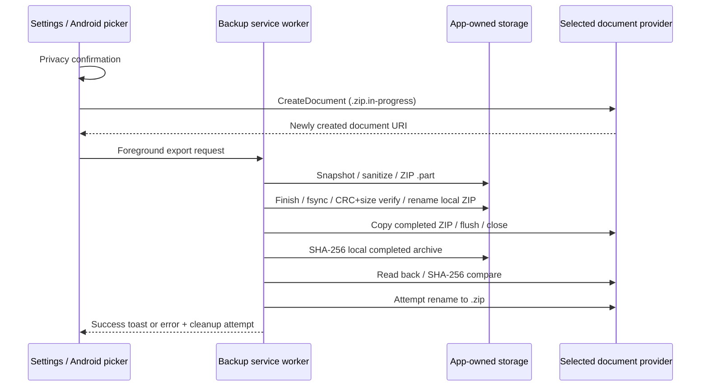

# Android SAF, temporary files, lifecycle and performance

Implementation below is source-verified; provider timing, atomicity, actual device termination and performance remain unmeasured.

## Current export order

1. `VideoPreferencesCommon` shows warning, then launches `ActivityResultContracts.CreateDocument("application/octet-stream")` with `nova-backup-yyyy-MM-dd-HHmm.zip.in-progress`, using default device timezone for the display name. The selected provider creates a document before returning URI. App tries persisted read+write grant; SecurityException falls back to transient grant. URI then starts a foreground service. **Library generation has not started when the destination is created.** [VideoPreferencesCommon.java:334](https://github.com/heretoecode/Supernova/blob/b3504c2c4b1725f3070416d14b63e53ae1db3d74/src/main/java/com/archos/mediacenter/video/utils/VideoPreferencesCommon.java#L334), [VideoPreferencesCommon.java:1013](https://github.com/heretoecode/Supernova/blob/b3504c2c4b1725f3070416d14b63e53ae1db3d74/src/main/java/com/archos/mediacenter/video/utils/VideoPreferencesCommon.java#L1013).
2. Service publishes ongoing notification ID **7**, dataSync foreground type (API 29+), `START_NOT_STICKY`; export and import share one worker-thread guard. MIME, SAF and grants are platform integration, not a new app-owned file browser. [MediaLibraryBackupService.java:63](https://github.com/heretoecode/Supernova/blob/b3504c2c4b1725f3070416d14b63e53ae1db3d74/src/main/java/com/archos/mediacenter/video/utils/MediaLibraryBackupService.java#L63), [MediaLibraryBackupService.java:105](https://github.com/heretoecode/Supernova/blob/b3504c2c4b1725f3070416d14b63e53ae1db3d74/src/main/java/com/archos/mediacenter/video/utils/MediaLibraryBackupService.java#L105), [AndroidManifest.xml:1208](https://github.com/heretoecode/Supernova/blob/b3504c2c4b1725f3070416d14b63e53ae1db3d74/AndroidManifest.xml#L1208).
3. Downloadable art references are queried before the provider/DB snapshot lock. Then `ProviderDiscoveryGate.LOCK` and exclusive MediaLib holder lock surround close/checkpoints, database snapshot filtering, ZIP generation and local verification. Local directory is **app-specific external files**, or internal `files/backups` if unavailable; it is not the selected destination, and external app storage is not equivalent to strictly private internal storage on every legacy device. [MediaLibraryBackupService.java:216](https://github.com/heretoecode/Supernova/blob/b3504c2c4b1725f3070416d14b63e53ae1db3d74/src/main/java/com/archos/mediacenter/video/utils/MediaLibraryBackupService.java#L216).
4. `VerifiedBackup.write` makes `nova-export-*.part` beside local destination, finishes ZIP, flushes, fsyncs, validates nonempty required entries and reads every payload for CRC/size, then local `renameTo`. Local `.part` removed in finally on normal exception. This protects the local completed file; it does **not hide the already-created SAF document**. [VerifiedBackup.java:9](https://github.com/heretoecode/Supernova/blob/b3504c2c4b1725f3070416d14b63e53ae1db3d74/src/main/java/com/archos/mediacenter/video/utils/VerifiedBackup.java#L9).
5. Completed local ZIP is streamed to selected URI with mode `w`; copied byte count must equal local length and be nonzero. It closes the output, hashes the local ZIP, reads/hashes provider contents, compares SHA-256. This confirms provider-readable bytes then, not remote cloud upload durability. Read-after-write availability is required today. [MediaLibraryBackupService.java:141](https://github.com/heretoecode/Supernova/blob/b3504c2c4b1725f3070416d14b63e53ae1db3d74/src/main/java/com/archos/mediacenter/video/utils/MediaLibraryBackupService.java#L141).
6. After validation, service queries display name, removes terminal `.in-progress` or `.in-progress.zip`, ensures `.zip`, attempts `DocumentsContract.renameDocument`. It keeps returned URI. Unsupported/failed rename is caught; success toast explains manual renaming when needed. No verification runs again through a changed URI after rename. Filename change is not guaranteed atomic replacement or cloud sync completion. [MediaLibraryBackupService.java:152](https://github.com/heretoecode/Supernova/blob/b3504c2c4b1725f3070416d14b63e53ae1db3d74/src/main/java/com/archos/mediacenter/video/utils/MediaLibraryBackupService.java#L152).
7. On caught Exception, service emits safe structured failure event, attempts `deleteDocument` of its created destination, shows error toast; cleanup failure only logs warning. Stop foreground/remove and `stopSelf` in finally. Dated local completed archives are retained even after destination failure; no retention limit here. Process death cannot run cleanup/finally. An Error such as OOM is not caught by `catch(Exception)`; this is a possible uncovered failure path, **not the observed incident cause**. [MediaLibraryBackupService.java:160](https://github.com/heretoecode/Supernova/blob/b3504c2c4b1725f3070416d14b63e53ae1db3d74/src/main/java/com/archos/mediacenter/video/utils/MediaLibraryBackupService.java#L160).

## What can prevent incomplete destination files appearing?

Platform contract: SAF's system picker can create a document, open a document or grant a directory tree; providers support differing operations through document flags. `ACTION_CREATE_DOCUMENT` creates a new name rather than overwriting an existing file. Tree access has restricted roots on newer Android. These are verified against the [official SAF guide](https://developer.android.com/training/data-storage/shared/documents-files), accessed 2026-10-13.

[renameDocument](https://developer.android.com/reference/android/provider/DocumentsContract#renameDocument(android.content.ContentResolver,%20android.net.Uri,%20java.lang.String)) changes an existing document's display name and can return a changed URI or fail; support is advertised by [FLAG_SUPPORTS_RENAME](https://developer.android.com/reference/android/provider/DocumentsContract.Document#FLAG_SUPPORTS_RENAME). The API does not establish a universal transactional publish/replace guarantee. Treat atomicity and remote persistence as provider-specific properties needing measurement, not assumptions based on a support flag.

| Proposed approach | What it achieves | Remaining limitation / decision |
|---|---|---|
| **Prepare/verify in private internal storage before launching CreateDocument** | No selected destination placeholder during expensive snapshot/compression/CRC stage; only copy/readback remains | New file can still be zero/partial during transfer. User waits before choosing destination; handle cancel/relaunch/private stage expiry |
| User-selected directory tree, then create a new document after private verification | Allows deferred destination creation/capability checks without picking a file first | Tree access differs from current save UX, restrictions/provider compatibility; new document still visible during transfer |
| Provider temp document, verify, then rename when supported | Incomplete object is explicitly labelled; final name only appears after verified copy | Temporary object can be visible, even dot-prefixed; rename may not be atomic; returned URI must be retained and checked |
| Provider-specific transactional staging API or locally controlled same-volume publish | Can hide preparation and support atomic visibility **if that provider/filesystem actually guarantees it** | No general SAF API for this. Do not bypass provider grants; requires separately proven provider contract |
| Copy directly to final `.zip` after preparation | Shorter visible interval and simple name | Partial final-name ZIP can mislead; unsuitable as universal “complete-only” promise |

**Recommendation (proposed):** privately prepare first, offer truthful Preparing → Saving → Verifying → Finalising progress, query supported write/read/delete/rename flags, retain created URI in a device-private operation journal, verify readback, and announce exact outcome including rename/cleanup limitations. Keep unique new destinations; do not overwrite/delete unrelated documents. Never promise total invisibility across Android providers. Offer explicit failure/retry when provider cannot supply integrity readback; do not silently mark unverifiable copy as success. No change is implemented.

## Lifecycle, cancellation and interrupted files

Current source has no export cancel action, `setProgress`, stage percentages, per-attempt destination journal, startup export recovery or notification attempt ID. Worker runs independently of Settings Activity; an Activity exit can coexist with successful service completion. Process death/force-stop prevents completion and cleanup; `START_NOT_STICKY` does not automatically replay the export. A second export/import request while a worker is alive returns after its picker may have created another file: **inferred orphan-placeholder risk** because that second URI is not handed to a cleanup path. Existing backup requests/events can still be emitted even for this guard rejection.

Before publication, cooperative cancellation should release DB/history locks, close streams and remove only owned staging/created destinations; cancellation between rename and final reporting must first reconcile verified published output. During restore apply, “cancel” must not abort arbitrary swaps: use existing journal rollback and show Restoring/Recovering truthfully. Persist bounded operation state privately, reconcile app startup, report cleanup failure and retain recoverable local ZIP when remote copy fails. Low internal/external/provider storage, grant revocation, unmounted USB, provider cancellation/read timeout and cloud eventual consistency need explicit outcomes. Retention and resume/retry policy require owner choice.

## Current import order and fallback gaps

`OpenDocument` filters `application/zip`/`application/octet-stream`; `BackupReview.show` stages an exact UUID cache snapshot and validates it on a daemon worker before showing version/time/category review. Checking dialog is noncancelable; confirmation cancel removes staging. Import service revalidates that staged token, makes a dated recovery ZIP with **current export choices**, restores under journal/locks, forces artwork pending, reports completion, waits two seconds and explicitly restarts the app. This restart exists on **import only**. [VideoPreferencesCommon.java:345](https://github.com/heretoecode/Supernova/blob/b3504c2c4b1725f3070416d14b63e53ae1db3d74/src/main/java/com/archos/mediacenter/video/utils/VideoPreferencesCommon.java#L345), [BackupReview.java:13](https://github.com/heretoecode/Supernova/blob/b3504c2c4b1725f3070416d14b63e53ae1db3d74/src/main/java/com/archos/mediacenter/video/utils/BackupReview.java#L13), [MediaLibraryBackupService.java:178](https://github.com/heretoecode/Supernova/blob/b3504c2c4b1725f3070416d14b63e53ae1db3d74/src/main/java/com/archos/mediacenter/video/utils/MediaLibraryBackupService.java#L178), [MediaLibraryBackupService.java:317](https://github.com/heretoecode/Supernova/blob/b3504c2c4b1725f3070416d14b63e53ae1db3d74/src/main/java/com/archos/mediacenter/video/utils/MediaLibraryBackupService.java#L317).

Activity recreation/process death can leave abandoned stage folders; no explicit review-worker cancellation or stage-retention sweep is present in these classes. Review checks `isFinishing`, not a durable Activity/operation state. Lifecycle and cache-reclamation tests remain required.

Missing picker export fallback uses app-owned dated `nova-backup-<epoch>.zip`; legacy import fallback still looks for fixed **`backup.zip`**, so it does not discover those dated exports automatically. No APK/source edits made to correct this. “+ credentials” titles in [strings.xml:981](https://github.com/heretoecode/Supernova/blob/b3504c2c4b1725f3070416d14b63e53ae1db3d74/res/values/strings.xml#L981) contradict exclusion and export summary. Filename branding is legacy only: reader validates ZIP content/manifest, not `nova-` prefix; change naming without dropping old readers or rewriting existing files.

## Cost model and genuine progress

| Current stage | Work/cost, locks | Proposed measurable progress / optimisation |
|---|---|---|
| Enumerate art/source snapshot | Provider queries and canonical paths; before exclusive DB lock | Count known references/files; indeterminate while discovering; no-art policy eliminates file classification/copy after approved format decision |
| Checkpoint/snapshot | Opens media/shortcut/provider DBs and even excluded `credentials_db`; checks WAL busy state | Files/bytes copied; review excluded-credential checkpoint necessity (can fail export although not exported); freeze selected categories and settings once per attempt |
| Scrub/selection | Copies whole DB; scans text columns/rows, updates URLs, nulls secrets, VACUUM; second VACUUM when history/resume filtering applies | Bounded row/file counts and stages; preserve privacy and snapshot consistency before optimising; do not claim cache metadata is safe to drop blindly |
| History snapshot | Drain writer barrier (15s), history LOCK, WAL checkpoint/copy/filter/VACUUM | Waiting/snapshot stage; avoid pretending waiting is percent copied; concurrent playback/privacy choices need coherence test |
| ZIP | Default ZipOutputStream DEFLATE, buffered disk write; no explicit compression level; streamed DB/art, not whole archive in heap | Input bytes/known file count, rate-limited UI updates; compare compression levels with synthetic libraries, avoid recompressing excluded art |
| Local verification | Read/decompress every entry for CRC/size, local fsync and rename | Verified bytes/entry count; preserve integrity checks |
| SAF save | One full archive copy, flush/close | Copied bytes / completed local archive size |
| Destination verify | Another local full SHA read plus provider full readback | Readback bytes / archive size; distinguish provider-unavailable/timeout from corrupted data |
| Rename/report | Provider query/rename, success/failure/cleanup | Indeterminate bounded phase; show completion only after bytes verified and accurately identify final-name outcome |

No compression/runtime benchmark was run. Archive work entails repeated reads and sanitized DB copies; external/slow cloud destination can dominate final stages. Media lock spans local generation/CRC verification; SAF copy happens after its release. Settings and history selection are read multiple times and not frozen under one common preference lock: **inferred cross-category consistency risk** during concurrent user changes. Do not invent throughput estimates or universal performance gains.

Restore space can include staged expansion (bounded at 4 GiB), live data, old recovery copies, `.new` copies and a dated recovery archive. Export includes original DB, sanitized copy, history copy and local ZIP/part. Bounds prevent unlimited expansion, not disk-full failure. Proposed byte/free-space budgeting, bounded retry/timeouts, shorter snapshot-lock scope, operation metrics and cleanup retention all require implementation and acceptance testing.
