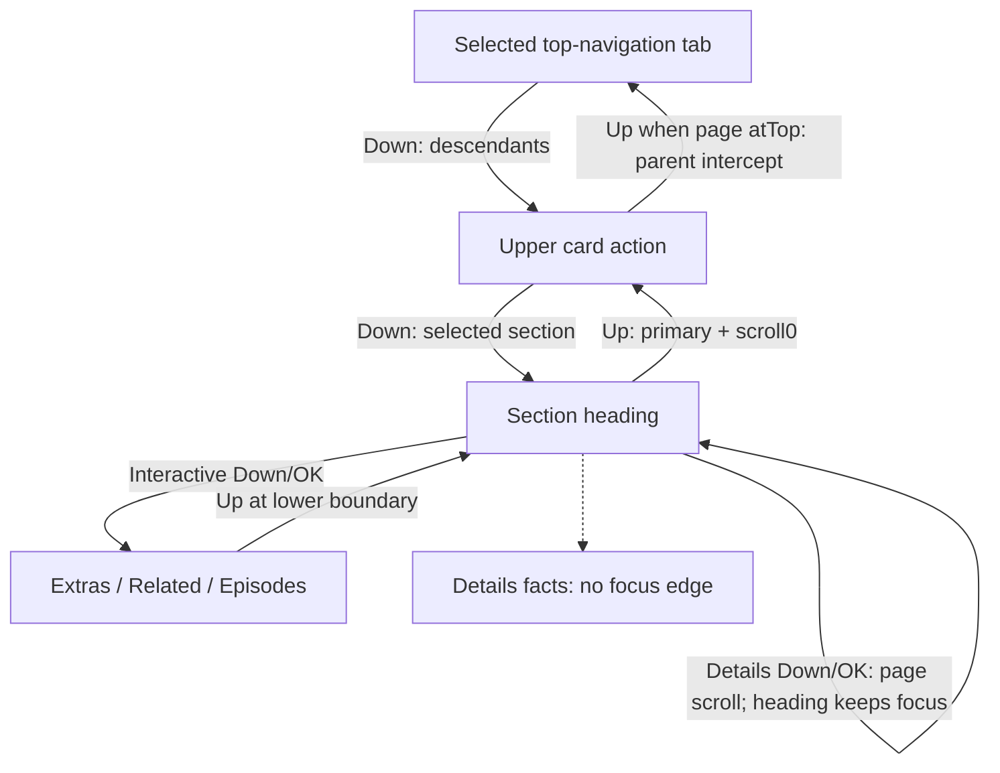

# 04 — Current D-pad, scrolling, file selection and lifecycle

S at signed source; O only where attributed; U for physical Android/Shield execution. PreviewMoviePage [P120](https://github.com/heretoecode/Supernova/blob/b3504c2c4b1725f3070416d14b63e53ae1db3d74/src/main/java/com/archos/mediacenter/video/leanback/details/PreviewMoviePage.java#L120)–174 and PreviewToolbar25–57 are the main graph, with TopNavigation parent dispatch taking precedence. Existing native fixture tests are attributed in report05.

## Focusable hierarchy and selected state

Focusable: top navigation tabs, visible upper card actions, section tab headings, interactive Extras/Related cards, season headings and episode cards. Not focusable: page ScrollView itself, body, card container/title/metadata/plot, Cast/Crew text rows, fact panels/children, scan overlay. Informational rows have contentDescriptions but no OK behavior or person route. Details content has no independent focus rail/scroll widget.

Current section order: movie/episode **Details, Extras if playable, More Like This if cards**; local show/season and remote tv **Seasons & Episodes, Details, optional Extras, optional More Like This**. Episodes **do not** expose a Seasons & Episodes heading merely because they are Episode model objects (`show`/remoteKind gate). Missing optional tab disappears, and left/right follows remaining visual order with bounded edges.

Constructor first builds/selects Details. Later `bindShow` inserts Seasons & Episodes ahead of it but `rebuildTabs` **preserves activeSection if it still exists**. Thus a fresh source-created TV page can retain Details selected in position2; “TV order starts Seasons” does not imply that its content always opens first. A reused page preserves current valid activeSection; no explicit fresh-title reset is in `bind`/`bindShow`. `rebuildTabs` attempts to restore focused heading by its tag. No saved-state field for activeSection is implemented in these activities. The owner chronicle reports Down from Play reaching first Seasons & Episodes in their walkthrough; that is O, and is not used to override this source-selected route. Installed-state/focus timing would be needed to reconcile it.

On tab focus, `showSection(label,false)` changes content immediately, no OK required. OK listener invokes `showSection(label,true)`. SelectedSegment underline is white when any child is focused, #88FFFFFF fallback beneath selected tab when strip loses focus. Tab background/icons are removed; no connected cap, content frame or actual full-width divider.

## Current transition table

| Starting state / key | Source behavior | Scroll/focus consequence |
|---|---|---|
| Page creation | Movie fragment binds and posts focusPrimary; show does likewise; remote binds after worker then focuses; season focuses if none | Play/Resume preferred, else trailer if visible (currently forced GONE), else providerActions requestFocus, else first tab. Card is a container, not a focus target. |
| Play / Left | Consumed | Stays Play. |
| Play / Right | If detached Versions object's visibility VISIBLE calls versions.requestFocus, otherwise More.requestFocus | Multi-file detached target may fail and leave Play; key still consumed. This direct route skips provider control. |
| More / Right | Consumed | Stays More. |
| More / Left | If Play visible choose Versions if VISIBLE else Play | Same detached Versions risk. If no Play visible, falls through framework search. |
| Attached provider action directions | No equivalent explicit horizontal route in page | Android focus search handles its keys; do not claim tested symmetric Play↔provider↔More route. |
| Any card descendant / Down | Page selects currently selected heading | [P160](https://github.com/heretoecode/Supernova/blob/b3504c2c4b1725f3070416d14b63e53ae1db3d74/src/main/java/com/archos/mediacenter/video/leanback/details/PreviewMoviePage.java#L160)–161, not explicitly first/leftmost heading. Framework reveal may move page before content is entered. |
| Card at top / Up | **TopNavigation parent** checks page.atTop then focuses selected top-nav tab | AtTop requires scrollY0, focus inside heroPage outside tabBar. Parent preempts page-local Play→Match Metadata Up when already atTop. |
| Play / Up when parent does not intercept and Match Metadata visible | Page requests Match Metadata | [P149](https://github.com/heretoecode/Supernova/blob/b3504c2c4b1725f3070416d14b63e53ae1db3d74/src/main/java/com/archos/mediacenter/video/leanback/details/PreviewMoviePage.java#L149); direct page unit test demonstrates page route, not shell precedence. |
| Match Metadata / Down | Page requests Play | Left/right consumed; Up otherwise framework or top-nav parent. |
| Tab heading / Left or Right | PreviewToolbar walks visible, enabled, focusable siblings; consumes edge | Focus change switches active content; **no automatic content-entry call** on horizontal switch. Focus/ScrollView reveal timing remains runtime-dependent. |
| Tab heading / Up | focusPrimary then scrollTo0 | [P158](https://github.com/heretoecode/Supernova/blob/b3504c2c4b1725f3070416d14b63e53ae1db3d74/src/main/java/com/archos/mediacenter/video/leanback/details/PreviewMoviePage.java#L158); returns Play/provider fallback, not a focusable card container. |
| Details heading / Down | showSection(Details,true), consumed | ScrollTo(max(0,heroHeight−44dp−48dp)); stays on heading, does not enter facts. Repeated Down calls same target. |
| Details heading / OK | Same showSection(Details,true) through click | Scroll action with heading focus retained. No informational activation. |
| Interactive tab / Down or OK | Same page-scroll target; seasons focuses next episode, other tabs lower.requestFocus | Focus enters appropriate interactive contents where available. |
| Episode card / Up or Down | Page walks episode rows; Up may first go adjacent focusable season heading; above first row goes tab; last Down consumed | Season heading retains its own clickable season-details route. [P163](https://github.com/heretoecode/Supernova/blob/b3504c2c4b1725f3070416d14b63e53ae1db3d74/src/main/java/com/archos/mediacenter/video/leanback/details/PreviewMoviePage.java#L163)–169/405–418. |
| Interactive lower child / Up at top boundary | If scrollY>0 and no lower FOCUS_UP candidate, focusSectionTab | Selects active heading and scrollTo0. Otherwise default search applies. |
| Top-nav tab / Left or Right | Bounded visual-order array; focus alone does not invoke navigation click | Current Details page remains until selection/OK. |
| Top-nav tab / Down | content.requestFocus, consumed | Uses descendants/framework; no explicit focusPrimary call here. Result can depend on current remembered descendants. |
| Top-nav tab / Up | Consumed | Remains top-nav. |
| Top-nav tab / OK | Explicit destination launch | Settings/Search; other tabs MainActivityLeanback preview_tab/CLEAR_TOP then finish for fragments; custom has direct CustomLibraryActivity handling in shell. |
| Back in ordinary Details | VideoDetailsActivity dispatcher calls closePreviewNativeDetails (always false) then normal dispatcher | No custom tab→card Back state machine; normally exits activity. Show/season/remote likewise use ordinary Activity behavior except visible modal handling. Return destination depends on opener stack. |
| Back in More/dialog | PreviewDialog dismiss/restoration mechanisms | Separate modal, native handlers unchanged. Parent stack/focus fallback explicit in shared dialog; no informational reader launched by Details. |

The dotted line is a visual relationship, **not a navigation edge**. Shell dispatch precedence matters: tests calling page.dispatchKeyEvent alone do not exercise parent interception. Current page uses explicit immediate scrollTo and disables smooth scrolling. ScrollView inherited touch/programmatic/other key behavior remains possible; this audit does not certify every hardware key. Current lower Down no additional movement in a test after an earlier Details click is not proof the page has no scrolling.

## Back-to-opener restoration

`PreviewPages.open` calls rememberFocus and diagnostics.focusEntry before invoking native click. FocusAnchor stores cell key, position, child tag, inner rail index and token; per-tab scrollStates exist. `onRequestFocusInDescendants` restores when an anchor exists. restoreFocus resolves current cell/child or bounded fallback, retries up to8 frames for adapter attachment, requests exact child if possible and logs fallback. This is **intended source restoration**, not proof the owner-reported Tulsa King Back failure is fixed. Fragment resume/rebuild/import timing and focus acquisition can affect the result; report05 retains a shell-level acceptance case. Search/browser have their own retained view/selection mechanisms; no universal tested Back guarantee is inferred from PreviewPages alone.

## Selected physical file

MultipleVideoLoader resolves files for the selected indexed ID/path. VideoDetailsFragment.onLoadFinished collects variants; preview mode calls PreviewVariants.choose even after cursor matching an old selected URI. It prefers an available saved choice (`id|canonicalURI`), otherwise BEST_FIRST: availability, PlaybackCompatibility, quality/resolution/HDR, size-per-duration descending, then ID. Actual ranking depends on settings/LibraryHealth/native metadata. It is not simply the first filename or last played file. Title-level resume is restored across variants. The chosen `mVideo` is bound to every physical technical fact.

Native VersionsDialog sorts real files, uses safeLocation and cached measurements, remembers selection, then native callback fullyReloadVideo. This handler exists, but **the preview Versions button has no parent**. Source setter/dispatch references cannot certify its accessibility. No redesign policy for multi-edition access is chosen here. Whole-show technical aggregates do not select a representative episode; count all matching indexed files.

## Asynchronous content lifecycle

| Stage | Current data/state transition |
|---|---|
| Initial intent bind | Immediate title/description and available indexed year/duration/codec/source/path/size; absent fields omitted. Unmatched physical file gets Not matched and Synopsis unavailable, with Match Metadata only if native action exists. |
| Native cursor authoritative reload | Fragment rebuilds current Video and action adapter; keeps matching cached native metadata where applicable; page.bind and setVersions; launches full-tags/subtitle/native metadata tasks. Cursor notifications drive later reloads. |
| Tags completion | Main handler calls page.setTags; defaults actors/directors/writers; selects real backdrop; calls enrichment/renderDetails/renderRelated/extras. Enrichment credits, if retained, replace local people again. |
| Snapshot completion | Movie fragment uses separate one-shot PreviewLibraryLoader worker; only applies to same page when attached. Page.setSnapshot rebuilds facts/related; current snapshot or global memory supports show technical totals. |
| TV seasons/episodes completion | TvshowFragment per-season cursor adapters call page.setSeason and update playback target. This rebuilds interactive rows, **does not call setSnapshot/renderDetails**. Show aggregate technical facts rely on global memory freshness/other render triggers. |
| Identity enrichment start | Metadata ID: remote TMDB ID, Movie.onlineId, EpisodeTags.parentShow.onlineId, ShowTags.onlineId, else matching snapshot entry. kind movie/tv; id≤0 skips. Enqueues FOREGROUND except season. Dedup key kind:id:season; not keyed on file, locale, country or tag revision. |
| Disk-first enrichment | PreviewDetailsData.cached reads title/credits/classification, seasons, extras/recommendations; returns null if neither title nor credits. If credits exist but title absent, substitutes empty JSONObject. Source remains usable without network, but no lower “stale” label. |
| Gateway/refresh | PreviewMetadataCache reads locale-named AtomicFile envelopes, max3MiB read,64 read locks/64 separate fetch locks, freshness7days. Fresh skips fetch; failed fetch returns old data. StreamingRepository API is TMDB v3 using existing client credential resource; bounded HTTP2MiB and payload validation. No credential values copied. |
| Package load | Sequential title/classification/credits, all tv seasons, extras/recommendations and bounded provider checks; catches optional sections separately. Fresh result posted after whole load, not after each optional field. Cached result can appear first. Network delay can postpone appearance of noncached sections. |
| Apply result | Generation check discards old identity task. Sets enrichment, season overview only, rebuilds people/facts/related/extras/seasons/tabs. Same media can change column visibility and widths as data arrives; no geometry-freeze for the fact layout. |
| Error | Enrichment exception logs diagnostic category and retains last usable data or indexed-only state. No explicit lower retry/error card. Remote initial activity error has its own dialog. File-retriever errors/empty tracks leave unknown rows absent. |
| Native technical completion | Metadata object attached to current mVideo; saves index fields for indexed media; updateMetadataWhenReady rebinds preview only for Movie. Episode preview refresh relies on subsequent trigger; captured task does not explicitly recheck current file identity before writing current mVideo on completion (cancellation exists). Treat as a race/staleness review item, not a reproduced failure. |
| Detach / release | P onDetachedFromWindow cancels enrichment, increments generation, unregisters action adapter, unbinds holders and releases landscape/extra cards (does not reset enrichmentKey or explicitly dismiss More here); fragment shuts snapshot worker/cancels native tasks; shell releases artwork/shade. No app-source changes performed here. |

Some races retain old tags/enrichment during a file/title bind until `setTags`/request resolves; same identity is purposely not refetched. No verified guarantee that all fields are a single synchronized provider/index snapshot. A scan icon is not proof fields are fresh. `setSeason` does not remove all stale season maps on every ordinary bindShow; task/reload state must be tested rather than asserted flawless.

## Scanner overlay and scanning-state variations

Video/show fragments construct Overlay, which locates TopNavigation, moves clock to status and progress_group to scanStatus. ScannerAndScraperProgress polls every1000ms. General fragment resumed visibility AND active status determine shown state. Active status is network scan, scraper, NFO export, collection scrape, local initial/regular import. Counter priority: network, local import, NFO export, scrape, collection scrape. Floating status strings are hardcoded English: “Scanning network library…”, “Updating network library…”, “Scanning local library…”, “Updating local library…”, “Exporting metadata…”, “Identifying library titles…”. Counter hidden in floating style. Spinner ThinSpinner or Foundation DoubleRingDrawable by build flag. It is a nonfocusable overlay, not an information field.

The overlay occupies bottom-right **without reserving lower layout height**, so overlap with long content is possible (I); exact owner photo overlap U. File/tag/cursor updates can occur during scan, while aggregates may be based on older memory snapshot. No full Details freeze or “all metadata indexed” state exists here. PreviewRemoteDetailsActivity and PreviewSeasonActivity create TopNavigation directly but do not construct the fragment Overlay; an empty scan container does not establish that they display the same poller. Local Movie and Tvshow fragment variants have it.

## Approved owner target — distinct state machine

| Input/state | T: required future behavior |
|---|---|
| Details active | One fixed information viewport; no vertical/horizontal content or page movement to read it; no focusable/clickable facts/people/synopsis. |
| Details heading Left/Right | Switch applicable headings in approved order: Details → Extras → Seasons & Episodes → More Like This (movies omit inapplicable tab); one focus target per icon+label. |
| Details heading Up | Return to Details card/actions by agreed route; preserve intended Play/Resume initial behavior. |
| Details heading Down | Stay on heading, no content entry **and no scroll**. |
| Details heading OK | No information activation or content-scroll action. |
| Active-tab chrome | Continuous cap connected to stable shared frame,4% usable-width sides/4% usable-height bottom; supersedes prior selected underline proposal. |
| Interactive tabs | Preserve active selection when focus enters cards; selected-versus-focused chrome exact treatment remains owner decision. |
| Back | Preserve established exit/modal/opener semantics and exact selected-poster restoration; no new reader/Back step assumed. |

Current rows already satisfy no-information-focus in principal constructors. That partial match must not be described as the whole fixed-screen contract implemented.
