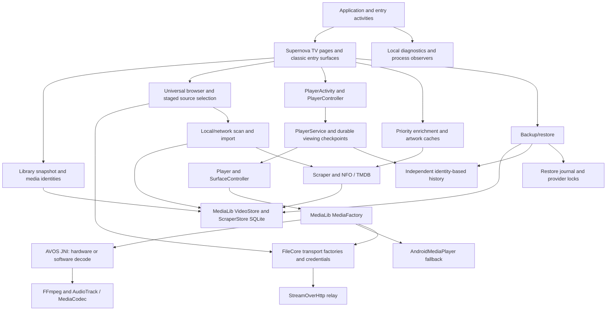

# 02 — Codebase architecture and ownership

**VERIFIED static architecture, high confidence.** The frozen Video tree has 2250 tracked files and 769 production Java files. [Package counts](evidence/package-counts.json), [every production method declaration discovered](evidence/production-symbol-inventory.tsv), [module counts](evidence/module-source-counts.json), [manifest components](evidence/manifest-components.tsv) and [tree ownership](evidence/video-tree-inventory.tsv) extend this map beyond recently modified classes. Method matching is syntactic: multiline declarations and JNI dynamic registration still require inspection; it is not a call graph or proof of reachability.

## Module and feature ownership

| System / ownership | Entry and implementation | Dependencies and output | Maintenance boundary |
|---|---|---|---|
| Process / NOVA inherited and customised | CustomApplication.attachBaseContext / onCreate; EntryActivity; TV MainActivityLeanback; browser.MainActivity | Restore recovery, UI policy, diagnostics, permissions, locale, audio capabilities, network services and process lifecycle | Boot, upgrade and entry routes must remain distinct; global startup work affects all screens |
| TV composition / Supernova | MainFragment → PreviewPages → TopNavigation; programmatic Android Views and RecyclerViews | Snapshot loader, shared artwork, custom rows, network browser, navigation | Existing Supernova geometry and D-pad semantics are the product contract |
| Movies / TV / mixed libraries / Supernova over inherited stores | PreviewLibraryLoader, PreviewPages, CustomLibraryPage/Activity, UserCollectionStore | ContentResolver → VideoStore/ScraperStore, MediaLib DB; per-page preferences and filtering | Custom page configuration, user collections and upstream movie collections are different stores |
| Details / inherited plus Supernova | VideoDetailsFragment, PreviewMoviePage, PreviewDetailsData/Facts, TvshowFragment, PreviewSeasonActivity | Provider IDs, metadata cache, artwork, enrichment, extras, trailers, recommendation actions | Data and presentation are intertwined; isolate technical fixes from upstream layout changes |
| Playback / inherited plus customised | PlayerActivity ↔ PlayerService ↔ Player; PlayerController; SurfaceController | IMediaPlayer/MediaFactory → AVOS or AndroidMediaPlayer; refresh rate, audio focus/routes, resume/checkpoint state | Java callbacks are not decoder presentation timestamps |
| Floating / external playback / inherited | FloatingPlayerActivity/Service, ExternalPlayerService, ExternalPlayerWithResultStarter | Android PiP/overlay permission, explicit external intents and result/resume handling | Infrequent paths remain real entry points; not safe cleanup by low visibility |
| Native / inherited with workflow patches | MediaLib LibAvos/AvosMediaPlayer → JNI → aos-avos | FFmpeg, AudioTrack, MediaCodec, software video, libyuv, subtitle decoders, torrent helpers | Public metadata enums and JNI signatures must match Supernova HDR/audio-track additions |
| Files / inherited plus Supernova | UniversalFileBrowser, BrowserSelection, PreviewSources; classic browser packages retained | FileCore MetaFile2/ListingEngine/FileEditor factories and MediaLib UPnP extension | Staged library inclusion differs from physical deletion; preserve dirty-exit review |
| Discovery / inherited | jcifs SMB and SMBJ, JSch SFTP and SSHJ, FTP(S), WebDAV, UPnP | Credentials DB, SFTP trust overlay, transient connections; proxy for network input | Defaults do not eliminate alternate implementations or old persisted schemes |
| Scan/index / inherited fork plus patches | VideoStoreImportService/Impl, NetworkScannerServiceVideo, NetworkAutoRefresh/Job | Import cursors, source selection, ProviderDiscoveryGate, ScraperProvider and broadcasts | Scanner completion/coalescing and restore locks are cross-cutting |
| Scrape/artwork / inherited plus Supernova | MediaScraper/AutoScrapeService, ScraperImage, PreviewEnrichmentQueue/MetadataCache, Picasso | TMDB IDs/localized data, NFO, posters/backdrops, persistent package queue | Fetched description/artwork does not establish local file codec facts |
| Subtitles / inherited plus Supernova | SubtitleManager/Gfx/TextView; OpenSubtitlesApiHelper, SubtitleTransfer, SubtitleDiscovery/Policy | Local embedded/sidecar cues, provider search/download, private cache/backoff | Provider accounts and rate limits separate from playback availability |
| Provider integration / inherited plus Supernova | Trakt services and streaming package; putio browser/sync/library bridge | Remote account API, Android provider-app intents, token envelope, association DB | Availability is not locally playable media; credentials excluded from backups |
| Persistence / inherited plus independent | VideoOpenHelper, ScraperTables; ViewingHistory; enrichment and provider stores | SQLite, SharedPreferences, AtomicFile caches; restore journal and locks | Migration namespaces, identity history and portable settings must be reconciled first |
| Settings / customised | VideoSettingsFragment, PreviewSettings, InlineOpenSubtitles, FoundationAboutWorkspace | XML preferences reorganised into programmatic panels, dialogs, account flows, licenses | Disabled/hidden preferences still drive saved values and internal code |
| Diagnostics / Supernova | Diagnostics, DiagnosticFlightRecorder, DiagnosticArchive/ExportActivity, ArtworkRequest | Private bounded JSONL, process/session/operation IDs, SAF export, watchdog and heap samples | Generic string API is not a typed privacy allowlist |
| Phone/classic UI / inherited | browser widgets/adapters/loaders, info, cover, tvshow, collections and utility packages | Manifest external intents, preference paths, shared storage/player services | Foundation forces custom UI but alternate entry and fallback surfaces remain |
| Build/test/legal / inherited plus Foundation | Gradle app + sibling modules, pinned repo manifest, 12 dependency patches, preparation scripts | R8/resource shrinking, four ABIs, release Robolectric/JUnit tests, native receipts, runtime/legal inventories | Build recipe and packaged source are more precise than tag names |

Source anchors: [CustomApplication.java:470](https://github.com/heretoecode/Supernova/blob/b3504c2c4b1725f3070416d14b63e53ae1db3d74/src/main/java/com/archos/mediacenter/video/CustomApplication.java#L470), [CustomApplication.java:634](https://github.com/heretoecode/Supernova/blob/b3504c2c4b1725f3070416d14b63e53ae1db3d74/src/main/java/com/archos/mediacenter/video/CustomApplication.java#L634), [MainFragment.java:373](https://github.com/heretoecode/Supernova/blob/b3504c2c4b1725f3070416d14b63e53ae1db3d74/src/main/java/com/archos/mediacenter/video/leanback/MainFragment.java#L373), [PreviewPages.java:18](https://github.com/heretoecode/Supernova/blob/b3504c2c4b1725f3070416d14b63e53ae1db3d74/src/main/java/com/archos/mediacenter/video/leanback/PreviewPages.java#L18), [Player.java:523](https://github.com/heretoecode/Supernova/blob/b3504c2c4b1725f3070416d14b63e53ae1db3d74/src/main/java/com/archos/mediacenter/video/player/Player.java#L523), [MediaLib/MediaFactory.java:159](https://github.com/heretoecode/aos-MediaLib/blob/5758074049bc153ac4967b4ecd21886469270076/src/com/archos/medialib/MediaFactory.java#L159), [settings.gradle:1](https://github.com/heretoecode/Supernova/blob/b3504c2c4b1725f3070416d14b63e53ae1db3d74/settings.gradle#L1), [supernova-0138-qa.yml:63](https://github.com/heretoecode/Supernova/blob/b3504c2c4b1725f3070416d14b63e53ae1db3d74/.github/workflows/supernova-0138-qa.yml#L63).

## Dependency / ownership graph

## Threading and resource management

**VERIFIED:** diagnostics uses two bounded writer queues (256 routine, 512 important) and a scheduled heartbeat; ViewingHistory has a serial writer and 15-second drain barrier; PreviewEnrichmentQueue has a persistent SQLite queue and one scheduled worker; MainFragment creates a short-lived cache-reader executor and shuts it down. UniversalFileBrowser uses generation tokens, detaches listing listeners and aborts stale work, stops discovery and scan callbacks on detach, and closes its metadata executor on close. These are existing ownership mechanisms to preserve.

**INFERRED, medium confidence:** process-scoped workers and static caches complicate leak attribution; source contains static Player/PlayerService references and many retained listeners. A retained reference is not a leak proof. Cache writer queues and enrichment retries need measured saturation and lifecycle coverage before consolidation.

Anchors: [ViewingHistory.java:18](https://github.com/heretoecode/Supernova/blob/b3504c2c4b1725f3070416d14b63e53ae1db3d74/src/main/java/com/archos/mediacenter/video/leanback/ViewingHistory.java#L18), [PreviewEnrichmentQueue.java:14](https://github.com/heretoecode/Supernova/blob/b3504c2c4b1725f3070416d14b63e53ae1db3d74/src/main/java/com/archos/mediacenter/video/leanback/PreviewEnrichmentQueue.java#L14), [MainFragment.java:375](https://github.com/heretoecode/Supernova/blob/b3504c2c4b1725f3070416d14b63e53ae1db3d74/src/main/java/com/archos/mediacenter/video/leanback/MainFragment.java#L375), [UniversalFileBrowser.java:479](https://github.com/heretoecode/Supernova/blob/b3504c2c4b1725f3070416d14b63e53ae1db3d74/src/main/java/com/archos/mediacenter/video/leanback/filebrowsing/UniversalFileBrowser.java#L479). Quantitative overhead and retained heap paths remain UNKNOWN.

## Build and test topology

**VERIFIED:** AGP 9.3.2, Java source/target 17, compile SDK 37, target SDK 36, min SDK 23; app namespace remains com.archos.mediacenter.video. Three flavors (amazon, noamazon, manageexternalstorage), universal or per-ABI APK packaging; app release enables minification and resource shrinking. Signed QA is Foundation identity plus `supernovaQa` instrumentation flag and noamazonRelease universal. `settings.gradle` points to sibling FileCoreLibrary and MediaLib directories; this single Git checkout alone is not a buildable multi-repo workspace.

BuildConfig.FOUNDATION and FoundationUiPolicy force `try_new_ui=true` even after restore. This does not remove classic activities or make their resources dead. Existing keep rules retain all com.archos.mediacenter classes and members. Existing release tests run with Robolectric, JUnit and Mockito; device and native harness evidence has different scope. See [build.gradle:310](https://github.com/heretoecode/Supernova/blob/b3504c2c4b1725f3070416d14b63e53ae1db3d74/build.gradle#L310), [proguard-project.txt:7](https://github.com/heretoecode/Supernova/blob/b3504c2c4b1725f3070416d14b63e53ae1db3d74/proguard-project.txt#L7), [FoundationUiPolicy.java:13](https://github.com/heretoecode/Supernova/blob/b3504c2c4b1725f3070416d14b63e53ae1db3d74/src/main/java/com/archos/mediacenter/video/foundation/FoundationUiPolicy.java#L13) and reports 11–13.
