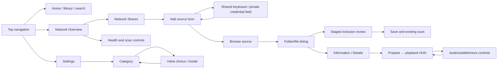

# 09 — Source UI atlas and navigation contracts

## Evidence and coverage

**VERIFIED static inventory:** [78 manifest activity/alias entries](evidence/manifest-screen-atlas.tsv) includes TV, classic/phone, external intent, utility and sibling-module screens. [Literal label candidates](evidence/ui-static-literals.tsv), [D-pad/Back/restoration branches](evidence/navigation-static-branches.tsv), [shared consumers](evidence/shared-component-consumers.tsv), and production symbols cover the entire source tree rather than only custom classes. Manifest declaration does not establish everyday visibility; literal mining can associate a label with a conditional callback and is not an exact rendered text hierarchy.

Existing 0.138 [application-view renders](https://github.com/heretoecode/Supernova/blob/16a60cb11a5dd20ebe374873db360e32b617d7b0/docs/0.138/ui/README.md) are **OBSERVED recorded synthetic Robolectric evidence** with their own provenance. They include Details density/text scale, HUD, Search, navigation, technical Settings/licence reader and Home. They are not Shield screenshots. No new images, emulator navigation, device hierarchy or runtime focus captures were produced here.

**INCOMPLETE runtime atlas:** exact bounds/text/order in every conditional state, focus transitions after recreation and screenshot comparison need the installed validated APK and authorized test fixture/device capture. No reachable Shield/emulator/JDK/Android SDK is attached to this environment. Source atlas below documents known structure/routes and explicitly leaves runtime proof pending.

## Surface atlas

All source-route rows below are VERIFIED static; visual correctness/back-focus outcomes remain UNKNOWN unless cited in original QA evidence.

| Surface / entry / conditions | Implementation and shared roles | Action / Back / focus contract to validate |
|---|---|---|
| Launch/startup permission path | EntryActivity, MainActivityLeanback, PreviewStartupSurface, CustomApplication | Launch theme→content first composition; permission-denied recovery; no startup flash |
| Welcome / media setup | Existing wizard/setup path and UniversalFileBrowser.onboarding | Select drives/folders, review/save starts scan; cancel/dirty exit restores coherent selection |
| Top navigation | TopNavigation, seven tab/custom slots, time/brand/scan overlays | Left/Right tabs, Down into content, Up from first row; custom page label and text scaling |
| Home hero | PreviewPages, PreviewFeaturedCard/Indicators, artwork and metadata | Hero direction, Play/More Info action-local focus; cached/no-artwork/error states |
| Home rows / Continue Watching | PreviewHomeRows, PreviewSeriesJourney, common card presenter | Next unstarted episode/season transitions, row limits, return to selected media |
| Movies library | PreviewPages common Library renderer, Header/Columns/Toolbar/FocusRecycler | Grid/list, filter/sort, counts, page/selection/scroll restoration |
| TV library | Same common renderer with show/episode identity | Air Date ordering and unknown/tied dates, mode-specific selection |
| Custom library/page guide | CustomLibraryPage/Activity, existing walkthrough/editor and shared renderer | Create/edit/filter actions, Save/Cancel, respective opener restoration |
| Movie Details | VideoDetailsFragment/PreviewMoviePage/DetailsFacts/People | Cinematic header, Play/Streaming/More, tabs and read-only facts; long/missing metadata |
| Show Details | TvshowFragment and shared details/data | Available season/episode links; local-vs-streaming facts; return to originating row |
| Season / episode Details | PreviewSeasonActivity, PreviewEpisodeRow/Choice, common facts | Episode navigation, selection, artwork fallback; preserve identity/resume |
| Streaming-only Details | PreviewRemoteDetailsActivity/StreamingActions | Availability and provider launch; no fabricated local technical badges |
| Details Extras/recommendations | Trailer/TvTrailers, MoreActions, episode/version/people/artwork flows | External provider unavailable, focus restoration and cancellation |
| Search empty/input/results | PreviewSearch, PreviewSearchText, SearchIndex, PreviewKeyboard | Inline field and key focus; Done/Clear/Cancel; typo/original title/people query result paths |
| Network Overview | UniversalFileBrowser + SharedThreePanel | Nonfocusable centre scan description; right description/actions; explicit panel transition |
| Local Storage / drive/folders | Universal browser + FileCore listing and source selection | >8 drives / >50 folders, scroll, revoked/unmounted state and remembered focus |
| Network Shares | networkShares/connectionForm/connect | Saved share→browse; Add Network Source→protocol/host/port/path/auth; validation/cancel |
| Discovery / UPnP / provider browser | discovery/controller and UPnP listener | Scan/server select, empty/loading/failure, listener cleanup and back |
| File listing/selected Information | List/grid/All Files/sort toolbar + facts/address scroll | Folder open/up/breadcrumb, movie details, selection changes and empty-folder safe target |
| Inclusion review | BrowserSelection and requestExit/save flow | Add/Remove/Exclude/Restore Inclusion→review→save/scan or cancel; physical files preserved |
| Network Scanning | scanControls and PreviewNetworkScanning/LibraryScan | Interval/manual/return scan, ongoing background status, no unwanted focus jump |
| Library Health categories | LibraryHealthPanel | Missing/source/metadata categories, reports/actions and rail expansion/back |
| Settings category workspace | PreviewSettings + SharedThreePanel + preferences | 12 actual categories, first left focus, remembered centre/right; inline choice lists |
| Integration subpages | InlineOpenSubtitles, Trakt/IntroDB toggles | Disable hides subcontrols but preserves settings; credential input private; account errors |
| Appearance/accent editor | PreviewAccent chooser and recreate | Choice applies intended surfaces and restores category/selection |
| Backup/restore review | SAF picker, BackupReview, MediaLibraryBackupService | Choose/private unencrypted warning/review/confirmation; failed restore and progress states |
| Diagnostics digest/marker/reference | Diagnostics + PreviewDialog; QR/reference | Category→local incident→reference, export picker; disabled/no-reference states |
| About / Technical / Release notes | FoundationAboutWorkspace and FoundationAboutActivity | Nested item reveal/scroll, technical read-only facts, focus on rapid expand/collapse |
| Licences catalogue/reader | BundledNoticePager / VideoSettingsLicencesFragment | Catalogue↔bounded lossless reader pages, Next/Previous, loading/error and repeated open |
| Preparing Playback | PlayerActivity startup overlay using cached genuine taglines/artwork | Prepare/buffer/cancel/error/retry→first output; no synthetic tagline substitutes |
| Playback HUD | PlayerController + PlayerControlsRelativeLayout/PreviewHudTiming/transport | Compact timestamp, Subtitles/Audio/More secondary row, Play/Pause/seek/duration main row; auto-hide, local seek focus |
| Playback menus/track/delay/speed/skip | tvmenu, SubtitleSettingsDialog, local/provider chooser | Track acknowledgement, private mode, speed/refresh/audio controls, Back→HUD |
| Subtitle search/download | SubtitleDiscovery/Results/Chooser, SubtitlesWizard/Downloader | Manual override/cache/backoff/download allowance, no false local badges |
| External playback / floating / PiP | ExternalPlayerService/result listener, FloatingPlayerActivity/Service | Result/resume checkpoint, handoff, Home/Back and audio focus route transitions |
| Generic choose/read/review/input/delete | PreviewDialog/PreviewTextInput/OperationDialog; native destructive confirm | Parent modal stack, Cancel/opener focus and fallback if opener detached |
| Inherited classic/phone/pickers | browser/info/cover, FolderPicker, protocol Activities and legacy preferences | External intents and unusual paths; do not delete by absence from Home |

Anchors: [TopNavigation.java:198](https://github.com/heretoecode/Supernova/blob/b3504c2c4b1725f3070416d14b63e53ae1db3d74/src/main/java/com/archos/mediacenter/video/leanback/TopNavigation.java#L198), [PreviewPages.java:18](https://github.com/heretoecode/Supernova/blob/b3504c2c4b1725f3070416d14b63e53ae1db3d74/src/main/java/com/archos/mediacenter/video/leanback/PreviewPages.java#L18), [PreviewDialog.java:15](https://github.com/heretoecode/Supernova/blob/b3504c2c4b1725f3070416d14b63e53ae1db3d74/src/main/java/com/archos/mediacenter/video/leanback/PreviewDialog.java#L15), [PreviewKeyboard.java:13](https://github.com/heretoecode/Supernova/blob/b3504c2c4b1725f3070416d14b63e53ae1db3d74/src/main/java/com/archos/mediacenter/video/leanback/PreviewKeyboard.java#L13), [PlayerController.java:116](https://github.com/heretoecode/Supernova/blob/b3504c2c4b1725f3070416d14b63e53ae1db3d74/src/main/java/com/archos/mediacenter/video/player/PlayerController.java#L116), [FoundationAboutWorkspace.java:41](https://github.com/heretoecode/Supernova/blob/b3504c2c4b1725f3070416d14b63e53ae1db3d74/src/main/java/com/archos/mediacenter/video/foundation/FoundationAboutWorkspace.java#L41).

## Pilot: Network & Files → Overview

**VERIFIED, high confidence at signed source:** UniversalFileBrowser constructor calls `SharedThreePanel.heading(right,"Information")`, then creates another `TextView` with `SharedThreePanel.text(c,"Overview",21)` and separately appends a divider. These two widgets receive identical generic 21sp white sans-serif-light text treatment; neither is an existing typed PanelHeader or SectionHeader. They are different construction calls with different semantic use. Both strings are literal source text rather than string IDs. Changing `heading` affects consumers listed in the impact inventory but does not automatically affect the separate `text(...,21)` Overview field.

| Element | Exact current identity / role inference | Focus and behavior |
|---|---|---|
| Locations | heading(left,"Locations") generic TextView + divider | Nonaction heading; left rail location rows are actions |
| Left Overview | location("Overview", this::showOverview) | Select invokes showOverview, becomes panel anchor |
| Right Information | generic heading helper, 21sp | Proposed panel heading; no action |
| Right Overview | stored `heading` TextView, generic text helper, 21sp + divider | Proposed selected-context heading; dynamic for other selections |
| Right description | `information` TextView 16sp inside capped ScrollView | ScrollView focusable only for nonempty text, with accentFocus and revealContext; it is a deliberate read/scroll target |
| Scan Library | right action → PreviewLibraryScan.request | Requests existing scanner; no new scanner needed |
| Network Scanning | right action → scanControls | Shows existing scan status/settings; continues off-screen |
| Library Health | right action → health(-1) | Opens existing category panel |
| Centre scanOverview | 16sp TextView from PreviewLibraryScan.overview | Explicitly nonfocusable, nonfocusable-in-touch-mode, null background at this source |

Source: [UniversalFileBrowser.java:105](https://github.com/heretoecode/Supernova/blob/b3504c2c4b1725f3070416d14b63e53ae1db3d74/src/main/java/com/archos/mediacenter/video/leanback/filebrowsing/UniversalFileBrowser.java#L105), [UniversalFileBrowser.java:255](https://github.com/heretoecode/Supernova/blob/b3504c2c4b1725f3070416d14b63e53ae1db3d74/src/main/java/com/archos/mediacenter/video/leanback/filebrowsing/UniversalFileBrowser.java#L255), [SharedThreePanel.java:38](https://github.com/heretoecode/Supernova/blob/b3504c2c4b1725f3070416d14b63e53ae1db3d74/src/main/java/com/archos/mediacenter/video/leanback/SharedThreePanel.java#L38).

The earlier owner description of an unexpected centre focus target is **OBSERVED historical user report**, not current source proof. 0.138 now explicitly disables focus on centre scanOverview. The right description scroll target remains intentional. Runtime source/APK/device matching is needed to determine whether the owner still sees any unexpected target.

Static dimensions: SharedThreePanel padding20dp, corner16dp, elevation4dp, inter-panel gap16dp. Browser changes ratios by mode; opening a folder uses .31/.42/.27, while Settings uses .28/.46/.26. On narrow logical width<780, viewport exposes a 900dp panel via horizontal scrolling. Preserve this responsiveness; a screenshot at one resolution does not certify focus reveal at another.

## Navigation graph and runtime capture method

The graph is functional, not a verified every-key focus graph. PROPOSED capture packet per surface: exact APK/source, device/Android/display/logical density/text scale, fixture/permissions/provider state, screenshot with synthetic/private-minimized content, UI hierarchy IDs/bounds/visibility/focusability, ordered D-pad sequence, focused semantic ID before/after, back/modal depth and saved state. Capture normal/loading/empty/error/disabled/recreated states and focus zoom clipping. Keep raw device material local unless separately authorized. Robolectric render is feasible from existing tests after build-tool setup; device capture remains the required hardware evidence.
